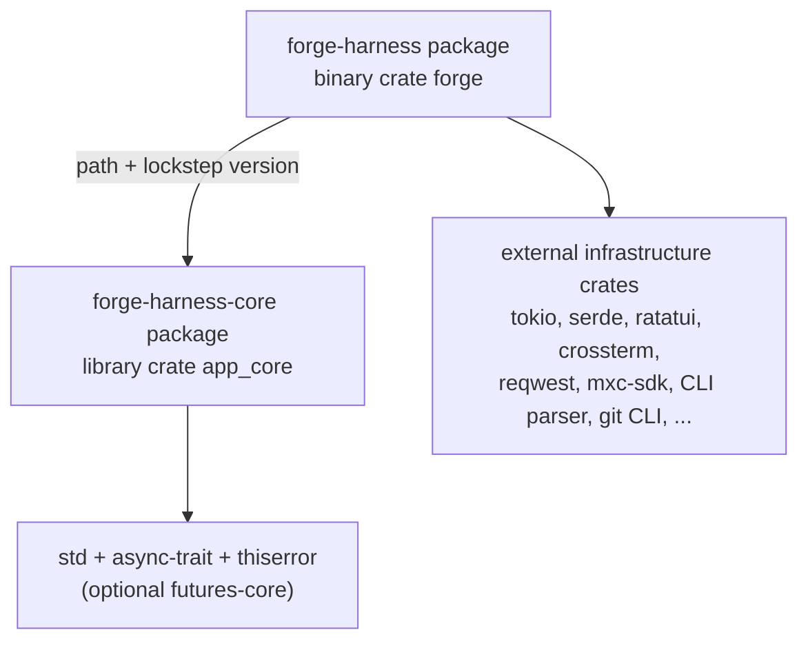
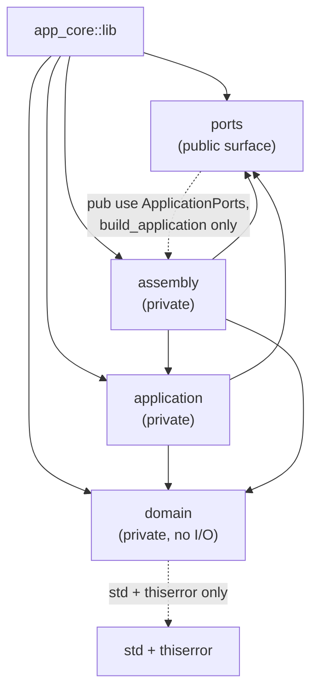
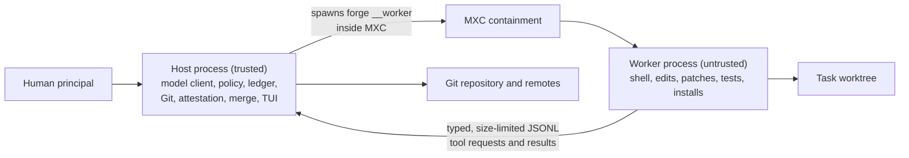
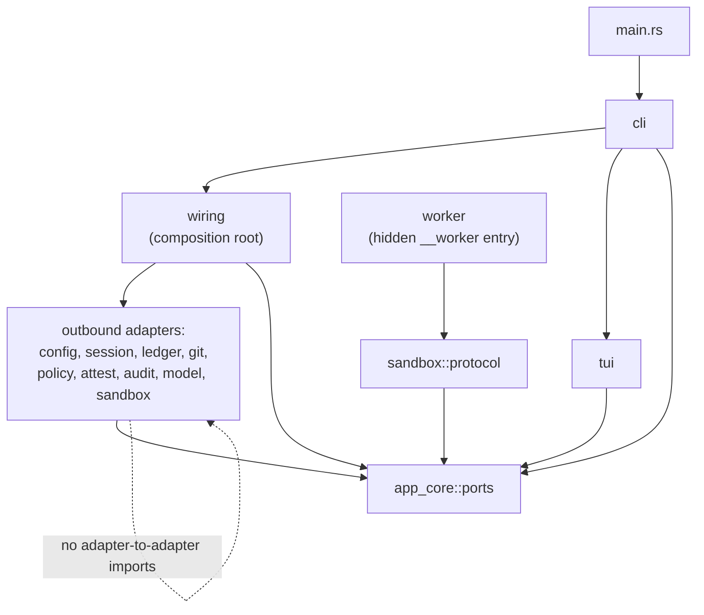

# Forge v1 Architecture

**Status:** Approved  
**Date:** 2026-11-03  
**Owner:** Forge architecture  
**Sources:** `docs/PRD.md` §5, §6.5, §6.7; NFR-MAINT-001; D-13; [Define the architecture, dependency, and naming rules](https://github.com/Xaidel/forge/issues/20)  
**Companions:** [dependency-rules.md](dependency-rules.md), [naming-conventions.md](naming-conventions.md)  
**ADRs:** [ADR-0001](../docs/adr/0001-two-crate-ports-only-core.md), [ADR-0002](../docs/adr/0002-executor-agnostic-io-free-core.md), [ADR-0003](../docs/adr/0003-hidden-worker-subcommand.md)

---

## 1. Purpose and authority

This document is the architecture contract for Forge v1. It fixes the workspace shape, crate and module boundaries, the public surface, the host/worker split, and the composition rules that every technical design and implementation ticket must obey.

It does not restate product behavior. `docs/PRD.md` is the single normative product spec. Exact port signatures, record fields, error variants, worker IPC framing, and provider schemas are owned by the relevant TDDs, principally TDD-0002, TDD-0003, TDD-0006, and TDD-0010.

When this document and a TDD disagree about a boundary rule, this document wins. When this document and the PRD disagree about product behavior, the PRD wins.

---

## 2. Constraints

- Rust **1.93 MSRV**, edition **2024**, stable toolchain.
- Cargo workspace with **exactly two members**.
- Distributed as the standalone **`forge`** binary through the published **`forge-harness`** crate.
- Only **`app_core::ports`** is a public library surface.
- The core depends on **no workspace crate** and contains no Tokio, Serde, Ratatui, reqwest, MXC, Git, environment, or provider types.
- Adapters never call one another. Wiring composes; adapters do not.
- The worker is a hidden **`forge __worker`** subcommand in the same binary.
- The repository contains no `.agents/`, paseo, external template reference, or `docs/specs/` tree.

---

## 3. Architecture rules

| ID | Rule | Enforced by |
|---|---|---|
| **ARCH-01** | The workspace has exactly two members: `crates/app_core` and `crates/infra_local`. | Architecture test; `cargo metadata` |
| **ARCH-02** | `crates/app_core` publishes the `forge-harness-core` package and builds the `app_core` library crate. `crates/infra_local` publishes the `forge-harness` package and builds only the `forge` binary crate. | Architecture test; `Cargo.toml` inspection |
| **ARCH-03** | Only `app_core::ports` is public. `domain` and `application` are private modules. `assembly` is private and is re-exported only through `ports`. | `lib.rs` privacy; `#![deny(unreachable_pub)]`; architecture test |
| **ARCH-04** | `app_core::domain` performs no I/O and has no dependency on `ports`, `application`, or `assembly`. | Architecture test; source scan |
| **ARCH-05** | `app_core::ports` owns every public record, trait, and error category. It does not depend on `domain` or `application`. | Architecture test; source scan |
| **ARCH-06** | `app_core::application` is the only mapping layer between `domain` records and `ports` records. It is private. | Architecture test; source scan |
| **ARCH-07** | `app_core::assembly` constructs private use cases and returns `Arc<dyn Trait + Send + Sync>` capabilities. Its public items are reachable only through `ports`. | Architecture test; source scan |
| **ARCH-08** | `infra_local` has no library target. Its only target is the `forge` binary. Tests are unit tests inside the binary crate or process-level integration tests. | `Cargo.toml`; architecture test |
| **ARCH-09** | `infra_local::wiring` is the only module allowed to name concrete adapters. | Architecture test; import scan |
| **ARCH-10** | Outbound adapters depend on `app_core::ports` and external crates, never on another adapter. | Architecture test; import scan |
| **ARCH-11** | The worker is the hidden `forge __worker` subcommand, spawned as a separate process inside MXC. There is no separate worker binary and no worker crate. | `Cargo.toml` target scan; process test |
| **ARCH-12** | The core is executor-agnostic and I/O-free. Its normal dependencies are exactly `async-trait` and `thiserror`; `futures-core` is optional and feature-gated. | Architecture test; `cargo metadata` |
| **ARCH-13** | No `anyhow::Error`, `Box<dyn Error>`, or private domain type crosses a port boundary. Errors are mapped to public port error categories. | Source scan; review |
| **ARCH-14** | Port records are owned plain data. Serialization and external representation mapping live in `infra_local`. | Source scan; review |
| **ARCH-15** | The repository contains no `.agents/` directory, no paseo configuration, no external template reference, and no `docs/specs/` tree. | Architecture test; file scan |
| **ARCH-16** | A new `infra_*` crate requires a demonstrated compilation, deployment, reuse, ownership, or dependency need and an accepted ADR. The initial workspace stays at two members. | Architecture test; review; ADR |

---

## 4. Workspace map

```text
forge/
  Cargo.toml                 # workspace: exactly two members
  crates/
    app_core/                # package forge-harness-core; lib crate app_core
      Cargo.toml
      src/
        lib.rs               # mod domain; pub mod ports; mod application; mod assembly;
        domain.rs
        domain/
          value_objects/
          events/
          entities/
          services/
        ports.rs             # public module root; re-exports ApplicationPorts/build_application
        ports/
          inbound.rs
          inbound/
          outbound.rs
          outbound/
          error.rs
          error/
          records.rs
          records/
        application.rs
        application/
        assembly.rs
    infra_local/             # package forge-harness; binary crate forge
      Cargo.toml
      src/
        main.rs              # thin entry: cli::run()
        cli.rs
        cli/
        tui.rs
        tui/
        sandbox.rs
        sandbox/
          protocol.rs        # worker IPC contract types
        worker.rs            # hidden __worker entry
        worker/
        model.rs
        model/
          anthropic.rs
          openai_compat.rs
        git.rs
        ledger.rs
        session.rs
        policy.rs
        attest.rs
        audit.rs
        config.rs
        wiring.rs
        wiring/
```

### 4.1 Package and target mapping

| Logical layer | Cargo package | Cargo target | Crate name in code | Published |
|---|---|---|---|---|
| Core | `forge-harness-core` | `[lib] name = "app_core"` | `app_core` | Yes |
| Infrastructure | `forge-harness` | `[[bin]] name = "forge"` | `forge` | Yes |
| Worker | same `forge-harness` package | hidden subcommand `__worker` | `forge` | Yes |

There is **no `infra_local` Cargo package and no `infra_local` library target**. `infra_local` is the source directory and the name of the infrastructure layer. The published binary package is `forge-harness`; the binary is `forge`.

The core is published because `cargo install forge-harness` must resolve its dependency from crates.io. Cargo will not publish a package that depends on an unpublished path dependency. Both packages share one lockstep version and are published core-first.

### 4.2 Crate graph



There is no other workspace edge. `app_core` never depends on `forge-harness`; `forge-harness` never depends on a second workspace crate.

---

## 5. Core module graph



The dotted edge is a **re-export edge**, not a behavioral dependency. `ports` must not use `assembly`, `domain`, or `application` types in its own definitions. The architecture test permits `use crate::assembly` only in `ports.rs` for the two public re-exports.

### 5.1 Public surface

`app_core/src/lib.rs` is exactly:

```rust
#![forbid(unsafe_code)]
#![deny(unreachable_pub)]
#![deny(missing_docs)]

mod domain;
pub mod ports;
mod application;
mod assembly;
```

`app_core/src/ports.rs` is the public module root:

```rust
pub mod error;
pub mod inbound;
pub mod outbound;
pub mod records;

pub use crate::assembly::{build_application, ApplicationPorts};
```

The exact records, traits, and error variants are TDD-0002's contract. The architecture fixes only their location and visibility.

### 5.2 What each module owns

| Module | Owns | Does not own |
|---|---|---|
| `domain` | Entities, value objects, events, stateless domain services, domain invariants. | I/O, serialization, provider types, runtime types, public records. |
| `ports` | Inbound capabilities, outbound contracts, port-owned records, stable error categories, `ApplicationPorts`, `build_application`. | Domain behavior, use-case orchestration, adapters, serialization. |
| `application` | Private use cases; orchestration of domain behavior through ports; mapping between domain and port records. | Transport, storage, runtime, configuration, provider types, public API. |
| `assembly` | Construction of use cases; dependency injection; returning `Arc<dyn Trait + Send + Sync>` capabilities. | Business rules; adapter implementation; I/O. |
| `infra_local` | CLI, TUI, MXC, worker, model HTTP, Git CLI, JSONL sessions, Markdown ledger, policy, attestation, audit, config, wiring, binary lifecycle. | Domain rules; public library surface; adapter-to-adapter calls. |

---

## 6. Dependency direction

The full rule set and enforcement commands are in [dependency-rules.md](dependency-rules.md). The architectural direction is:

| From | May depend on | Must not depend on |
|---|---|---|
| `domain` | `std`, `thiserror` | `ports`, `application`, `assembly`, any infrastructure crate |
| `ports` | `std`, `async-trait`, `thiserror`, optional `futures-core`; `assembly` for the two re-exports only | `domain`, `application`, any infrastructure crate |
| `application` | `domain`, `ports`, `std`, `async-trait`, `thiserror` | `assembly`, any infrastructure crate |
| `assembly` | `domain`, `ports`, `application`, `std`, `async-trait`, `thiserror` | any infrastructure crate |
| `infra_local` | `app_core::ports`, external infrastructure crates | `app_core::domain`, `app_core::application`, another outbound adapter |

The core never sees an infrastructure type. The infrastructure never sees a private core type. The only crossing is `app_core::ports`.

---

## 7. Host and worker architecture



### 7.1 Trust boundary

- The **host** is the trusted computing base. It owns model requests, context assembly, the policy engine, gates, Git commits, worktrees, merges, the ledger, attestations, terminal rendering, and credentials.
- The **worker** is untrusted by construction. It executes shell commands, file edits, patches, tests, package installs, and any MCP, plugin, or hook processes inside MXC.
- The worker cannot write `.git`, `.forge/attestations`, `.forge/trust`, `.forge/local/keys`, `.forge/local/sessions`, `.forge/decisions`, or `.forge/assumptions`. The exact denial list is owned by TDD-0006 and TDD-0010.
- Tool results cross a typed, size-limited IPC boundary. JSONL framing is the starting point; exact framing is TDD-0006.

### 7.2 Hidden worker subcommand

- The only binary target is `forge`.
- The worker is `forge __worker`, marked hidden in the CLI parser. It is absent from `forge --help` and from the public CLI contract.
- The host spawns it inside MXC. Users do not invoke it directly.
- There is no `forge-worker` binary, no worker-only package, and no worker-only crate.
- The worker module may depend on `sandbox::protocol` (the IPC contract) and `app_core::ports`. It must not depend on host-only adapters: `cli`, `tui`, `wiring`, `model`, `git`, `ledger`, `session`, `policy`, `attest`, or `audit`.

---

## 8. Infrastructure composition



### 8.1 Allowed infrastructure edges

| Module | May use | Must not use |
|---|---|---|
| `main` | `cli` | any adapter directly |
| `cli` | `wiring`, `tui`, `app_core::ports` | concrete outbound adapters |
| `tui` | `app_core::ports`, local view types | concrete outbound adapters, `wiring` |
| `wiring` | all adapters, `app_core::ports` | neither business rules nor domain types |
| outbound adapters | `app_core::ports`, external crates | another outbound adapter |
| `worker` | `sandbox::protocol`, `app_core::ports` | host-only adapters |

### 8.2 Composition rules

- `wiring` is the **only** module that names concrete adapters. It reads configuration, constructs adapters, and passes them to `app_core::ports::build_application`.
- `cli` never constructs an adapter. It parses input, asks `wiring` for a composed runtime, and drives `tui` or plain mode.
- `tui` is a projection. It renders port records and view types; it does not call Git, the ledger, the model, or the sandbox.
- Outbound adapters never call one another. If `attest` or `ledger` needs Git, it receives a `GitPort`; if `audit` needs session events, it receives a session read port. Wiring supplies the dependency.
- The only shared code between the sandbox adapter and the worker is `sandbox::protocol`, the IPC contract. It is a protocol module, not adapter behavior. It is the single documented cross-adapter dependency.
- No `util`, `helpers`, `common`, or `misc` modules. Small pure helpers live in the module that owns them.
- `config` is an outbound adapter. Only `wiring` reads it. Other adapters receive resolved configuration values through their constructors.

---

## 9. Data and error boundaries

### 9.1 Port records

- Ports exchange **owned snapshots**, never references to private aggregates.
- `domain` records are private. `ports` records are public plain data.
- `application` maps between them. The mapping is explicit and tested.
- Port records carry no serde derives, no provider types, and no infrastructure types.
- Serialization DTOs live in `infra_local`; they map to and from port records at the adapter boundary.

Naming follows [naming-conventions.md](naming-conventions.md): `*Snapshot` for persisted state, `*Record` for ledger artifacts, `*Report` for query outputs, and the PRD's exact term for domain concepts.

### 9.2 Error boundary

- `domain` uses `thiserror` for `DomainError`; it never leaks into a public signature.
- `ports` owns the stable public error categories (`SessionError`, `LedgerError`, `GitError`, `ModelError`, `SandboxError`, `PolicyError`, `AttestationError`, `ConfigError`, `AuditError`, `IdSourceError`, `ApplicationError`, `DomainError` as a public category). `TerminalError` belongs to `infra_local::tui`; the core never renders, so a terminal error never crosses a port.
- `application` maps `DomainError` and port errors into public application/port error categories.
- `infra_local` may use `anyhow` internally for diagnostics, but `anyhow::Error` and `Box<dyn Error>` never cross a port.
- Public error enums are `#[non_exhaustive]` so new categories can be added without a breaking change.
- Error messages are lower-case, have no trailing period, and name the failed operation and the next action where possible.

---

## 10. Async and concurrency

- Async ports use `async-trait` and are object-safe.
- Port futures are `Send` and cancellation-safe: dropping a future must not leave partial state. Mutating operations are atomic or expose an idempotent recovery path.
- No request-scoped state is stored in an adapter between calls.
- No lock is held across `.await`.
- `ApplicationPorts` contains only `Arc<dyn Trait + Send + Sync>` capabilities.
- The core is executor-agnostic. It does not spawn tasks, own a runtime, or depend on Tokio. The host runtime lives in `infra_local`.
- `futures-core` is optional and feature-gated. It may be added only if TDD-0002 proves the streaming port needs a `Stream` return. No `futures-util`, `futures-executor`, or `tokio-stream` in the core.

---

## 11. Extension rules

### 11.1 Adding a port

1. Define the trait and its records in `app_core::ports`.
2. Keep the trait object-safe and cancellation-safe.
3. Map domain types in `application`; do not expose them.
4. Add a fake in the core tests and an adapter contract test in `infra_local`.
5. Update TDD-0002 and the architecture test if a new public module is introduced.

### 11.2 Adding an adapter

1. Implement the port in a new `infra_local` module.
2. Depend only on `app_core::ports` and external crates.
3. Construct it in `wiring`; never let another adapter construct it.
4. Add it to the architecture test's adapter allowlist.
5. Update the relevant TDD.

### 11.3 Adding a workspace crate

A new `infra_*` crate is forbidden by default. It requires all of:

- A demonstrated compilation, deployment, reuse, ownership, or dependency need that cannot be met inside `infra_local`.
- An accepted ADR in `docs/adr/`.
- An update to the workspace map, dependency rules, architecture test, and TDD set.
- A name of the form `infra_<domain>` and the same adapter-isolation rules.

The initial workspace stays at two members. A third member is a deliberate review gate, not a refactor convenience.

### 11.4 Adding a hard-to-reverse choice

Promote it to an ADR when all three are true:

1. The cost of changing it later is meaningful.
2. A future reader would wonder why it was done this way.
3. There were genuine alternatives and a real trade-off.

ADR numbering is sequential in `docs/adr/`. The architecture and dependency documents link the ADR.

---

## 12. Enforcement

The rules are enforced at four levels.

### 12.1 Compile-time

- `app_core/src/lib.rs` uses `#![forbid(unsafe_code)]`, `#![deny(unreachable_pub)]`, and `#![deny(missing_docs)]`.
- `infra_local/src/main.rs` uses `#![forbid(unsafe_code)]`.
- Private modules make `app_core::domain` and `app_core::application` unreachable from `infra_local`.
- The binary has no library target, so `infra_local` has no public API.

### 12.2 Architecture test

`crates/infra_local/tests/architecture.rs` runs in CI and asserts:

- Exactly two workspace members and the expected package/target names.
- The exact normal dependency set of `forge-harness-core`.
- No forbidden crate or `std` I/O imports in `crates/app_core/src`.
- No `crate::domain` or `crate::application` imports in `ports`.
- No `crate::ports` imports in `domain`.
- `use crate::assembly` appears only in `ports.rs` for the two re-exports.
- `lib.rs` has no `pub mod` other than `ports`.
- Outbound adapters do not import another outbound adapter.
- `worker` does not import host-only adapters.
- No `.agents/`, paseo configuration, external template reference, or `docs/specs/` tree.
- The binary target is only `forge`; the worker is not a separate target.

The test reads `cargo metadata` and scans source with `std` path APIs. It must be platform-independent and must not require network access.

The repository scan looks for actual artifacts: an `.agents/` directory, paseo configuration or lock entries, a `docs/specs/` directory, and template references in manifests/build files. It excludes `arch_docs/`, `docs/`, and the architecture test itself, so prose that states the rule does not trip the rule.

### 12.3 Lints and formatting

`cargo fmt --all --check` and `cargo clippy --workspace --all-targets --all-features -- -D warnings` run in CI.

The core denies `unwrap_used`, `expect_used`, `panic`, `todo`, `unimplemented`, `dbg_macro`, `print_stdout`, and `print_stderr`.

The infrastructure denies `dbg_macro`, `todo`, and `unimplemented`. `unwrap_used` and `expect_used` are denied in the core only; infrastructure startup may use a justified `expect` for an invariant that cannot be handled.

### 12.4 Release gate

- `cargo package --list -p forge-harness-core` and `cargo package --list -p forge-harness` succeed.
- `cargo publish --dry-run -p forge-harness-core`, then `cargo publish --dry-run -p forge-harness`, succeed in that order.
- `cargo install --path crates/infra_local --locked` builds the `forge` binary.
- `forge --help` does not list `__worker`.

---

## 13. Allowed and forbidden examples

### 13.1 Allowed

```rust
// application/start_task.rs — maps a port snapshot to a private domain entity.
use crate::domain::entities::Task;
use crate::ports::{TaskId, TaskSnapshot, TaskStorePort};

pub(crate) struct StartTaskUseCase {
    store: std::sync::Arc<dyn TaskStorePort>,
}
```

```rust
// infra_local/wiring.rs — the composition root names the concrete adapter.
use crate::git::GitCli;
use app_core::ports::{GitPort, build_application};

let git: std::sync::Arc<dyn GitPort> = std::sync::Arc::new(GitCli::new(repo_root));
```

```rust
// infra_local/attest.rs — receives Git through a port; does not import crate::git.
use app_core::ports::GitPort;

pub(crate) struct AttestationService {
    git: std::sync::Arc<dyn GitPort>,
}
```

### 13.2 Forbidden

```rust
// Forbidden: ports depending on a private domain type.
use crate::domain::entities::Task;
pub trait TaskStorePort {
    async fn load(&self, id: &TaskId) -> Result<Option<Task>, TaskStoreError>;
}
```

```rust
// Forbidden: an outbound adapter importing another outbound adapter.
use crate::git::GitCli;
```

```rust
// Forbidden: a core dependency on an infrastructure crate.
use tokio::process::Command;
use serde::Serialize;
```

```rust
// Forbidden: a second public module in the core.
pub mod application;
pub mod domain;
```

```rust
// Forbidden: a separate worker binary target.
[[bin]]
name = "forge-worker"
path = "src/worker.rs"
```

---

## 14. Traceability

| Source | Covered by |
|---|---|
| PRD §6.5 workspace and module boundaries | ARCH-01 to ARCH-14; workspace map; module graphs |
| PRD §6.7 documentation map | This document, `dependency-rules.md`, `naming-conventions.md` |
| NFR-MAINT-001 | ARCH-01 to ARCH-16; dependency rules; architecture test |
| D-13 v1 scope, stack, and distribution | Package/target map; publish rules; hidden worker |
| Ticket #20 | All rules and ADRs |

---

## 15. What this document does not decide

- Exact port trait signatures, method names, records, and error variants — TDD-0002.
- Exact session event schema and resume protocol — TDD-0003.
- Exact worker IPC framing, permission scopes, and canary suite — TDD-0006.
- Exact CLI flags, TUI layout, and streaming cadence — TDD-0001 and TDD-0009.
- Exact model adapter normalization and provider profiles — TDD-0007.
- Exact Git, attestation, merge, and hooks mechanics — TDD-0008.
- Exact policy, ledger, and security schemas — TDD-0004, TDD-0005, and TDD-0010.
- Test layers and development workflow beyond the architecture gates — the late `arch_docs` set.
