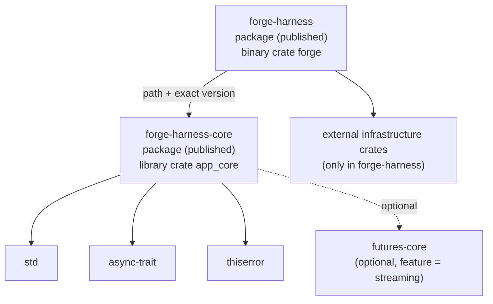

# Forge v1 Dependency Rules

**Status:** Approved  
**Date:** 2026-11-03  
**Owner:** Forge architecture  
**Sources:** `docs/PRD.md` §6.5, NFR-MAINT-001, D-13; [Define the architecture, dependency, and naming rules](https://github.com/Xaidel/forge/issues/20)  
**Companions:** [architecture.md](architecture.md), [naming-conventions.md](naming-conventions.md)  
**ADRs:** [ADR-0001](../docs/adr/0001-two-crate-ports-only-core.md), [ADR-0002](../docs/adr/0002-executor-agnostic-io-free-core.md), [ADR-0003](../docs/adr/0003-hidden-worker-subcommand.md)

---

## 1. Scope

This document fixes every allowed dependency direction in the Forge workspace and the checks that enforce them. It covers:

- Workspace membership and package/target layout.
- Allowed and forbidden dependencies of `app_core`.
- Allowed and forbidden dependencies of `infra_local`.
- The published-crate dependency graph.
- The rule for adding a new `infra_*` crate.
- The architecture test and CI commands.

It does not fix exact crate versions, the full adapter dependency set, or port signatures. Those belong to the relevant TDD.

---

## 2. Rule index

| ID | Rule | Enforced by |
|---|---|---|
| **DEP-01** | The workspace has exactly two members: `crates/app_core` and `crates/infra_local`. | `cargo metadata`; architecture test |
| **DEP-02** | `crates/app_core` is package `forge-harness-core`, library crate `app_core`. `crates/infra_local` is package `forge-harness`, binary crate `forge`. | `cargo metadata`; architecture test |
| **DEP-03** | `app_core` depends on no workspace crate. | `cargo metadata`; architecture test |
| **DEP-04** | `forge-harness` depends on package `forge-harness-core` by path plus the exact shared version, with dependency key `app_core`. It depends on no other workspace crate. | `cargo metadata`; manifest inspection |
| **DEP-05** | `app_core` normal dependencies are exactly `async-trait` and `thiserror`. | `cargo metadata`; architecture test |
| **DEP-06** | `futures-core` is optional and gated by the `streaming` feature. It may be present only if TDD-0002 requires a `Stream` return. | `cargo metadata`; review |
| **DEP-07** | `app_core` dev-dependencies are exactly `pollster`. Build-dependencies are empty. | `cargo metadata`; architecture test |
| **DEP-08** | `app_core` contains no Tokio, Serde, Ratatui, crossterm, reqwest, MXC, Git library, UUID, time, rand, anyhow, tracing, or logging crate. | Source scan; architecture test |
| **DEP-09** | `app_core` contains no `std::env`, `std::fs`, `std::net`, or `std::process`; no `SystemTime::now` or `Instant::now`. | Source scan; architecture test |
| **DEP-10** | `ports` does not depend on `domain` or `application`. `domain` does not depend on `ports`, `application`, or `assembly`. | Source scan; architecture test |
| **DEP-11** | `ports` may use `assembly` only in `ports.rs`, and only for the `ApplicationPorts` and `build_application` re-exports. | Source scan; architecture test |
| **DEP-12** | `infra_local` imports only `app_core::ports` from the core. It never imports `app_core::domain` or `app_core::application`. | Compile-time privacy; source scan |
| **DEP-13** | Outbound adapters do not import one another. `wiring` is the only module that names concrete adapters. | Source scan; architecture test |
| **DEP-14** | `worker` imports `sandbox::protocol` and `app_core::ports` only. It does not import host-only adapters. | Source scan; architecture test |
| **DEP-15** | Published crates use registry versions for external dependencies. No git dependencies. A path dependency is allowed only for a workspace member that is published with the matching version. | `cargo publish --dry-run`; review |
| **DEP-16** | `app_core` and `forge-harness` share one version and are published core-first. | Manifest inspection; release gate |
| **DEP-17** | A new `infra_*` crate requires a demonstrated need and an accepted ADR. The initial workspace stays at two members. | Architecture test; review |
| **DEP-18** | The repository contains no `.agents/`, paseo configuration, external template reference, or `docs/specs/` tree. | File scan; architecture test |
| **DEP-19** | No `anyhow::Error`, `Box<dyn Error>`, or private domain type crosses a port boundary. | Source scan; review |
| **DEP-20** | No lock is held across `.await`; no request-scoped state is stored between port calls. | Review; async tests |

---

## 3. Workspace dependency graph



The graph is acyclic. There is no edge from `app_core` to `forge-harness`, and no edge between two infrastructure adapters.

---

## 4. Layer matrix

| From | May depend on | Must not depend on |
|---|---|---|
| `domain` | `std`, `thiserror` | `ports`, `application`, `assembly`, `infra_local`, any external infrastructure crate |
| `ports` | `std`, `async-trait`, `thiserror`, optional `futures-core`; `assembly` for the two re-exports only | `domain`, `application`, `infra_local`, any external infrastructure crate |
| `application` | `domain`, `ports`, `std`, `async-trait`, `thiserror` | `assembly`, `infra_local`, any external infrastructure crate |
| `assembly` | `domain`, `ports`, `application`, `std`, `async-trait`, `thiserror` | `infra_local`, any external infrastructure crate |
| `infra_local` | `app_core::ports`, external infrastructure crates | `app_core::domain`, `app_core::application`, another outbound adapter |
| `wiring` | all `infra_local` adapters, `app_core::ports` | business rules, private core types |
| `cli` | `wiring`, `tui`, `app_core::ports` | concrete outbound adapters |
| `tui` | `app_core::ports`, local view types | concrete outbound adapters, `wiring` |
| `worker` | `sandbox::protocol`, `app_core::ports` | host-only adapters |

The dotted `ports → assembly` edge is a re-export, not a behavioral dependency. `ports` must not use `assembly` types in its own definitions; it only re-exports `ApplicationPorts` and `build_application`.

---

## 5. `app_core` dependency allowlist

### 5.1 Allowed normal dependencies

| Crate | Why | Notes |
|---|---|---|
| `std` | Core language and data structures. | No I/O sampling; see DEP-09. |
| `async-trait` | Object-safe async port traits. | Baseline dependency. |
| `thiserror` | Ergonomic public error enums. | Baseline dependency. |
| `futures-core` | The `Stream` trait for a streaming model port. | Optional, feature-gated, trait-only. Only if TDD-0002 proves it is needed. |

No other normal dependency is allowed. In particular, `serde`, `tokio`, `ratatui`, `crossterm`, `reqwest`, `mxc-sdk`, `git2`, `gix`, `uuid`, `chrono`, `time`, `rand`, `anyhow`, `tracing`, and `log` are forbidden.

### 5.2 Allowed dev-dependencies

| Crate | Why |
|---|---|
| `pollster` | Minimal executor shim for async use-case tests. |

No Tokio, even in dev-dependencies. The core's tests must remain executor-agnostic.

### 5.3 Build dependencies

None.

### 5.4 Manifest shape

```toml
# crates/app_core/Cargo.toml
[package]
name = "forge-harness-core"
version = "1.0.0"
edition = "2024"
rust-version = "1.93"
license = "MIT"
publish = true

[lib]
name = "app_core"
path = "src/lib.rs"

[dependencies]
async-trait = "..."
thiserror = "..."
futures-core = { version = "...", optional = true }

[features]
streaming = ["dep:futures-core"]

[dev-dependencies]
pollster = "..."

[lints.rust]
unsafe_code = "forbid"
unreachable_pub = "deny"
missing_docs = "deny"

[lints.clippy]
unwrap_used = "deny"
expect_used = "deny"
panic = "deny"
todo = "deny"
unimplemented = "deny"
dbg_macro = "deny"
print_stdout = "deny"
print_stderr = "deny"
```

The `streaming` feature is present only if TDD-0002 requires it. An unused optional dependency fails review.

### 5.5 Allowed `std` surface

Allowed:

- `std::collections`, `std::fmt`, `std::marker`, `std::sync`, `std::time::Duration`, `std::time::SystemTime` as a value type.
- `std::sync::Arc`, `std::sync::Mutex`, `std::sync::RwLock` for in-process coordination, subject to DEP-20.
- `std::error::Error` as a trait bound, but not as a type-erased return.

Forbidden:

- `std::env`, `std::fs`, `std::net`, `std::process`.
- `SystemTime::now()`, `Instant::now()`.
- Any call that reads the clock, filesystem, environment, network, or process table.
- `std::thread::spawn` or any runtime spawning.

Time and IDs arrive through `Clock` and `IdSource` ports. Serialization lives in `infra_local`.

---

## 6. `infra_local` dependency rules

### 6.1 Allowed external crates

`infra_local` may use the external crates required by its adapters. The exact set is owned by the relevant TDD, but it includes:

- Async runtime and process control: `tokio`.
- Serialization: `serde`, `serde_json`, `toml`.
- CLI parsing: the parser chosen by TDD-0001.
- Terminal: `ratatui`, `crossterm`, `ratatui-textarea`, `similar`, `syntect`, `two-face`.
- HTTP/SSE: `reqwest` or an equivalent chosen by TDD-0007.
- Sandbox: `mxc-sdk`.
- Identity: `uuid` or an equivalent chosen by TDD-0003.
- Time: `time` or an equivalent chosen by TDD-0003.
- Local diagnostics: `anyhow`, `tracing`, or an equivalent.
- Git: the Git CLI through `std::process` or `tokio::process`; no `git2` or `gix` in v1.

No external crate may leak into a public port signature. Adapters translate.

### 6.2 Adapter isolation

The outbound adapters are:

`config`, `session`, `ledger`, `git`, `policy`, `attest`, `audit`, `model`, `sandbox`.

They may import:

- `app_core::ports`.
- External crates.
- Standard library.
- `sandbox::protocol`, but only the `sandbox` adapter may import it. No other outbound adapter may.

They may not import:

- Another outbound adapter.
- `app_core::domain` or `app_core::application` (compile-time unreachable, but the test also scans).
- `cli`, `tui`, or `wiring` (except that `wiring` imports them, not the reverse).

If `attest` needs Git, it receives `Arc<dyn GitPort>`. If `ledger` needs Git, it receives `Arc<dyn GitPort>`. If `audit` needs session events, it receives a session read port. Wiring supplies the dependency.

### 6.3 Composition root

`wiring` is the only module allowed to name concrete adapters. It:

1. Reads configuration through the `config` adapter.
2. Constructs each adapter.
3. Coerces each adapter to its port trait object.
4. Calls `app_core::ports::build_application`.
5. Returns `ApplicationPorts` plus any presentation values the CLI or TUI needs.

`cli` never constructs an adapter. It asks `wiring` for a composed runtime.

### 6.4 Worker isolation

`worker` is the hidden `forge __worker` entry. It may import:

- `sandbox::protocol` (the IPC contract).
- `app_core::ports`.
- External crates needed to execute tools.

It may not import:

- `cli`, `tui`, `wiring`.
- `model`, `git`, `ledger`, `session`, `policy`, `attest`, `audit`, `config`.

The worker is a separate process and a separate trust boundary, not a library entry point.

---

## 7. Published-crate dependency rules

### 7.1 Lockstep versioning

`forge-harness-core` and `forge-harness` share one version. The harness depends on the core with a path plus that exact version, renamed to the crate name used in code:

```toml
[dependencies]
app_core = { package = "forge-harness-core", path = "../app_core", version = "=1.0.0" }
```

When the shared version changes, both packages change together. A partial publish is not a valid release.

### 7.2 No unpublished or git dependencies

A published crate must resolve every dependency from a registry. The core is published first because `cargo install forge-harness` resolves it from crates.io. Git dependencies are forbidden in both published manifests.

### 7.3 Publish order

1. `cargo publish -p forge-harness-core`
2. `cargo publish -p forge-harness`

The release checklist runs the dry-run form of both commands in that order.

### 7.4 Manifest shape

```toml
# crates/infra_local/Cargo.toml
[package]
name = "forge-harness"
version = "1.0.0"
edition = "2024"
rust-version = "1.93"
license = "MIT"
publish = true

[[bin]]
name = "forge"
path = "src/main.rs"

[dependencies]
app_core = { package = "forge-harness-core", path = "../app_core", version = "=1.0.0" }
tokio = { version = "...", features = ["..."] }
serde = { version = "...", features = ["derive"] }
serde_json = "..."
# ... other infrastructure crates ...

[lints.rust]
unsafe_code = "forbid"

[lints.clippy]
dbg_macro = "deny"
todo = "deny"
unimplemented = "deny"
```

There is no `[lib]` section. The only target is the `forge` binary.

---

## 8. New `infra_*` crate rule

A new workspace crate is denied by default. It may be added only when all of the following are true:

1. **Demonstrated need.** One of:
   - Compilation isolation that cannot be achieved with features or modules.
   - A deployment artifact that must be built or published separately.
   - Reuse by more than one binary or product.
   - A clear ownership boundary that `infra_local` cannot express.
   - A dependency conflict that cannot be resolved with Cargo features.
2. **Accepted ADR.** The ADR records the need, alternatives, dependency direction, and ownership.
3. **Architecture update.** The workspace map, this document, the architecture test, and the TDD set are updated in the same change.
4. **Naming.** The crate is named `infra_<domain>` and follows the same adapter-isolation rules.
5. **No product-scope change.** The crate does not add behavior beyond the PRD.

The initial workspace stays at two members. A third member is a deliberate review gate, not a convenience refactor.

---

## 9. Enforcement

### 9.1 Architecture test

`crates/infra_local/tests/architecture.rs` is a normal Rust integration test in the binary package. It does not import the `forge` crate; it shells out to `cargo metadata` and scans the repository.

It must assert:

1. `cargo metadata --no-deps --format-version 1` lists exactly two workspace members.
2. The packages are `forge-harness-core` and `forge-harness`.
3. `forge-harness-core` has exactly one target: the `app_core` library.
4. `forge-harness` has exactly one target: the `forge` binary.
5. `forge-harness-core` normal dependencies are exactly `async-trait` and `thiserror`, plus optional `futures-core`.
6. `forge-harness-core` dev-dependencies are exactly `pollster`.
7. `forge-harness-core` build-dependencies are empty.
8. `forge-harness` depends on `forge-harness-core` by path plus version, and on no other workspace crate.
9. `crates/app_core/src` contains no forbidden import from DEP-08 and no forbidden `std` path from DEP-09.
10. `crates/app_core/src/ports.rs` and its submodules do not import `crate::domain` or `crate::application`.
11. `crates/app_core/src/domain.rs` and its submodules do not import `crate::ports`, `crate::application`, or `crate::assembly`.
12. `crate::assembly` appears only in `ports.rs` and only in the two re-export lines.
13. `lib.rs` has no `pub mod` other than `ports`.
14. Outbound adapters do not import another outbound adapter, using the module allowlist from §6.2.
15. `worker` does not import a host-only adapter.
16. No `.agents/` directory, no paseo configuration, no external template reference, and no `docs/specs/` tree exist. The scan looks for actual artifacts, excludes `arch_docs/`, `docs/`, and the test file itself, and does not match prose that states the rule.
17. No `[[bin]]` target other than `forge`.
18. `forge-harness` has no `[lib]` target.

The test uses `std::path` and normalizes separators. It must run on Windows, macOS, and Linux. It must not require network access.

### 9.2 CI commands

```sh
cargo fmt --all --check
cargo clippy --workspace --all-targets --all-features -- -D warnings
cargo test -p forge-harness --test architecture
cargo test --workspace
```

The release gate additionally runs:

```sh
cargo package --list -p forge-harness-core
cargo package --list -p forge-harness
cargo publish --dry-run -p forge-harness-core
cargo publish --dry-run -p forge-harness
cargo install --path crates/infra_local --locked
forge --help
```

The last command must not list `__worker`.

### 9.3 Review checks

The architecture test cannot decide intent. Reviewers also check:

- A new dependency in `app_core` is not smuggled in through a feature.
- A new adapter does not contain business rules.
- A port signature does not expose a private core type.
- A new `infra_*` crate has its ADR and architecture update.
- `anyhow::Error` and `Box<dyn Error>` do not cross a port.

---

## 10. Allowed and forbidden examples

### 10.1 Allowed

```rust
// crates/app_core/src/application/start_task.rs
use crate::domain::entities::Task;
use crate::ports::{TaskId, TaskSnapshot, TaskStorePort};

pub(crate) struct StartTaskUseCase {
    store: std::sync::Arc<dyn TaskStorePort>,
}
```

```rust
// crates/infra_local/src/wiring.rs
use crate::git::GitCli;
use app_core::ports::{GitPort, build_application};

let git: std::sync::Arc<dyn GitPort> = std::sync::Arc::new(GitCli::new(repo_root));
```

```rust
// crates/infra_local/src/attest.rs
use app_core::ports::GitPort;

pub(crate) struct AttestationService {
    git: std::sync::Arc<dyn GitPort>,
}
```

```toml
# crates/app_core/Cargo.toml
[dependencies]
async-trait = "..."
thiserror = "..."
```

### 10.2 Forbidden

```toml
# crates/app_core/Cargo.toml
[dependencies]
tokio = "..."
serde = { version = "...", features = ["derive"] }
```

```toml
# crates/infra_local/Cargo.toml
[dependencies]
some_infra_crate = { path = "../infra_other" }
```

```rust
// crates/infra_local/src/attest.rs
use crate::git::GitCli; // adapter-to-adapter call
```

```rust
// crates/app_core/src/ports.rs
use crate::domain::entities::Task; // private domain type in the public surface
```

```rust
// crates/app_core/src/domain.rs
use crate::ports::TaskSnapshot; // domain depending on ports
```

```rust
// crates/app_core/src/lib.rs
pub mod application; // only ports may be public
```

```rust
// crates/app_core/src/lib.rs
use tokio::process::Command; // runtime type in the core
```

```rust
// crates/infra_local/src/worker.rs
use crate::ledger::MarkdownLedger; // worker importing a host adapter
```

---

## 11. Exceptions and ADR process

There are no standing exceptions to DEP-01 through DEP-20. Any exception requires an accepted ADR that states:

- Which rule is being changed.
- Why the alternative is worse.
- The dependency direction that replaces it.
- The enforcement change.
- The migration or reversal cost.

An ADR that adds a third crate must be linked from `architecture.md`, `dependency-rules.md`, and the architecture test.

---

## 12. Traceability

| Source | Covered by |
|---|---|
| PRD §6.5 workspace and module boundaries | DEP-01 to DEP-14 |
| NFR-MAINT-001 | DEP-01 to DEP-20 |
| D-13 v1 scope, stack, and distribution | DEP-02, DEP-04, DEP-15, DEP-16 |
| Ticket #20 | All rules, ADRs, and enforcement |
| ADR-0001 | DEP-01 to DEP-04, DEP-12, DEP-16 |
| ADR-0002 | DEP-05 to DEP-11, DEP-19, DEP-20 |
| ADR-0003 | DEP-14, DEP-17 |
