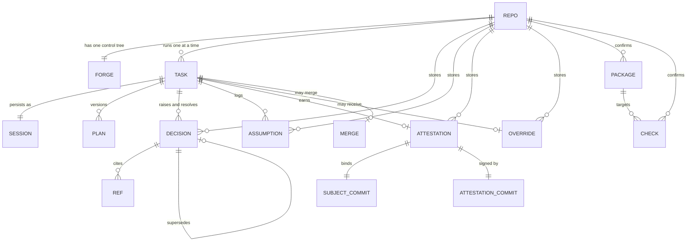
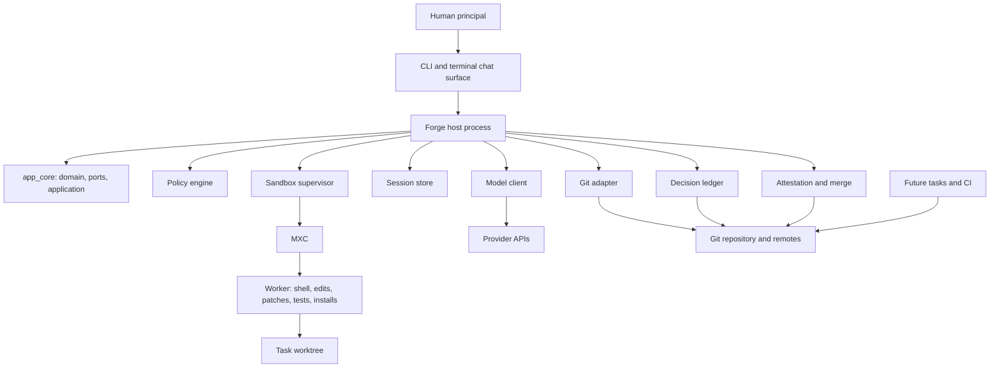

# Forge v1 — Product Requirements Document

| Field | Value |
|---|---|
| Status | `ready` |
| Owner | Karl Abechuela |
| Version | 1.0.0 |
| Last updated | 2026-11-03 |
| Source map | [Forge — Map](https://github.com/Xaidel/forge/issues/1) |
| Decision register | [Appendix A](#appendix-a--decision-register) |
| Open owner decisions | [Appendix C](#appendix-c--open-owner-decision-register) |
| Product spec authority | This document is the single normative product spec for Forge v1. |

## How to read this document

This PRD states **what Forge v1 must do**, the user-visible behavior and defaults, the contracts that bind the behavior, and the acceptance criteria that prove it. It does not restate schemas owned by a technical design document (TDD). It names the contract owner instead.

Sections 1–6 give the product context and domain model. Sections 7–12 are normative requirements and contracts. Sections 13–15 cover validation, delivery, and risk. The appendices hold the decision register, traceability matrix, and open-decision register.

**Requirement rows.** Functional and non-functional requirements use the nine-column row below. One row is one requirement, not one test case. Multiple acceptance cases are numbered inside the result cells.

```text
ID | actor/trigger | required behavior | successful result
error/empty/edge result | interface/data reference
verification method | evidence/decision | unresolved owner decision
```

Rules:

- `MUST`, `MUST NOT`, `SHOULD`, `SHOULD NOT`, and `MAY` are used as defined by RFC 2119.
- `successful result` and `error/empty/edge result` describe observable behavior. They are the acceptance criteria.
- `unresolved owner decision` is `none`, or `Q-xx — <owner> — <what is blocked> — revisit_if: <condition>`.
- `evidence/decision` cites a register ID (`D-xx`) plus the artifact that holds the detail.
- Verification uses one fixed vocabulary: `automated`, `manual-terminal`, `hardware-canary`, `dogfood-metric`, `inspection`. A row names more than one only when each covers a different case.
- `N/A — <reason>` is allowed. A blank cell is not.
- IDs are stable. Adding a requirement does not renumber an existing one.

**Contract owners.** The PRD states the behavioral contract; the named TDD owns the exact schema, signature, or serialization. The planned TDD index is:

| TDD | Slice |
|---|---|
| TDD-0001 | CLI, configuration, init, and repo map |
| TDD-0002 | Domain model, ports, application assembly |
| TDD-0003 | Session state, events, resume |
| TDD-0004 | Agent loop, plan, gates, and policy engine |
| TDD-0005 | Decision ledger and records |
| TDD-0006 | Sandbox, worker IPC, permissions, canaries |
| TDD-0007 | Model adapters, provider profiles, cost |
| TDD-0008 | Git, worktrees, attestation, merge, hooks |
| TDD-0009 | Terminal UI, streaming, plain mode |
| TDD-0010 | Security controls and review evidence |
| TDD-0011 | Dogfood instrumentation and metrics |

## Authority and conflict rule

| Artifact | Authority |
|---|---|
| This PRD | The single normative product spec: what v1 must do, user-visible behavior, defaults, and acceptance |
| Decision ledger | Normative for decision rationale and status |
| TDDs | Normative for exact technical contracts |
| `arch_docs/` | Normative for dependency, naming, and testing rules |
| ADRs | Normative for Forge-specific hard-to-reverse decisions |

On conflict, this PRD is presumed wrong until the relevant decision is explicitly superseded. No silent override runs in either direction. The PRD is readable without GitHub access: decisions are stated in it, and issue and ledger links are provenance. Exact schemas are referenced, never required to understand behavior.

## Changelog

| Version | Date | Change |
|---|---|---|
| 1.0.0 | 2026-11-03 | Initial `ready` PRD generated from the completed wayfinder map and decisions D-01 to D-20. The PRD freeze moves with the dogfood freeze to the start of W19, applying the D-18 calendar amendment to D-15's earlier W9 reference. |

---

## 1. Thesis

### 1.1 The problem

AI-assisted development increases the rate at which a codebase changes and the distance between the person who accepted a change and the person who must explain it later. The diff shows **what** changed. It rarely preserves **why**, which alternatives were rejected, what was assumed, what was verified, or what the human actually understood at the moment of approval. That gap accumulates as **cognitive debt**.

**Cognitive debt** is the accumulated stock of consequential change in a codebase that the developer cannot explain or justify. It is the product goal.

### 1.2 The governance insight

The unit of accountability is the **decision**, not the commit. A commit can be correct and still be unexplainable. A decision record carries the context, the options, the human's own rationale, the consequences, the reversibility, and the blast radius. If consequential decisions are gated while the work is fresh and recorded where the work lives, the repository retains an explanation that survives the session.

### 1.3 The claim and its proxy

The operational proxy is the **explanation gap**: on a sampled merged task, the distance between what changed and why, and what the developer can explain without the artifact.

Forge's v1 claim, bounded by the dogfood protocol in Section 13:

> Compared with the developer's current AI-assisted workflow, Forge reduces the explanation gap on consequential changes by making consequential decisions explicit, gating them before action, and recording the human's rationale alongside the code.

Forge does **not** claim to eliminate cognitive debt, to make every change understood, to generalize beyond one developer, one repository, and four weeks of dogfood, or to equate attestation coverage with understanding. The validation section states the limitation.

### 1.4 What Forge is

Forge is a standalone, local-first coding-agent harness for professional individual developers and small teams. It owns the plan, implement, test, and review loop. It stops for consequential decisions before code, stops again during code rather than inferring intent, and records the human's own rationale in a Git-native ledger. It enforces a human attestation before merge.

- Single user, one repository per session, local-first, terminal-only.
- A single-agent loop with pluggable models and explicit provider profiles.
- A versioned plan, four blocking human gates, and a twelve-state task machine.
- One worktree per task, host-owned Git mutations, and a signed attestation commit.
- A committed decision ledger and a local-only session/audit trail.
- A single static-ish `forge` binary distributed through `cargo-dist`.

### 1.5 What Forge is not

- Not a hosted service, cloud sync, shared team ledger, or multi-tenant product.
- Not an IDE plugin, GitHub App, PR bot, or editor integration.
- Not a multi-agent orchestrator.
- Not an autonomous merger; every merge requires human attestation or an audited override.
- Not a model trainer or fine-tuning product.
- Not a build system, package dependency graph, or monorepo orchestrator.
- Not a container manager or remote execution service.
- Not a prevention product for prompt injection or malicious repositories. It contains impact and makes steering visible; it does not prevent influence (D-18).
- Not a non-code artifact tool. Docs-only, data-only, and generated-only repositories are outside v1's code-task scope.

### 1.6 Design principles

| Principle | Consequence |
|---|---|
| **Deterministic before model-dependent** | The policy engine, sandbox, protected paths, Git hardening, install gates, host-exec argv checks, egress checks, review flags, and audit records are enforcement. Labels and prompt hardening are best-effort. |
| **Human authority** | The human answers every gate. The agent never attests, never invents a rationale, and never auto-approves. |
| **Host-owned mutations** | The trusted host writes the ledger, commits, attestation commit, and merge. The worker cannot write the paths those operations depend on. |
| **Local-first** | No telemetry, no hosted service, no account. The repository and `.forge/` artifacts are the record. |
| **Honest labels** | `Guarded` is never called a sandbox. `Sandboxed` is earned by canaries. Model summaries are labeled. Unknown cost is labeled unknown, never zero. |
| **Durable state** | Gates persist indefinitely. A crash is recoverable. A pause is resumable. A cancel is terminal. |
| **Fail closed** | Missing trust is untrusted. Missing execution policy blocks a task. A missing canary downgrades the mode. A missing attestation blocks merge. |
| **Minimal ceremony** | Light tasks get a short plan and logged assumptions. Full ceremony is reserved for risk. |
| **Terminal citizenship** | Native scrollback, no alternate-screen dashboard, a small live region, and a plain fallback. |

---

## 2. Goals, success, and non-goals

### 2.1 v1 goals

| ID | Goal |
|---|---|
| G-01 | Make every consequential decision explicit, human-owned, and recorded with the human's verbatim rationale. |
| G-02 | Keep a Git-native decision and assumption ledger that a future maintainer can read without the session transcript. |
| G-03 | Enforce the plan, decision, permission, and review/attestation gates without timeout or auto-approval. |
| G-04 | Contain tool execution inside MXC while the host owns every mutation the gates depend on. |
| G-05 | Contain the impact of prompt injection and make steering attempts visible in the transcript, review packet, and attestation record. |
| G-06 | Onboard a real repository deterministically, with human-confirmed facts and explicit unknowns, without inventing commands or overwriting user files. |
| G-07 | Treat a monorepo as one first-class repository with confirmed package roots, package-aware checks, and package-grouped review. |
| G-08 | Provide a terminal-native chat surface that streams, preserves native scrollback, keeps gates inline, and degrades honestly to plain text. |
| G-09 | Ship a standalone installable `forge` binary on macOS, Windows, and Ubuntu with documented floors and no Node, npm, or Bun runtime. |
| G-10 | Validate the thesis with a pre-registered solo dogfood and report the result honestly, including its limitations. |

### 2.2 Success headline

The v1 validation is successful only when the mechanism engaged and the sample was met. The headline is:

- **Primary outcome:** cold-review explanation accuracy improves by at least 15 percentage points, or by at least 10 points with a 20% or greater time-to-explain improvement.
- **Leading indicator:** decision coverage is at least 80% of audited consequential changes.
- **Guardrails:** at least 60% of attempted real tasks reach done and merged without switching to baseline; override rate is at most 10%; median active mid-flight decision wait is at most 5 minutes and p90 at most 20 minutes.
- **Invariant:** 100% attestation coverage for `done` tasks, by construction.

These are validation gates, not product promises. Section 13 defines every metric, formula, source, sample rule, threshold, and limitation.

### 2.3 Non-goals

The non-goals are split into **never** (outside this product's scope) and **v1.1** (deferred, in scope later). A v1.1 item is not a v1 commitment.

#### 2.3.1 Never

| Non-goal | Reason |
|---|---|
| Hosted multi-tenant service, cloud sync, shared team ledgers | D-03, D-11 |
| IDE plugin, GitHub App, PR bot, editor integrations | D-03 |
| Multi-agent orchestration | D-01, D-13 |
| Autonomous merge without human attestation | D-05, D-11 |
| Model training or fine-tuning | D-01 |
| Non-code artifacts as first-class tasks | D-03, D-19 |
| Multi-repo orchestration: cross-repo tasks, ledgers, attestations, merges, shared state | D-20 |
| Monorepo build orchestration, package dependency graphs, affected-package calculation | D-20 |
| Per-package ledgers, decision policies, execution policies, worktrees, locks, or trust domains | D-20 |
| Package-manager execution or build-system introspection during init; model-inferred package discovery | D-16, D-19, D-20 |
| Team roles, SSO, RBAC, MDM/GPO, enterprise audit export | D-03, D-12 |
| Pricing, licensing, business model, mobile app | D-03 |
| Local web UI and browser-based review surfaces | D-10, D-17 |
| Teammate delegation of a pending decision | D-10 |
| Multi-party or quorum attestation | D-11 |
| Remote merge enforcement, branch protection, CI attestation verification | D-11 |
| Remote or hardware-backed attestation infrastructure, key rotation, revocation, transparency logs | D-11, D-14 |
| Squash and rebase merges of task branches; v1 merges are always `--no-ff` | D-11 |
| OS keychain integration | D-11, D-16 |
| Preventing prompt injection; defending against a compromised host, kernel, MXC runtime, terminal emulator, or model provider | D-18 |
| Defending against a malicious human who bypasses gates or deletes hooks | D-11, D-18 |
| Semantic detection of every malicious repository, document, or tool result; full taint tracking; formal non-interference | D-18 |
| Guaranteeing the human reads, understands, or remembers the review packet | D-18 |
| Secret-scanning completeness; proving attestation comprehension | D-18 |
| Protecting data after the human approves a malicious host-exec action | D-18 |
| MCP/tool poisoning defenses; MCP is not in v1 | D-18 |
| Forge binary and release supply-chain compromise | D-18 |
| Docs-only, data-only, or generated-only repositories as first-class v1 targets | D-19, D-20 |
| A workspace or multi-root session concept | D-20 |

#### 2.3.2 v1.1 deferrals

Owner for every v1.1 item: Karl Abechuela. Section 15.3 records the reusable revisit condition for each item.

| Deferral | Source |
|---|---|
| OpenAI Responses API adapter and native Gemini adapter | D-13 |
| macOS notarization and Windows Authenticode | D-13 |
| Windows arm64 guarantee | D-13 |
| Container/devcontainer backend and a second sandbox engine | D-12, D-13 |
| Linux distributions beyond Ubuntu 24.04 LTS | D-12, D-13 |
| Provider-authoritative or org-wide hard budget enforcement | D-13, D-16 |
| Richer diff and Markdown review; auto-update | D-13 |
| Session compaction and `gc` | D-13 |
| `forge report` command | D-14 |
| `forge panic`, audit export, automatic key rotation/revocation | D-18 |
| Full prompt-injection eval harness and adaptive red-teaming | D-18 |
| D16 LLM classifier screening of tool output | D-18 |
| D17 stronger plan-step binding beyond the pre-action guard | D-18 |
| D18 CaMeL-style taint/capability tracking | D-18 |
| D19 dual-LLM/quarantine architecture | D-18 |
| D21 MCP tool pinning if MCP is added | D-18 |
| D22 local-model policy for sensitive repositories | D-18 |
| Path-level egress allowlists and raw-content-host policy | D-18 |
| Quote-as-untrusted UI for human-pasted text | D-18 |
| Per-directory, nested, and propagated repository trust | D-18, D-20 |
| Secret scanning of the full local session log and terminal output | D-18 |
| Semantic steering detection and classifier-assisted review | D-18 |
| Formal security proof or third-party audit | D-18 |
| Semantic code indexing and inferred module graph | D-19 |
| Opt-in model-assisted discovery of commands, entry points, and docs | D-19 |
| Repo-map drift detection and automatic refresh | D-19 |
| Build-system parser/plugin packs for more toolchains | D-19, D-20 |
| External-developer validation design | D-14 |
| Planner/executor split behind the same plan artifact | D-09 |
| Mouse tracking, images, rich text beyond the minimal Markdown subset, OSC 8 links, user themes, custom keybindings, file-path and `@` autocomplete, in-app pager and search, transcript export, notifications or bell, split panes or tabs, concurrent tasks per terminal, SSH-specific features, and screen-reader TUI support beyond `--plain` | D-17 |
| MicroVMs, remote execution service, credential-injecting proxy, WSL2 setup wizard, and a per-run GUI, clipboard, or synthetic-input opt-in | D-12 |
| Third-party or remote attestation verification | D-11 |

---

## 3. Personas and jobs

### 3.1 Personas

| ID | Persona | Description |
|---|---|---|
| P1 | **The accountable developer** (primary) | A solo professional or small-team developer who owns the change and must explain or justify it later. They work in a terminal, care about their repository and credentials, and do not want a second dashboard. |
| P2 | **The inheritor** (secondary) | A teammate or future maintainer who reads the ledger and attestation after the fact. V1 has no shared live state; P2 justifies legible records, not collaboration features. |
| — | **Anti-personas** | Enterprise administrator, non-coding stakeholder, autonomous agent without a human owner, and a team expecting live shared decisions. |

### 3.2 Jobs to be done

| ID | Job | v1 response |
|---|---|---|
| JTBD-01 | Get an intent from a sentence to a merged change without losing why it was built that way. | Plan, gates, ledger, attestation, merge. |
| JTBD-02 | Answer "why is this here?" months later without replaying a chat. | Git-native decision records with human rationale. |
| JTBD-03 | Let an agent work on my repository without giving it my machine or credentials. | MXC worker isolation, host-owned mutations, permission scopes. |
| JTBD-04 | Stop the agent at the moments that matter, not at every line. | Risk-scaled grilling and a deterministic decision policy. |
| JTBD-05 | Prove what was verified and what I attested to. | Structured evidence, review packet, signed attestation. |
| JTBD-06 | Onboard a messy or legacy repo without the tool inventing commands. | Deterministic scan, repo brief, confirmed facts, explicit unknowns. |
| JTBD-07 | Work in a monorepo without per-package bureaucracy. | One repo, confirmed package roots, package-aware checks and review. |
| JTBD-08 | Recover from a closed terminal, a crash, or an interruption. | Durable state, pause, resume, crash-safe intent/result. |
| JTBD-09 | Keep the tool out of my way when the task is small. | Light risk, short plan, logged assumptions, same review and attestation. |
| JTBD-10 | Know whether the product is actually working. | Pre-registered dogfood metrics and an honest final memo. |

---

## 4. Journeys

Each journey has an actor, a goal, preconditions, at least one success case, its material failure and empty cases, the requirements it touches, and the decisions behind it. The journey is the end-to-end product behavior; the requirement rows in Section 7 are the acceptance units.

### J-01 First run

**Actor:** P1. **Goal:** install Forge and initialize an existing repository so the first task can start safely.

**Preconditions:** A Git repository with at least one commit. A supported host or a trusted repository that can run `Guarded`. A provider profile and key, or the intent to configure one.

**Success case:**

1. The developer installs `forge` through Homebrew, `cargo install forge-harness`, or a release installer, and runs `forge init`.
2. Init performs preflight: confirms a Git repository with at least one commit, warns on a dirty tree, and detects an existing `.forge/`.
3. The deterministic scan reports languages, manifests, lockfiles, toolchains, candidate checks, entry points, module roots, package roots, docs, generated and vendored trees, and security findings.
4. The repo brief shows each facet as `confirmed`, `proposed`, or `unknown`. The developer accepts, edits, rejects, or marks each unknown. A library can confirm an explicit absence of entry points.
5. The developer chooses verification: an automated check, a manual method with a one-line description, or unconfigured with a warning.
6. The developer chooses a provider profile, resolves the key, and optionally validates it.
7. The execution-policy probe runs, the developer reviews and accepts the generated `.forge/execution-policy.json`, and the negative canary suite runs.
8. The developer declares the repository trusted or untrusted, chooses or generates a signing key, and installs the managed hooks or opts out.
9. Init prints a summary of what was written, what is confirmed, what is unknown, what is unconfigured, and what blocks `forge run`. It does not commit.
10. `forge run` starts the first task because the base ref, provider, execution policy, trust, and verification are present.

**Failure and empty cases:**

| Case | Behavior |
|---|---|
| Not a Git repository, or no commits | Init stops with a clear error. No partial `.forge/` is written. |
| Dirty working tree | Warn and continue. The first task creates its own worktree from the base commit. |
| Existing newer `.forge` schema | Read-only. Init refuses to rewrite; it prints the version and the migration path. |
| Existing `.forge` with uncommitted changes | Never overwrite. Show a proposal or diff. |
| Existing Git hooks | Never overwrite. Print the lines to add and leave enforcement degraded. |
| No tests and no docs | Init succeeds with warnings and does not scaffold. The first task's plan must name a verification method; a light task without automated tests upgrades to full risk. |
| Unclear architecture | Entry points, module roots, or docs remain `unknown`. Init finishes. The first task in an unmapped area is full-risk with an orientation step. |
| Unrecognized build system | No guessed command. The developer may add a command, choose manual verification, or leave verification unconfigured. |
| Monorepo | Package roots are proposed, confirmed, or left unknown. Init finishes. No per-package configuration is created. |
| No human-authored source | Init reports the repository as outside v1's code-task scope. |
| Unsupported host, trusted repository | `Guarded — not sandboxed` from init through merge, with persistent labels. |
| Unsupported host, untrusted repository | `forge run` refuses. `Guarded` is not offered as containment. |
| User declines hooks | Init finishes; `forge status` and `forge audit` report degraded enforcement. |
| `--no-network` | Provider validation is skipped; `forge doctor` can recheck later. |

**Requirements touched:** FR-ONB-001 to FR-ONB-019, FR-MODEL-001 to FR-MODEL-009, FR-EXEC-003, FR-EXEC-005, FR-EXEC-008 to FR-EXEC-011, FR-TUI-001, FR-TUI-009, FR-TUI-010, NFR-SEC-003, NFR-SEC-007, NFR-SEC-008, NFR-SCALE-001, NFR-SCALE-002.

**Decisions:** D-12, D-13, D-16, D-18, D-19, D-20.

### J-02 Full-risk task

**Actor:** P1. **Goal:** take a multi-file or policy-triggered change from intent through plan approval, execution, verification, review, attestation, and merge.

**Preconditions:** An initialized repository. A configured provider, accepted execution policy, trust declaration, and verification. No other active task in the repo.

**Success case:**

1. `forge run` creates the task, acquires the repo lock, records the base commit, resolves config, policy, and model hashes, and creates the task worktree and branch before the first mutation.
2. Planning produces a versioned plan with acceptance criteria, steps, risk class, policy triggers, decision map, and assumptions. The plan is full risk because the task is multi-file or a trigger fired.
3. The plan gate shows the steps, risks, assumptions, and decision map. The developer approves or requests changes.
4. A blocking decision is answered with a chosen option and the human's own rationale. The decision is written to the ledger as a full record.
5. Execution works the plan. A scheduled mid-flight decision is reached; the pre-action guard blocks the action and presents the decision request. The developer answers; execution continues.
6. Verification runs targeted checks during steps, then the full configured suite, build, and lint. Every acceptance criterion has evidence.
7. The review packet shows the diff, plan versus actual, decisions, assumptions, verification evidence, open questions, package grouping, repo confidence, and untrusted-content summary.
8. The three-question viva asks the developer to explain the highest-risk decision, the riskiest hunk, and the weakest evidence. All three answers pass.
9. The developer types `attest` and the host creates the signed attestation commit `C2` containing only the canonical attestation record.
10. `forge merge` verifies the task is `done`, `C2` is signed, `HEAD == C2`, `C2^ == C`, the subject hashes match, and the merge is clean. It merges `--no-ff` and releases the open-branch lock.
11. The branch is retained until merge, then the task worktree is cleaned up after confirming no uncommitted changes.

**Failure and empty cases:**

| Case | Behavior |
|---|---|
| Plan rejected with material feedback | Return to `planning`; a new plan version is created with the cause and diff. |
| Plan rejected with minor feedback | Return to `executing`; the change is logged. |
| Decision deferred | Task moves to `paused`; the request stays pending; `forge resume` reprints it. |
| Decision rejected | Return to `planning`; the plan and decision map are revised. |
| Permission denied and an alternative is needed | Open a decision request or stop if no viable alternative exists. |
| Verification fails | Repair within three cycles; open a decision if a choice is needed; `stopped` if no progress. |
| Attestation answer wrong or incomplete | Specific feedback, stays open. After two failures, offer explain or stop. Never auto-pass. |
| Attestation stop | Task moves to `stopped`; branch stays unmerged; no attestation is recorded. |
| Merge conflict or moved base | Refuse and leave the task unchanged. `forge reopen` is the only path to a new attestation. |
| Crash | Resume from `state.json`; inspect the worktree; re-verify an interrupted action rather than replaying it. |
| Cancel | Terminal; branch and worktree retained; nothing merged; partial ledger records are not merged. |

**Requirements touched:** FR-PLAN-001 to FR-PLAN-010, FR-GATE-001 to FR-GATE-006, FR-EXEC-001 to FR-EXEC-013, FR-LEDGER-001 to FR-LEDGER-011, FR-VER-001 to FR-VER-010, FR-REV-001 to FR-REV-011, FR-MERGE-001 to FR-MERGE-010, NFR-SEC-004 to NFR-SEC-015, NFR-SCALE-001, NFR-SCALE-002.

**Decisions:** D-05, D-06, D-07, D-09, D-10, D-11, D-12, D-18.

### J-03 Light task

**Actor:** P1. **Goal:** make a small, localized change without the full plan-gate ceremony while keeping the same review and attestation standard.

**Preconditions:** An initialized repository. The change is single-file, localized, has no policy trigger, and is easy to reverse.

**Success case:**

1. Intake and planning produce a short plan, a risk class of `light`, and logged assumptions.
2. No plan gate is required. Execution begins because no blocking decision remains.
3. The pre-action guard still runs on every mutation. If a hard trigger fires, the task upgrades to full risk and re-enters planning or the plan gate.
4. Targeted checks run during the step; the full configured suite runs before review.
5. The review packet, viva, attestation, and merge are the same as J-02.
6. The task reaches `done` and is merged.

**Failure and empty cases:**

| Case | Behavior |
|---|---|
| A hard trigger fires | Upgrade to full risk; plan and decision map are revised. |
| No automated test exists | The task must add a test or upgrade to full risk so the human approves the manual verification method. |
| Multi-file or architectural change discovered | Upgrade to full risk and re-enter planning. |
| Verification fails | Same repair loop as J-02. |
| Attestation fails | Same two-attempt explain/stop path as J-02. |
| Cancel | Terminal; nothing merged. |

**Requirements touched:** FR-PLAN-004, FR-PLAN-006, FR-GATE-001, FR-GATE-006, FR-EXEC-001, FR-VER-001 to FR-VER-010, FR-REV-001 to FR-REV-011, FR-MERGE-001 to FR-MERGE-010.

**Decisions:** D-06, D-07, D-09, D-10, D-11.

### J-04 Mid-flight gates

**Actor:** P1. **Goal:** answer a decision or permission request that appears while the agent is already working, without losing the task or letting the agent proceed by inference.

**Preconditions:** A task in `executing`, `verifying`, or a scheduled decision trigger.

**Success case:**

1. The pre-action guard detects a policy trigger or the sandbox denies an action.
2. A decision request or permission request appears inline as an accent-bar message. The activity line says what Forge is waiting on.
3. A decision request shows the question, why now, context, two or three options, a recommendation, reversibility, blast radius, and no default. A permission request shows the exact action, working directory, mode, reason or denial, and scopes. Neither shows a model recommendation to allow.
4. The developer answers. A decision answer records the chosen option and the human's verbatim rationale in the ledger. A permission grant is audit-only and task-scoped or once-only.
5. Execution resumes at the blocked action. A denial that needs a design alternative opens a decision; a denial with no alternative stops the task.

**Failure and empty cases:**

| Case | Behavior |
|---|---|
| No answer | The task stays in `decision` or `permission` indefinitely. There is no timeout and no auto-approve. |
| Defer | Move to `paused`; the request remains pending. |
| Delegate | Forge researches or prototypes the analysis, returns with evidence, and asks again. The decision remains human. |
| Reject | Return to `planning`. |
| Deny and propose an alternative | The alternative is evaluated; if it needs a decision, a decision request opens. |
| Agent tries to proceed | The guard blocks; the action is not executed. |
| Permission request treated as a decision | Rejected by contract: a permission request never becomes a ledger decision. |

**Requirements touched:** FR-GATE-001 to FR-GATE-006, FR-EXEC-001, FR-EXEC-005 to FR-EXEC-007, FR-EXEC-012, NFR-SEC-006, NFR-SEC-012, NFR-SEC-013.

**Decisions:** D-05, D-06, D-10, D-12, D-18.

### J-05 Pause, resume, and crash

**Actor:** P1. **Goal:** close the terminal or survive a crash and resume the same task without replaying work or losing the pending gate.

**Preconditions:** A task in any non-terminal state.

**Success case:**

1. The developer presses Esc on an empty input or runs `/pause`; Forge finishes the current tool, stops before the next model call, persists state, and prints the resume command.
2. The developer closes the terminal. Nothing is lost.
3. `forge resume T-042` reacquires the repo lock, clears a stale lock if the previous process is gone, verifies the worktree, branch, and base commit, compares config, policy, and model hashes, and re-enters the last committed state.
4. The transcript reprints the task header, the last 50 entries, and the pending gate, with `replayed 50 of 312 events — /transcript for full history`.
5. If Forge crashed mid-action, the intent without a result is marked `interrupted`; Forge inspects the worktree and re-verifies instead of replaying the action.
6. Execution continues from the correct state.

**Failure and empty cases:**

| Case | Behavior |
|---|---|
| Stale lock | Detect and clear only when the recorded process is gone. |
| Config, policy, or model hash changed | Pause and ask; never silently continue. |
| Worktree missing or branch mismatched | Pause with a clear diagnostic; do not create a second worktree. |
| Truncated trailing event line | Ignore the partial line; trust the snapshot only when its sequence matches. |
| State snapshot corrupt | Rebuild from `events.jsonl`; if the key state cannot be preserved, `stopped`. |
| Resume while another session owns the lock | Wait or refuse. |
| Human still away | Gate persists; no timeout. |

**Requirements touched:** FR-REC-001 to FR-REC-011, FR-GATE-005, FR-EXEC-013, FR-TUI-007.

**Decisions:** D-09, D-17.

### J-06 Reject, cancel, override, reopen

**Actor:** P1. **Goal:** take the non-happy paths without corrupting state or silently merging an unattested branch.

**Preconditions:** A task at review, a task in progress, or a `done` task whose base has moved.

**Success case:**

1. Review rejection with minor feedback returns to `executing`; material feedback returns to `planning`. The review receipt records the reason.
2. Cancel asks for confirmation, then abandons the task. The branch and worktree are retained, nothing is merged, and the partial ledger is not merged. The task is terminal.
3. Override requires a reason and a typed task ID, creates a signed override record, merges the task branch, leaves the task `stopped`, and warns in `forge audit`.
4. `forge reopen T-042 --reason "..."` moves `done` back to `executing`, restores the worktree and branch, supersedes the old attestation without deleting it, and requires fresh verification, review, and attestation.
5. The state machine and ledger show exactly what happened.

**Failure and empty cases:**

| Case | Behavior |
|---|---|
| Override without a reason | Refuse. |
| Override without the typed task ID confirmation | Refuse. |
| Reopen with a dirty or missing worktree | Refuse with a diagnostic; no state change. |
| Cancel at a gate | Confirmation required; only `y` cancels. |
| Re-attestation after reopen | New version `v2` with `supersedes: [v1]`; the old record is never rewritten. |
| Merge after reopen | Requires the new `C2` and a clean verification. |
| Override merged | Task stays `stopped`, never `done`; `forge audit` lists the override. |

**Requirements touched:** FR-GATE-002, FR-GATE-004, FR-REV-008, FR-MERGE-005 to FR-MERGE-007, FR-REC-003, FR-REC-004, FR-REC-007.

**Decisions:** D-10, D-11.

### J-07 Unsupported host and untrusted repository

**Actor:** P1. **Goal:** understand exactly what protection is and is not active, and never mistake approval prompts for containment.

**Preconditions:** A host without native MXC containment, or a repository the developer declares untrusted.

**Success case:**

1. `forge doctor` names the missing floor or failed probe.
2. For a trusted repository, Forge runs `Guarded — not sandboxed`. The label is persistent in the activity line, every gate, `forge status`, and the review packet.
3. Every new shell command, network host, external write, and destructive action requires approval. `once` is the default; `this task` is available only for an exact command string, a specific host, or a specific read-only external path.
4. The review and attestation state that the task ran `Guarded`; the attestation record carries the execution mode.
5. For an untrusted repository, `forge run` refuses because `Sandboxed` is required. There is no `--force` bypass.

**Failure and empty cases:**

| Case | Behavior |
|---|---|
| MXC fails mid-task | Stop the task. Never continue unsandboxed automatically. Resume in `Guarded` only with an explicit human choice, audited. |
| User forces `Guarded` | Typed confirmation and audit entry. Not a convenience toggle. |
| Untrusted repository on a host that cannot run `Sandboxed` | Unsupported. `forge run` refuses with the reason. |
| Canary fails | Run `Guarded` and say which check failed. |
| Permission grant requested for credentials | `once` only; never `this task`. |
| Guarded approval fatigue | The human's only defense is attention; the mode is labeled and audited, not claimed as a boundary. |

**Requirements touched:** FR-EXEC-003, FR-EXEC-008 to FR-EXEC-011, FR-ONB-013, FR-ONB-014, NFR-SEC-003.

**Decisions:** D-12, D-18.

---

## 5. Domain model

Section 5 is canonical for product vocabulary. There is no separate root `GLOSSARY.md` in v1 unless a second bounded context appears.

### 5.1 Ubiquitous language

#### Core execution

| Term | Meaning |
|---|---|
| **Task** | The durable unit of developer intent. Owns one plan, its decisions, assumptions, and state. |
| **Session** | The persisted record of a task, 1:1 with it, stored under `.forge/local/sessions/<task-id>/`. Session persistence means task persistence across runs. |
| **Run** | One Forge process invocation. A run can crash, exit, and be resumed. |
| **Step** | One item in the plan. |
| **Attempt** | One try at a step or tool action. |
| **Gate** | A blocking human interaction: plan, decision, permission, or review/attestation. |
| **Decision request** | A blocking question that needs a human answer before a consequential action. Pending requests live in task state, not the ledger. |
| **Permission request** | A blocking execution gate: may I run this action? Audit-only; never a ledger decision. |
| **Grant** | A human approval for a permission request: `once`, `this task`, or, only through a policy edit, repo-wide. |
| **Review packet** | The evidence bundle handed to the human at review: diff, plan versus actual, decisions, assumptions, verification evidence, open questions. |
| **Attestation** | The human act that makes a task `done`. The agent never attests for the human. |
| **Task branch** | `forge/<task-id>`, checked out in the task worktree. |
| **Worktree** | The per-task Git worktree at `.forge/worktrees/<task-id>`. The unit of isolation and resume. |
| **Base ref** | The branch recorded at intake; the branch the task will merge into. |
| **Subject commit (`C`)** | The task-branch commit the human reviewed and attested: code, tests, and ledger. |
| **Attestation commit (`C2`)** | The signed commit immediately after `C`, containing only `.forge/attestations/<id>.json`. The signature and `C2^ == C` bind the viva to `C`. |
| **Clean merge** | A `--no-ff` merge of `C2` into `base_ref` that Git performs without conflict and without manual tree edits. |

#### Governance and ledger

| Term | Meaning |
|---|---|
| **Cognitive debt** | The accumulated stock of consequential change in a codebase that the developer cannot explain or justify. The product goal; not directly observable. |
| **Explanation gap** | The measured distance, on a sampled merged task, between what changed and why, and what the developer can explain without the artifact. The operational proxy for cognitive debt. |
| **Consequential change** | A change where a policy trigger fires, or a reasonable reviewer would require a decision: interface, schema or data, dependency, security boundary, cross-module refactor, deletion, performance-sensitive path, protected path, or deviation from plan. |
| **Decision policy** | `.forge/policy`: the versioned rulebook of hard triggers that force a decision request. |
| **Execution policy** | `.forge/execution-policy.json`: the committed rulebook for the execution boundary. |
| **Policy trigger** | A condition in `.forge/policy` that forces a decision request before the action. |
| **Protected path** | A repository path whose modification requires a decision and a review flag. |
| **Assumption** | A low-risk belief the plan relies on, with a basis, risk, and `revisit_if`. Logged rather than turned into a decision request. |
| **Decision record** | A Git-native Markdown record of a resolved decision, with YAML front matter and a human-authored rationale. |
| **Assumption record** | A Git-native Markdown record of an assumption and its lifecycle. |
| **Deferred decision** | A choice that can wait, with a `revisit_if`; kept in session state, not the ledger. |
| **Decision map** | The plan's versioned map of decisions with statuses `scheduled`, `requested`, `resolved`, `deferred`, and `out_of_scope`. |
| **Fog clear** | The plan is clear enough to codify: every step has a known approach and verification method, and no blocking decision remains. |
| **Risk class** | `light` for a single-file, localized change with no trigger and easy reversal; `full` for a policy trigger, multi-file or architectural change, unknown approach, or unmapped target. |
| **Rationale provenance** | The record of who authored the rationale and how it was captured: `typed`, `dictated`, or `imported`. |
| **Supersession** | Replacing a decision or assumption without rewriting history. Forward links are authoritative; backlinks are repairable. |
| **Errata** | Append-only natural-language corrections attached to a record, with date, source, verbatim evidence, and whether the decision changed. |
| **Ledger index** | The generated, gitignored `.forge/local/index.json` cache of the ledger. |
| **Visibility** | `repo` for a committed full record or `local` for a local-only full record with a committed safe stub. |
| **Implementer backlink** | `implemented_by`: commit refs filled at attestation and rebuildable from the `Forge-Decisions:` commit trailer. |
| **Override** | A human-only, signed, reasoned bypass that merges an unattested task branch and leaves the task `stopped`. |
| **Enforcement degraded** | A state where a hook is missing or conflicting, or Forge cannot verify; `forge status` and `forge audit` must say so. |

#### Security and sandbox

| Term | Meaning |
|---|---|
| **Worker** | The process that runs shell commands, file edits, patches, tests, package installs, and any MCP, plugin, or hook processes. It runs inside MXC. |
| **Host** | The trusted Forge process outside the sandbox: model client, ledger, policy engine, approval UI, Git operations, attestation, and merge. |
| **Sandboxed** | Native OS containment is active and the canary suite passes. |
| **Guarded** | No OS containment; the host mediates tools and every new command, network host, or external write needs approval. Explicitly not a sandbox. |
| **Sandboxed — network denied** | Native containment is active, but the platform's proxy path is unavailable, so network egress is denied. |
| **Canary** | A negative test that proves a denial before `Sandboxed` is displayed. |
| **Host exec** | A single approved command run by the host outside the sandbox, with host credentials. |
| **Repo trust** | A per-machine human declaration that a repository's origin and owner are trusted enough for `Guarded`. It never makes the repository's content trusted. |
| **Untrusted content** | All repository files, tool output, commit messages, web content, model output, and generated or vendored code. Everything that is not the human task or the Forge system prompt. |
| **Instruction source** | A content class allowed to direct the task. In v1, only the human task and the Forge system prompt are instruction sources. |
| **Provenance label** | A host-added marker naming the source and kind of untrusted content. |
| **Source envelope** | A structured wrapper around untrusted content in the model context. The model is told the wrapped content is data. |
| **Steering attempt** | Untrusted content that tries to redirect the task, claim authority, or authorize an action. |
| **Containment** | Limiting the impact of a successful injection to the sandbox and worktree, and requiring the human to authorize consequential actions. |
| **Visibility** | Surfacing and recording steering attempts in the transcript, review packet, and attestation record. |
| **Terminal sanitizer** | The single host function that neutralizes control sequences before untrusted text reaches the terminal. |
| **Tool-output budget** | The cap and truncation applied to tool results before they enter the model context. |
| **Secret scan** | The pattern, entropy, and decoded-content scan of the assembled model request and the staged diff. |
| **Review flag** | A host-generated marker for a file or diff property that needs human attention. |
| **Incident runbook** | The documented response steps for a suspected injection or persistence event. |

#### Onboarding and repo map

| Term | Meaning |
|---|---|
| **Repo scan** | The deterministic, read-only discovery pass at init. No model calls, no repository code execution, no installs. |
| **Repo brief** | The human-facing init review: detected facts, candidate checks, entry points, module roots, package roots, docs, generated and vendored trees, security findings, and facet status. |
| **Init report** | The local-only evidence record at `.forge/local/init-report.json`: raw candidates, sources, confidence, warnings, stale references, and a snapshot of the repo brief. |
| **Repo map** | The confirmed subset stored in committed `.forge/config`: `checks[]`, `context.entry_points`, `context.module_roots`, `context.docs`, `package_roots`, and the verification choice. |
| **Facet** | One of `checks`, `entry_points`, `module_roots`, `docs`, or `package_roots`. |
| **Facet status** | `confirmed`, `proposed`, or `unknown`. `proposed` never counts as confirmed context. |
| **Confirmed absence** | A `confirmed` facet whose value is an explicit `none` marker, used where absence is legitimate, such as a library with no executable entry point. Not the same as `unknown`. |
| **Primary entry point** | The optional entry point the human designates as the default for orientation and planning. Other confirmed entry points remain valid. |
| **Verified** | A runtime fact: a check ran successfully and produced evidence. Not a facet status and never set by init. |
| **Manual verification** | A repo-level acknowledgement with a one-line method, which the first task's plan must expand into a concrete checklist approved at the plan gate. |
| **Orientation step** | A plan step that reads the relevant manifests, CI, docs, and candidate entry points, confirms the owning module or entry point, and proposes a repo-map update if needed. |
| **Incomplete repo map** | At least one facet the task depends on is `proposed` or `unknown`. The product term for the colloquial "unclear repo." |
| **Repo confidence** | The review-packet section that states which map facts the task relied on, which checks were verified, manual, or never run, and which changed files fell outside the confirmed map. |
| **Package root** | A directory the human confirmed as a build or package unit. It may contain one or more toolchains and manifests. |
| **Package candidate** | A directory the deterministic scan proposed as a package root because it contains a recognized manifest. A candidate is evidence, not context, until confirmed. |
| **Container or workspace root** | A confirmed package candidate that contains other confirmed package roots and is not itself treated as a package by default. It can still hold root-level files, workspace-level checks, and repo-wide policy. |
| **Declared task scope** | The package roots and paths a task's approved plan says it intends to touch. |
| **Touched package** | A confirmed package root containing a changed file, whether or not the plan declared it. |
| **Nested repo or submodule** | A Git repository inside the parent repo. It is opaque to the parent: skipped by the scan, never edited, and initialized separately if the user wants Forge there. |

#### Models, checks, and terminal

| Term | Meaning |
|---|---|
| **Protocol adapter** | The wire implementation: Anthropic Messages or OpenAI Chat Completions. |
| **Provider profile** | A named endpoint plus protocol, auth mode, headers, model defaults, and price overrides. |
| **Model slot** | A named role (`primary`, `fast`, `local`) bound to a provider profile plus model and parameters. |
| **Active profile** | The profile a slot resolves to for the current task. |
| **Check** | A configured command with `id`, `kind` (`build`, `test`, `lint`, `format`, `typecheck`, `setup`), `command`, `cwd`, and `required`. |
| **Instruction doc** | A root-level `AGENTS.md`, `CLAUDE.md`, `README*`, or `CONTRIBUTING*` used as context, never configuration. |
| **Price table** | The versioned, built-in model price catalog with config overrides. |
| **Soft budget / hard budget** | Warn and pause thresholds per task. |
| **Local guardrail** | A Forge-enforced task budget, not a provider-side spend guarantee. |
| **Fallback** | None in v1; recovery is explicit `/model` switching. |
| **Transcript** | The visible conversation of a task: committed lines plus the live region. |
| **Session log** | The append-only `events.jsonl` under `.forge/local/sessions/<task-id>/`; the durable source of the transcript. |
| **Committed line** | A rendered line written once into native scrollback and never redrawn. |
| **Live region** | The bottom area, at most 8 rows, with the in-flight message, activity line, and input. |
| **Receipt** | The later message confirming a gate answer. |
| **Activity line** | The one-line status directly above the input. |
| **Reasoning block** | Provider-exposed reasoning, hidden by default and expanded with `/thinking`. |
| **Plain mode** | The line-oriented, no-ANSI fallback for non-TTY, `--plain`, and screen readers. |

#### Validation

| Term | Meaning |
|---|---|
| **Cold review** | A delayed, rubric-scored explanation of a merged task with the diff, ledger, transcript, and prior attestation answers hidden. |
| **Decision coverage** | Required decisions with a ledger record, or an explicit deferred decision with `revisit_if`, divided by required decisions. Audited from the plan, diff, and policy, never from the agent's narration. |
| **Active gate latency** | Time from a gate being shown to the human answering, excluding paused, deferred, and away time. |
| **Dogfood diary** | Local, gitignored record of each attempted task's type, risk, size, timing, outcome, interventions, and metric inputs. |

### 5.2 Entities and relationships



- A **repository** is one initialized Git repository with one `.forge/` control tree.
- A **task** is repo-wide. It owns one worktree, one branch, one plan lineage, and one session.
- A **package root** is a confirmed repo-map fact, not an execution unit. A task may touch several packages.
- A **decision** and an **assumption** live in one ledger; only resolved decisions enter it.
- An **attestation** binds the human viva to one subject commit and one attestation commit.
- A **merge** is a repo-level event; a package is never a merge unit.

### 5.3 Invariants

| ID | Invariant |
|---|---|
| INV-01 | One active task per repository. A repo-level lock guards it. |
| INV-02 | One open task branch per repository. A new task waits until the previous branch is merged or explicitly abandoned. |
| INV-03 | Pending decision requests live in session state, never in the ledger. Only resolved decisions enter the ledger. |
| INV-04 | A decision's rationale is the human's verbatim words. The agent never authors, drafts, or prefills it. |
| INV-05 | The host writes ledger records, commits, attestation commits, and merges. The worker cannot write those paths. |
| INV-06 | `done` requires human attestation. The agent never self-attests. |
| INV-07 | Attestation binds subject commit `C` and attestation commit `C2` with `C2^ == C`. Any commit after `C2` invalidates the attestation. |
| INV-08 | A task branch merges only through `forge merge`, always `--no-ff`, or through a signed, audited override. |
| INV-09 | No gate has a timeout or an auto-approve path. |
| INV-10 | `Sandboxed` is displayed only after the negative canary suite passes. |
| INV-11 | An untrusted repository requires `Sandboxed`; `Guarded` is refused. |
| INV-12 | `Guarded` is never described as a sandbox. |
| INV-13 | Only the human task and the Forge system prompt are instruction sources. Repository and tool content are untrusted data. |
| INV-14 | A write to a protected path requires a decision, and the host refuses to commit an unresolved protected-path change. |
| INV-15 | Ledger substance is immutable. Supersession, errata, and implementation backlinks are metadata and never rewrite the human's words. |
| INV-16 | A newer schema version is read-only until migrated. Unknown fields are preserved on rewrite. |
| INV-17 | One repo per session. A session never spans repositories. Independent sessions in different repos share no state. |
| INV-18 | A verification claim requires evidence. No evidence means no `verified`. |
| INV-19 | Unknown usage is labeled unknown, never silently counted as zero. |
| INV-20 | No telemetry, no hosted service, and no committed secrets, model reasoning, or customer data. |

### 5.4 Lifecycles

**Decision status:** created as `accepted`, `rejected`, or `deferred`; `accepted` may become `superseded` or `deprecated`; `rejected` may become `superseded` if revisited; `deferred` becomes `superseded` by the decision that resolves it; `superseded` and `deprecated` are terminal. `superseded_by` is required for `superseded`; `revisit_if` is required for `deferred`.

**Assumption status:** `assumed` may become `validated` or `invalidated`; any of `assumed`, `validated`, or `invalidated` may become `superseded` by a later assumption or by a decision that escalates it. `reviewed_by` records a human review, not a status change. "Seen and still assumed" is valid.

**Attestation:** `v1` is created at the first successful viva. Re-attestation after `forge reopen` creates `v2` with `supersedes: [v1]`. Old records are never rewritten. A task has at most one current attestation.

**Task:** the twelve-state machine in Section 10.2. `done` and `cancelled` are terminal; `done` may be reopened by `forge reopen`, a narrow exception that returns it to `executing`.

---

## 6. System overview and trust boundaries

### 6.1 Component diagram



### 6.2 Host and worker split

| Responsibility | Host | Worker |
|---|---|---|
| Model requests and streaming | Yes | No |
| System prompt and context assembly | Yes | No |
| Policy engine and pre-action guard | Yes | No |
| Permission and decision gates | Yes | No |
| Git commits, refs, worktrees, merge | Yes | No |
| Ledger and assumption records | Yes | No |
| Attestation commit and merge | Yes | No |
| Shell commands, edits, patches, tests | Supervises | Yes |
| Package installs | Supervises | Yes |
| MCP, plugin, or hook processes, if added | Supervises | Yes |
| Reads of repository and tool output | Mediates | Produces |
| Credential and key storage | Yes, outside the worker | No |
| Terminal rendering and sanitization | Yes | No |

The worker is untrusted by construction. The host is the trusted computing base. Tool results cross a typed, size-limited IPC boundary. JSONL framing is the starting point; the exact framing belongs to TDD-0006.

### 6.3 Authoritative state

| State | Authority | Location | Survives a crash |
|---|---|---|---|
| Task state | Host snapshot | `.forge/local/sessions/<task-id>/state.json` | Yes, via atomic snapshot |
| Task events | Host append-only log | `.forge/local/sessions/<task-id>/events.jsonl` | Yes |
| Plan versions | Host | `.forge/local/sessions/<task-id>/plans/` | Yes |
| Verification artifacts | Host, redacted and capped | `.forge/local/sessions/<task-id>/artifacts/` | Yes |
| Decision ledger | Host, committed | `.forge/decisions/` and `.forge/assumptions/` | Yes, in Git |
| Attestation | Host, committed | `.forge/attestations/` and signed `C2` | Yes, in Git |
| Override | Host, committed | `.forge/overrides/` | Yes, in Git |
| Repo trust | Host, local | `.forge/local/repo-trust.json` | Yes, per machine |
| Execution policy | Host, committed plus local override | `.forge/execution-policy.json` and `.forge/local/execution.local.json` | Yes |
| Decision policy | Host, committed | `.forge/policy` | Yes |
| Repo map | Host, committed | `.forge/config` | Yes |
| Audit log | Host, local | `.forge/local/sessions/<task-id>/events.jsonl` | Yes |
| Ledger index | Generated cache | `.forge/local/index.json` | Rebuildable |

The session log is canonical for the transcript. The TUI is a projection of it. The Git commit is the durable record of code, tests, and ledger. The host is the only process allowed to write those records.

### 6.4 Trust boundaries

| Boundary | Trusted? | What crosses it | Control |
|---|---|---|---|
| Human to host | Trusted | Task, answers, rationale, permissions | Human is the principal; the agent cannot answer for them |
| Host to worker | Worker untrusted | Tool calls, file content, output | MXC policy, IPC limits, host-owned mutation paths |
| Worker to task worktree | Untrusted writes | Code, tests, docs, generated files | Path policy, protected paths, review flags, host commit |
| Repository and tool output to model | Untrusted data | Text, logs, commit messages, web content | Instruction-source policy, provenance labels, source envelopes |
| Host to model provider | Trusted to receive, not to obey | Assembled request | Provider is not an instruction source; model output is untrusted |
| Host to terminal | Untrusted content sink | Sanitized strings | Central terminal sanitizer |
| Host to future tasks and CI | Persisted content | Committed worktree | Host commit, attestation, review, protected paths |

The sandbox contains **execution**, not **influence**. The worktree is the persistence bridge: the worker writes it, the host commits it, and future tasks or CI may trust or execute it. That is why protected paths, review flags, and the commit gate exist.

### 6.5 Workspace and module boundaries

```text
crates/
  app_core/
    src/
      domain/
        value_objects/
        events/
        entities/
        services/
      ports/
        inbound.rs
        outbound.rs
        error.rs
      application/
        <use_case>.rs
      assembly.rs
      lib.rs
  infra_local/
    src/
      cli.rs
      tui/
      sandbox/
      worker.rs
      model/
        anthropic.rs
        openai_compat.rs
      git.rs
      ledger.rs
      session.rs
      policy.rs
      attest.rs
      audit.rs
      config.rs
      wiring.rs
      main.rs
```

| Crate or module | Responsibility | Public surface |
|---|---|---|
| `app_core::domain` | Private domain model, value objects, events, entities, stateless services. No I/O. | Private |
| `app_core::ports` | Inbound capabilities, outbound contracts, port-owned state records, and stable error categories; re-exports `ApplicationPorts` and `build_application`; repository-like ports exchange owned snapshots, never private aggregates. | Public; the only public core surface |
| `app_core::application` | Private use cases orchestrating domain behavior through ports. No transport, storage, runtime, config, or provider types. | Private |
| `app_core::assembly` | Constructs use cases and returns `Arc<dyn Trait + Send + Sync>` capabilities. | Public via `ports` |
| `infra_local` | CLI, TUI, MXC, Git, model HTTP, JSONL sessions, Markdown ledger, policy adapters, signing, audit, config, wiring, lifecycle, `forge` binary. | Binary crate |
| `forge __worker` | Hidden subcommand spawned inside MXC. | Internal |

`app_core` depends on no workspace crate. Its baseline dependencies are `async-trait` and `thiserror`; a trait-only crate such as `futures-core` may be added only if the streaming model port needs it. No Tokio runtime, Serde, Ratatui, reqwest, MXC, Git, environment, or provider types in the core. Async ports are cancellation-safe, keep no request-scoped state, and never hold a lock across `.await`. A new `infra_*` crate requires demonstrated compilation, deployment, reuse, ownership, or dependency need and an ADR. The initial workspace is exactly two crates.

**Terminal and support libraries.** Ratatui 0.30, crossterm 0.29, `ratatui-textarea` 0.9.4, `similar` 3.2, and `syntect` 5.3 with `two-face`. Forge owns a minimal Markdown subset and a Lip Gloss-inspired theme layer; it does not depend on `tui-markdown`, `ratatui-markdown`, or `ratatui-lipgloss`.

### 6.6 Failure domains

| Failure | Blast radius | Response |
|---|---|---|
| Model provider outage | Task | Retry three times, then pause with `/model` guidance. No automatic fallback. |
| MXC failure | Task execution | Stop the task. Never continue unsandboxed automatically. |
| Worker crash | Task | Host persists intent, marks interrupted, inspects worktree, re-verifies. |
| Host crash | Task | Resume from snapshot and events. |
| Git hook missing or conflicting | Merge enforcement | Degraded status; `forge audit` warns; Forge-provenance merges fail closed. |
| Corrupt session snapshot | Task | Rebuild from events; if key state cannot be preserved, `stopped`. |
| Disk full or write failure | Task | Stop cleanly; no partial ledger commit. |
| Terminal too small | Presentation | Show a clear notice and preserve state; no data loss. |

### 6.7 Documentation map

| Path | Owns |
|---|---|
| `docs/PRD.md` | This product spec |
| `docs/tdd/README.md` | TDD index, status, reading order |
| `docs/tdd/0001-*.md` to `docs/tdd/0011-*.md` | Technical designs for the slices named in the contract-owner table |
| `docs/adr/` | Forge-specific hard-to-reverse decisions |
| `arch_docs/architecture.md` | Architecture contract |
| `arch_docs/dependency-rules.md` | Dependency rules and allowed directions |
| `arch_docs/naming-conventions.md` | Naming conventions |
| `arch_docs/testing.md` | Test layers and standards |
| `arch_docs/anti-patterns.md` | Rejected patterns |
| `arch_docs/development-workflow.md` | Gate workflow and review checkpoints |

---

## 7. Functional requirements and acceptance criteria

The rows below are the product acceptance units. A row is one requirement; numbered `S` and `E` cases are acceptance conditions inside it. Exact schemas and signatures are owned by the named TDD.

### 7.1 Onboarding

| ID | actor/trigger | required behavior | successful result | error/empty/edge result | interface/data reference | verification method | evidence/decision | unresolved owner decision |
|---|---|---|---|---|---|---|---|---|
| FR-ONB-001 | Developer; `forge init` in an uninitialized repository | The command MUST run preflight, then the phased flow of scan and repo brief, provider setup, execution-policy probe and canaries, signing and hooks, and summary; a dry-run or check flag MUST print the scan and proposed files without writing; it MUST NOT commit | S1: every phase completes or is explicitly skipped; S2: the summary states what was written, what is confirmed, what is unknown, what is unconfigured, and what blocks `forge run` | E1: not a Git repo or no commits stops with a clear error and no partial `.forge/`; E2: an existing newer schema is read-only; E3: an existing `.forge/` with uncommitted changes produces a proposal or diff, never an overwrite | `I-CLI`; `.forge/config`; `.forge/policy`; `.forge/local/init-report.json` | automated + manual-terminal | D-16, D-19 | none |
| FR-ONB-002 | Developer; init scans a repository | The scan MUST be deterministic, read-only, use `git ls-files`, skip submodules and generated or vendored trees, and MUST NOT execute repository code, build-system introspection, a package manager, or a model; it MUST report languages, manifests, lockfiles, toolchains, candidate checks, entry points, module roots, package roots, docs, `.env.example` and required environment variables, current and default branches, remotes, devcontainers, generated and vendored trees, and security findings | S1: every reported item carries a source and confidence; S2: each facet is `confirmed`, `proposed`, or `unknown` | E1: an unreadable or unparseable file is a warning, not a silent skip; E2: no candidates leaves the facet `unknown`; E3: init can finish with unknown facets | `I-INITREPORT`; repo brief; `.forge/config` | automated fixture + manual-terminal | D-16, D-19, D-20 | none |
| FR-ONB-003 | Developer; repo brief is shown | The brief MUST list each facet with its status and allow accept, edit, reject, or mark-unknown per row; it MUST NOT write a fact to `.forge/config` without confirmation; `confirmed none` MUST be available where absence is legitimate | S1: confirmed facts appear in `.forge/config`; S2: the brief shows what changed; S3: a library can confirm no entry point | E1: rejecting all leaves facets `unknown` and init still finishes; E2: a `proposed` candidate is never used as confirmed context | Repo brief; `.forge/config`; `.forge/local/init-report.json` | manual-terminal + automated state test | D-19, D-20 | none |
| FR-ONB-004 | Developer; scan finds no test command or no verification | Init MUST offer add-a-check, manual verification with a one-line method, or leave verification unconfigured; it MUST NOT scaffold tests; it MUST record the choice | S1: a manual method is recorded; S2: the first plan expands it into a concrete checklist approved at the plan gate; S3: review evidence is labeled manual | E1: unconfigured verification warns at init; E2: `forge run` refuses until verification is configured | `.forge/config` verification block; repo brief; run gate | manual-terminal + automated state test | D-16, D-19 | none |
| FR-ONB-005 | Developer; scan finds entry-point or module-root candidates | The brief MUST list every candidate with kind, path, source, and confidence; it MUST NOT auto-pick; the human MAY confirm a subset and MAY mark one primary entry point; module roots MUST exclude generated and vendored trees by default | S1: confirmed entries appear in `context.entry_points` and `context.module_roots`; S2: the primary marker is optional; S3: the plan uses the relevant confirmed entry | E1: no confirmation leaves the facet `unknown` and does not block run; E2: a confirmed absence (`none`) is valid for a library; E3: a generated tree is never proposed as a source root unless the human explicitly adds it | `.forge/config` `context`; repo brief | manual-terminal + automated state test | D-19, D-20 | none |
| FR-ONB-006 | Developer; scan finds generated or vendored trees | The scan MUST report each tree with its evidence, MUST exclude it from entry-point, module-root, and package-root proposals by default, MUST allow an explicit human override, and MUST NOT silently skip it | S1: a confirmed source root is recorded; S2: generated and vendored paths are flagged in the brief and review | E1: exclusions that leave no source root ask the human and leave `module_roots` `unknown`; E2: a repo with no human-authored source is reported as outside v1 scope | Repo brief; `.forge/local/init-report.json`; `.forge/config` | automated fixture + manual-terminal | D-19, D-18, D-20 | none |
| FR-ONB-007 | Developer; scan finds an unrecognized build system | The brief MUST name the manifest and build files and mark the toolchain unrecognized; it MUST NOT propose a guessed command or run introspection; the human MAY supply a command, choose manual verification, or leave verification unconfigured | S1: a supplied command or explicit manual choice is recorded; S2: statically parseable candidates may appear with source and low confidence | E1: no command and no manual choice leaves verification unconfigured; E2: `forge run` refuses with the missing prerequisite named | Repo brief; `.forge/config` | manual-terminal + automated fixture | D-19 | none |
| FR-ONB-008 | Developer; docs are missing, conflicting, or have broken references | The brief MUST list root docs with precedence and status, MUST show conflicts side by side, and MUST report broken references as `stale-reference`; it MUST detect other agent rule files but treat them as non-authoritative unless the human adds them to `context.docs`; it MUST NOT rewrite, merge, or generate docs; docs MUST remain context and never authority; doc-only entry points stay `proposed` | S1: the human confirms canonical context or leaves it `unknown`; S2: `AGENTS.md` remains canonical among instruction docs on conflict; S3: docs are labeled untrusted repository data | E1: no docs leaves `docs` `unknown` with a warning and no run block; E2: an unresolved conflict stays `unknown` or `proposed` and never authorizes anything | `.forge/config` `context.docs`; repo brief; review packet | automated fixture + manual-terminal | D-16, D-18, D-19 | none |
| FR-ONB-009 | Developer; `forge init` scans a repository with manifests at multiple levels | The scan MUST propose a package root for each directory containing a recognized manifest; workspace declarations MUST be evidence only; generated and vendored trees and nested repos or submodules MUST NOT be proposed; init MUST NOT execute repository code, a package manager, build-system introspection, or a model | S1: every candidate has a path, source or evidence, and `proposed` status; S2: the repo brief lists candidates and the root/container default | E1: an unrecognized manifest is reported as evidence and not guessed; E2: a workspace entry with no manifest is reported `unknown`; E3: no candidates leaves packages `unknown` and init still finishes | Repo brief; `.forge/local/init-report.json`; `.forge/config` package roots | automated fixture + manual-terminal | D-20, D-16, D-19 | none |
| FR-ONB-010 | Developer; repo brief shows package candidates | The human MUST accept, edit, reject, or mark each root `unknown`; only confirmed roots are written to `.forge/config`; a candidate containing other confirmed roots MUST default to container, but MAY be confirmed as a package; a changed file MUST belong to the deepest confirmed root | S1: confirmed roots appear in the repo map; S2: the container or package choice is visible; S3: root/container and outside-map groups are deterministic | E1: rejecting all leaves packages `unknown` and init finishes; E2: a root confirmed as both container and package is allowed; E3: an unconfirmed root never scopes a task or review | Repo brief; `.forge/config`; `.forge/local/init-report.json` | automated state test + manual-terminal | D-20, D-15, D-16 | none |
| FR-ONB-011 | Developer; scan finds package manifests and statically parseable scripts or targets | The scan MUST propose checks with `cwd` for statically parseable package commands and MAY propose workspace-level commands as repo-level checks; the human MUST confirm or supply commands; init MUST NOT run them or invent a command for an unrecognized build system | S1: each check has `id`, `kind`, `command`, `cwd`, `source`, and `required`; S2: per-package and repo-level checks are distinguishable | E1: an unrecognized build system produces no guessed command; the human supplies one or chooses manual; E2: a package with no check is valid at init; E3: an unconfirmed package check stays out of `checks[]` | `.forge/config` `checks[]`; repo brief | automated fixture + manual-terminal | D-20, D-16, D-19 | none |
| FR-ONB-012 | Developer; provider setup during init or later | Forge MUST support two protocol adapters behind four provider-profile templates (OpenCode Go, Anthropic direct, OpenAI direct, custom OpenAI-compatible); keys MUST resolve env-first, then a protected local file, then an interactive prompt; keys MUST NOT enter committed files, the sandbox, logs, or the transcript; validation MUST use `GET /models` where available or a consented one-token request; `--no-network` MUST skip validation | S1: a profile and key resolve and validate, or validation is explicitly skipped; S2: the summary states what is configured and what is not; S3: the OpenCode Go profile sends its session header and Forge user agent | E1: a missing key leaves init finished but `forge run` refuses; E2: an invalid key or endpoint is named by `forge doctor`; E3: no OS keychain is used; key replacement is a human-only setup action or local-file edit | `I-CONFIG`; `.forge/local/keys/providers.toml`; `forge doctor` | automated + manual-terminal | D-16, D-13 | none |
| FR-ONB-013 | Developer; execution-policy probe and review | Init MUST deterministically probe the OS, architecture, MXC support, shell, installed toolchains, package managers, Git remotes, and any existing devcontainer; it MUST report a devcontainer as unsupported in v1; it MUST generate a baseline `.forge/execution-policy.json` with no model inference; the human MUST review and accept it before the first task; with no accepted policy, `forge run` MUST refuse; `Guarded` MUST NOT be a bypass; machine-specific paths MUST live in `.forge/local/execution.local.json`; every task MUST pin the policy version and hash | S1: the human accepts a generated policy; S2: the negative canary suite runs and the active mode is labeled; S3: a policy change mid-task pauses and requires acknowledgment | E1: probe failure on a trusted repo runs `Guarded` with an explanation; E2: an untrusted repo without `Sandboxed` refuses; E3: a failed canary runs `Guarded` and names the failed check | `.forge/execution-policy.json`; `.forge/local/execution.local.json`; `I-EXECPOL`; `forge doctor` | hardware-canary + automated | D-12, D-18 | none |
| FR-ONB-014 | Developer; repo trust declaration | Init MUST ask the human to declare the repository trusted or untrusted, with no silent default; a missing or unanswered declaration MUST be untrusted; the declaration MUST be stored in gitignored, host-owned `.forge/local/repo-trust.json`; changing it MUST be a human-only audited action; a task MUST pin the declaration; a mid-task change MUST pause; an untrusted repository MUST require `Sandboxed` and MUST refuse `Guarded`; a trusted repository MAY use `Guarded` only with the persistent label | S1: the declaration is recorded and the mode matches it; S2: review and attestation show the trust declaration; S3: `forge run` refuses an untrusted repo on a host that cannot run `Sandboxed` | E1: missing declaration is treated as untrusted; E2: `--force` is not a v1 bypass; E3: a mid-task change pauses and requires re-declaration | `.forge/local/repo-trust.json`; activity line; review packet | automated + manual-terminal | D-18, D-12 | none |
| FR-ONB-015 | Developer; signing and hooks setup | Init MUST install `pre-merge-commit` and `reference-transaction` after a one-time explanation; `--no-hooks` MAY opt out; it MUST NOT overwrite existing hooks and MUST print the lines to add; the shim MUST call `forge hook`, record the absolute Forge path at install, fall back to `forge` on `PATH`, and work under Git for Windows; when Forge is missing, it MUST parse trailers with Git built-ins and fail closed for Forge-provenance merges; no pre-push or pre-commit hook is installed; `forge hooks status` MUST report installed, missing, outdated, or conflicting; `forge status` MUST report degraded enforcement | S1: hooks are installed and active; S2: a signing key is available and `allowed_signers` is committed; S3: a missing hook produces degraded status rather than a silent pass | E1: an existing hook is never overwritten; the user sees the exact lines; E2: no existing key generates an SSH Ed25519 key under `.forge/local/keys/` with repo-local `-c` overrides, never a global config change; E3: a conflicting hook leaves enforcement degraded and visible | `I-GIT`; `.forge/trust/allowed_signers`; `.forge/local/keys/`; `forge hooks status` | automated + manual-terminal | D-11 | none |
| FR-ONB-016 | Developer; init runs in an existing repository | Init MUST NOT overwrite or modify existing docs, tests, CI, manifests, build files, user code, the root `.gitignore`, global Git config, existing hooks, accepted `.forge` artifacts, or credentials; it MUST NOT commit, install toolchains or dependencies, run repository code, send repository content to a provider, write secrets to committed files, or auto-accept the execution policy; files are the source of truth, Forge MUST write them only through init or an explicit human edit, and it MUST NOT rewrite an accepted file without a diff and confirmation; there is no hidden config store | S1: no user file is modified; S2: a conflict produces a proposal or diff; S3: the summary lists every write | E1: a newer schema is read-only; E2: uncommitted `.forge` changes are never overwritten; E3: aborting leaves no partial `.forge/` | `I-CLI`; `I-CONFIG`; `forge audit` | automated + inspection | D-16, D-19, D-20 | none |
| FR-ONB-017 | Developer; re-init or repo-map update | Re-init MUST show the current map, new candidates, and a diff; it MUST NOT overwrite uncommitted `.forge` changes; a newer schema MUST be read-only; an older schema MUST migrate with a diff and confirmation; automatic drift detection MUST NOT run | S1: the human confirms an update and the diff is visible; S2: an older schema migrates with confirmation; S3: a plan-time map update is a host-applied diff confirmed at the plan gate | E1: uncommitted changes produce a proposal or diff only; E2: a newer schema is read-only | `.forge/config`; `.forge/local/init-report.json`; `I-CLI` | automated state test + manual-terminal | D-19, D-20 | none |
| FR-ONB-018 | Developer; `forge run` starts | Run MUST require a confirmed Git base ref, a provider profile and key, an accepted execution policy, a trust declaration, and configured verification; unknown entry points, module roots, docs, or package roots MUST NOT block run; missing verification MUST block; an untrusted repo without `Sandboxed` MUST block | S1: run starts with an incomplete map; S2: the plan is full-risk when the target is unmapped; S3: every missing prerequisite is named | E1: an unsupported untrusted host refuses; E2: a missing base ref asks, never assumes `main` or a GitHub remote; E3: a missing provider refuses | `I-CLI`; `forge doctor`; run gate | automated + manual-terminal | D-19, D-20, D-18 | none |
| FR-ONB-019 | Developer; init scan finds no human-authored source | Init MUST report that a docs-only, data-only, or generated-only repository is outside v1's code-task scope; it MUST NOT scaffold or invent source; it MAY finish with a warning | S1: the summary states the scope boundary; S2: `forge run` refuses with the reason; S3: no task is created | E1: a generated-only tree is not treated as source; E2: a docs-only repo is not initialized as a code task | `forge init` report; run gate; non-goals | manual-terminal + inspection | D-19, D-20 | none |

**Onboarding invariants.** These are binding rules behind the rows above.

- **Never overwrite or modify:** existing docs, tests, CI, manifests, build files, user code, the root `.gitignore`, global Git config, existing hooks, accepted `.forge` artifacts, or credentials.
- **Never assume:** a detected command is correct or safe; tests exist, pass, or are the only verification; docs are current or authoritative; a provider key, endpoint, model, or price is valid; network access, a single toolchain, a clean tree, a monorepo root, a default branch, or a GitHub remote; the user wants hooks, signing, or a cloud provider for local work.
- **Never:** commit during init; install toolchains or dependencies; run repository code; send repository content to a provider; write secrets to committed files; auto-accept the execution policy.

The repo brief renders inline in the existing terminal init flow. It is not a new screen, tab, or web surface. Large repositories are grouped and low-confidence candidates are collapsed by default; the brief never paginates and never requires a second screen.

### 7.2 Intake and planning

| ID | actor/trigger | required behavior | successful result | error/empty/edge result | interface/data reference | verification method | evidence/decision | unresolved owner decision |
|---|---|---|---|---|---|---|---|---|
| FR-PLAN-001 | Developer; task intake | Forge MUST create a durable task record, record the base commit and config, policy, and model hashes, and acquire the repo-level active-task lock; one task MUST be active per repo; a new task MUST wait or refuse until the previous branch is merged or explicitly abandoned | S1: the task record exists and the lock is held; S2: the task is bound to one repo root; S3: the base commit and hashes are recorded | E1: no commits stops with a clear error; E2: an existing lock waits or refuses; E3: a stale lock is cleared only when the recorded process is gone | `I-SESSION`; `.forge/active-task.lock`; session state | automated state test + manual-terminal | D-09, D-16 | none |
| FR-PLAN-002 | Developer; first mutating action | Forge MUST create exactly one worktree at `.forge/worktrees/<task-id>` on branch `forge/<task-id>` from the base commit before the first mutating action; the user's main working tree MUST remain untouched; setup commands MUST run once in the worktree; the worktree MUST be reused across resume, pause, decision, rejection, and re-attestation | S1: the worktree and branch exist at the first mutation; S2: a resumed run reuses the same worktree; S3: cleanup requires no uncommitted changes and no unmerged branch | E1: a crashed run never creates a second worktree; E2: cleanup is never forced; E3: orphaned worktrees are detected at startup and `forge task clean` handles manual cleanup | Git worktree; `I-GIT`; session state | automated process test + manual-terminal | D-09, D-13 | none |
| FR-PLAN-003 | Developer; planning completes | The plan MUST contain the goal, base commit, acceptance criteria, steps with id, intent, files, owning module or entry point, package roots, verification, status, and evidence, plus risk class, policy triggers, decision map, and assumptions; it MUST be stored as structured data plus rendered Markdown under the local session | S1: the plan is versioned and readable; S2: every step names its verification method; S3: every step names an owning module, entry point, or package root, or opens a blocking decision | E1: a missing owning unit at plan time is a blocking decision, not an inferred owner; E2: a plan that depends on an unknown mapping records an assumption with `revisit_if`; E3: old plan versions are retained | `I-SESSION`; plan; decision map | automated state test + manual-terminal | D-09, D-19, D-20 | none |
| FR-PLAN-004 | Developer; plan risk classification | Forge MUST classify a task as `full` when any policy trigger fires, the task is multi-file or architectural, the approach is unknown, or the target sits on a `proposed` or `unknown` entry point, module root, or package root; `light` is allowed only for a single-file, localized change with no trigger and easy reversal; a hard trigger MUST upgrade a light task | S1: the plan shows the risk class and reasons; S2: a light task with a new trigger upgrades before execution; S3: a light task with no automated test upgrades or adds a test | E1: an unclassified change is treated as full; E2: the human cannot silently waive a trigger; E3: upgrade re-enters planning or the plan gate | `.forge/policy`; plan; decision map | automated state test | D-06, D-07, D-09, D-18 | none |
| FR-PLAN-005 | Developer; plan contains decisions | The plan MUST carry a versioned decision map with statuses `scheduled`, `requested`, `resolved`, `deferred`, and `out_of_scope`; a blocking decision MUST prevent execution; a non-blocking decision MUST remain scheduled with a trigger at a step, file, or action; resolved entries MUST link to ledger records | S1: execution starts only when no blocking decision remains; S2: a scheduled decision becomes a request when its trigger is reached; S3: the map is versioned with the plan | E1: an unresolved blocking decision keeps the task in `planning` or `plan_review`; E2: a deferred decision moves to `paused`; E3: a resolved entry links to the ledger, never re-states the rationale | Plan; decision map; `.forge/decisions/` | automated state test + manual-terminal | D-06, D-09 | none |
| FR-PLAN-006 | Developer; planning assesses remaining unknowns | Every unknown MUST land in exactly one bucket: assumption with basis, risk, and `revisit_if`; deferred decision with `revisit_if`; open blocking decision that prevents execution; or out of scope. Execution MUST start only when every step has a known approach and verification method and no blocking decision remains | S1: every unknown is recorded in one bucket; S2: a full-risk plan gets human approval of the fog-clear judgment; S3: a light plan proceeds with logged assumptions and any hard trigger upgrades it | E1: an unknown with no bucket blocks planning; E2: a deferred decision is not written to the ledger; E3: out-of-scope work is never placed in the plan | Plan; assumptions; session state | manual-terminal + automated state test | D-06, D-07, D-09 | none |
| FR-PLAN-007 | Developer or system; plan changes | Replanning MUST be an explicit event, never silent drift; material revisions MUST re-enter `plan_review`; minor revisions MUST be logged and execution continues; each revision MUST record its cause, a diff, and links to the relevant record; old versions MUST be retained | S1: a material revision shows a new plan version and re-approval; S2: a minor revision is logged with its cause; S3: the plan lineage is inspectable | E1: acceptance criteria, scope, steps, files, modules, dependencies, policy triggers, risk class, or package scope count as material; E2: wording or ordering without scope change counts as minor; E3: a revision caused by a decision links to that decision | Plan; decision map; session state | automated state test + manual-terminal | D-09, D-19, D-20 | none |
| FR-PLAN-008 | Developer; plan gate for a full-risk task | The plan gate MUST show the plan, decision map, assumptions, risks, and verification set; the human MUST approve, reject with feedback, or edit; rejection with material feedback MUST return to `planning`; rejection with minor feedback MUST return to `executing`; no plan gate applies to a light task | S1: approval starts execution; S2: the human sees the full plan and assumptions; S3: the receipt records the decision | E1: no timeout and no auto-approve; E2: an unanswered gate persists; E3: a material change after approval re-enters the gate | `I-TUI`; plan; decision map | manual-terminal + automated state test | D-07, D-09, D-10 | none |
| FR-PLAN-009 | Developer; task targets an incomplete-map area | The plan MUST be full-risk and MUST include an orientation step that reads the relevant manifests, CI, docs, and candidate entry points, confirms the owning module or entry point, and proposes a repo-map diff when needed; each step MUST name its owning module, entry point, or package root; if the agent cannot name one, that is a blocking decision with options to map it first, treat it as module X, or stop | S1: the human approves the plan and any map diff; S2: later tasks in the confirmed area can be light; S3: the plan lists facets still `proposed` or `unknown` | E1: an unconfirmed package root is treated like any other incomplete map area; E2: a material map change re-enters `plan_review`; E3: an unmapped target never silently proceeds | Plan; `.forge/config` map diff; session state; repo confidence | automated state test + manual-terminal | D-19, D-20, D-09 | none |
| FR-PLAN-010 | Developer; task may span packages | The task MUST remain repo-wide with one worktree and one branch; the approved plan MUST declare the package roots and paths it intends to touch; a planned multi-package change MUST proceed; a changed file in an undeclared package MUST trigger the existing deviation-from-plan decision; no new package-boundary or monorepo policy trigger is added | S1: the plan shows the declared packages and paths; S2: a planned cross-package change proceeds; S3: review can compare declared and touched packages | E1: an unconfirmed package makes the plan full-risk with an orientation step; E2: a package root that cannot be named is a blocking decision; E3: the existing cross-module-refactor trigger still applies | Plan; `.forge/policy`; assumptions; repo map | automated state test + manual-terminal | D-20, D-09, D-19 | none |

### 7.3 Gates

| ID | actor/trigger | required behavior | successful result | error/empty/edge result | interface/data reference | verification method | evidence/decision | unresolved owner decision |
|---|---|---|---|---|---|---|---|---|
| FR-GATE-001 | Agent; a plan-time or pre-action policy trigger fires, or the agent raises a consequential choice | Forge MUST present a decision request with the question, why now, context, two or three compact options, a recommendation, reversibility, blast radius, and an explicit no-default; it MUST block the action until the human answers | S1: the human answers with an option and rationale; S2: the action proceeds or the plan changes; S3: the decision and rationale are recorded in the ledger | E1: no answer keeps the task in `decision`; E2: defer moves to `paused`; E3: reject returns to planning | Decision-request content contract; `I-TUI`; ledger | manual-terminal + automated state test | D-05, D-06, D-10 | none |
| FR-GATE-002 | Human; answering a decision request | The human MUST be able to answer `1` to `3`, write a rationale in their own words, or use `1: rationale` in one message; `defer`, `delegate`, and `reject` MUST be first-class; defer MUST pause; delegate MUST be analysis-only; reject MUST return to planning; the rationale MUST be recorded verbatim and attributed to the human | S1: the chosen option and verbatim rationale are recorded; S2: defer, delegate, and reject each produce the correct state; S3: the receipt shows the quote and ledger path | E1: an invalid option re-prompts without losing the draft; E2: delegate returns evidence and asks again; E3: reject never writes a resolved decision | `I-TUI`; decision request; ledger | manual-terminal + automated state test | D-10 | none |
| FR-GATE-003 | Agent; sandbox needs approval for an out-of-policy action | Forge MUST present a permission request with the exact command or resolved path or host, working directory, mode, reason or denial, available scopes, and what denial means; the human MUST be able to answer `1` to allow once, `2` to allow this task when offered, `3` to deny, or `why` for detail; it MUST NOT include a model recommendation to allow or deny; it MUST NOT time out or auto-approve; the task MUST stay in `permission` until answered | S1: the human allows once, allows this task when offered, or denies; S2: the action executes only after approval; S3: the request, grant, and denial are audited | E1: denial with no alternative stops the task; E2: denial needing a design alternative opens a decision; E3: a permission request never becomes a ledger decision | Permission-request content contract; `I-TUI`; audit log | manual-terminal + automated state test | D-12, D-10, D-18 | none |
| FR-GATE-004 | Human; granting a permission | `once` MUST be available for shell commands, external writes, credential reads, destructive commands, and host-side Git operations; `this task` MUST be available only for a specific network host, a specific read-only external path, or an exact command string; `this task` MUST NOT be available for credential reads, destructive commands, or out-of-worktree writes; repo-wide changes MUST require a human-authored policy diff and a ledger decision, never a prompt option | S1: a `once` grant covers one exact action; S2: a `this task` grant is visible in `/permissions` and cleared at task end; S3: every grant is audited | E1: a credential read offers `once` only; E2: an out-of-worktree write offers `once` only; E3: a repo-wide request is redirected to a policy edit | Execution policy; permission request; audit log | manual-terminal + automated state test | D-12 | none |
| FR-GATE-005 | Human; gate is left unanswered | Every gate MUST be durable and blocking; there MUST be no timeout, no auto-approve, and no default answer; the task state MUST persist across process exit; `forge resume` MUST reprint the pending gate; pause and away MUST be explicit; cancel MUST require confirmation | S1: closing the terminal does not lose the gate; S2: resume reprints the request; S3: nothing proceeds without an answer | E1: an unanswered request persists indefinitely; E2: `paused` is resumable without a new decision; E3: cancel is terminal and merges nothing | Session state; `I-CLI`; `I-TUI` | automated state test + manual-terminal | D-09, D-10 | none |
| FR-GATE-006 | Human; reading any gate | Plan, decision, permission, review, and attestation gates MUST render as inline accent-bar messages in the same transcript; the persistent input MUST stay focused; no gate MAY open a modal, tab, dashboard, or local web view; the activity line MUST say what Forge is waiting on; a receipt MUST follow the answer | S1: each gate is a distinct message with a label row; S2: the answer is typed in the same input; S3: the transcript remains the record | E1: a gate is never hidden by a collapsed tool line; E2: a terminal too small shows a notice and preserves state; E3: plain mode renders the same gate as linear text | `I-TUI`; transcript | manual-terminal + inspection | D-10, D-17 | none |

### 7.4 Execution and sandbox

| ID | actor/trigger | required behavior | successful result | error/empty/edge result | interface/data reference | verification method | evidence/decision | unresolved owner decision |
|---|---|---|---|---|---|---|---|---|
| FR-EXEC-001 | Agent; any mutating action | Every mutating action, including file writes, shell commands, network access, dependency changes, deletions, and config changes, MUST pass the deterministic pre-action guard; the policy MUST be checked at plan time, before the action, and on replan; read-only actions are exempt; the model MAY raise additional triggers but MUST NOT override the engine; low-risk assumptions MUST be logged; a decision record MUST pin the policy version and hash when a trigger fired | S1: a triggered action blocks before execution; S2: an untriggered low-risk action proceeds with a logged assumption when applicable; S3: the policy version and hash are recorded | E1: a model attempt to bypass a trigger is refused; E2: an unknown policy state pauses; E3: a read-only action never asks for a decision | `.forge/policy`; pre-action guard; ledger | automated state test + manual-terminal | D-06, D-09, D-18 | none |
| FR-EXEC-002 | Developer; task executes tools | The whole tool-execution worker, including shell commands, file edits, patches, tests, package installs, and any MCP, plugin, or hook processes, MUST run inside MXC; the host MUST keep the model client, ledger, policy engine, approval UI, and Git operations outside; tool results MUST cross a typed, size-limited IPC boundary | S1: every tool action runs in the worker; S2: no host credential or model key enters the worker environment; S3: a worker escape attempt is denied | E1: an unsupported host runs `Guarded` or refuses; E2: an IPC message over the limit is rejected with a diagnostic; E3: a worker crash is contained and reported | MXC; `I-WORKER`; execution policy | automated process test + hardware-canary | D-12, D-13 | none |
| FR-EXEC-003 | Developer; Forge selects the execution mode | Forge MUST support `Sandboxed`, `Sandboxed — network denied`, and `Guarded — not sandboxed`; the mode MUST be persistent in the activity line, every gate, `forge status`, and the review packet; there MUST be no silent downgrade | S1: a supported host with a passing canary shows `Sandboxed`; S2: Windows without a working proxy shows `Sandboxed — network denied`; S3: an unsupported host shows `Guarded — not sandboxed` | E1: a canary failure downgrades and names the check; E2: a mid-task MXC failure stops the task; E3: the mode is never inferred from a previous run | `I-TUI`; `forge status`; review packet; `I-EXECPOL` | hardware-canary + manual-terminal | D-12, D-18 | none |
| FR-EXEC-004 | Agent; host-owned mutation | The host MUST write ledger records, task commits, the attestation commit `C2`, and the merge commit; the worker MUST NOT write `.git`, `.forge/attestations`, `.forge/trust`, `.forge/local/keys`, `.forge/local`, `.forge/decisions`, or `.forge/assumptions`; the task worktree path under `.forge/worktrees/` is the explicit write exception; human-only `forge` subcommands, at minimum `attest`, `merge`, `hooks`, `reopen`, `init`, and the override path, MUST require an interactive host capability | S1: the agent can read ledger and Git metadata but cannot write control paths; S2: the host commits from structured events; S3: the worker environment lacks the human-only capability | E1: a control-path write is denied and audited; E2: a temporary or test Git repository under sandbox temp is allowed; E3: a human-only command invoked from the worker is denied | Execution policy; host/worker IPC; audit log | automated + hardware-canary | D-12, D-11 | none |
| FR-EXEC-005 | Developer; default capability posture | Forge MUST enforce the default allow, ask, and deny posture in Section 11.3: worktree read and write allowed; toolchain, caches, and temp allowed; reads elsewhere in home denied with one-path once approval; credential stores denied with one-file once approval; `.env*` denied except examples; `.git` and `.forge` control paths host-owned; non-destructive shell allowed; destructive commands ask; child processes inherit the sandbox; GUI, clipboard, and synthetic input denied; network denied except allowlisted hosts; package install allowed only to an allowlisted registry and still triggers the dependency decision; Git read allowed; Git commit, ledger, attestation, and merge host-only; push and private fetch host-side after approval; loopback denied unless opted in; environment allowlist only | S1: each default matches the table; S2: a denied action opens the correct request; S3: the environment contains no model key or cloud credential | E1: a new network host asks once; E2: a credential read is `once` only; E3: a destructive command is an intent check, not a security boundary | `I-EXECPOL`; permission request; audit log | automated + hardware-canary | D-12, D-18 | none |
| FR-EXEC-006 | Agent; network egress | Network MUST be denied by default; allowlisted package registries and repo-declared hosts MUST go through the Forge-owned local HTTP/CONNECT proxy; a new host MUST ask once; DNS-rebinding and private, link-local, and metadata address checks MUST apply; redirects MUST be rechecked on every hop; DNS MUST be forced through the proxy; bytes and destinations MUST be logged per request; raw-content and user-generated-content hosts MUST be blocked unless the task needs them; loopback MUST be denied unless the repo opts in; path-level allowlists are v1.1 | S1: an unlisted host is denied; S2: an allowlisted request is attributed and logged; S3: a redirect to a private address is blocked | E1: a loopback request without opt-in is denied; E2: a raw-content host is blocked unless justified; E3: an allowlisted host carrying attacker content remains a residual exfiltration path | `I-EXECPOL`; proxy log; permission request | automated + hardware-canary | D-12, D-18 | none |
| FR-EXEC-007 | Developer; a legitimate action is outside the sandbox | Forge MUST offer exactly three escape hatches: `forge exec --host "<exact command>"` for one exact command in a stated working directory with the host environment after a permission request; explicit `forge run --guarded` with a typed confirmation and audit entry; and a reviewed `.forge/execution-policy.json` edit with a human-authored diff and ledger decision; there MUST be no general `--no-sandbox` or blanket skip-permissions flag, no container backend, and no WSL2 setup wizard; `forge merge --override` is a merge escape, not a sandbox escape | S1: host exec runs only the exact approved command; S2: `--guarded` is typed and audited; S3: a policy edit is a human diff plus decision | E1: host exec does not bypass the decision policy; E2: an interactive shell cannot be steered through host exec; E3: `forge doctor` and `forge sandbox probe` diagnose but do not bypass | `I-CLI`; permission request; audit log | manual-terminal + automated | D-12, D-18 | none |
| FR-EXEC-008 | Developer; init or session start | The negative canary suite MUST run at init and session start and MUST prove six denials: write outside the task worktree, read a credential path, unlisted network host, child process inherits denials, symlink or junction escape, and absence of a model key or cloud secret in the worker environment; `Sandboxed` MUST be displayed only after all pass; a failure MUST run `Guarded` and name the failed check | S1: all six canaries pass on a supported host; S2: the mode is `Sandboxed`; S3: the release checklist includes a green run on real hardware for macOS 15+, Windows 11 24H2+ x64, and Ubuntu 24.04 LTS | E1: any failure downgrades and explains; E2: canaries are a regression gate, not proof of security; E3: Windows may be a self-hosted runner or documented manual gate but cannot be skipped | Canary suite; `forge doctor`; release checklist | hardware-canary + automated | D-12, D-18 | none |
| FR-EXEC-009 | Developer; native containment is unavailable | `Guarded` MUST be approval-only, host-mediated execution and MUST never be described as a sandbox; it MUST be persistent as `Guarded — not sandboxed`; the host MUST mediate tools, deny credential paths for direct reads, and scrub the environment; an approved shell command still runs as the user and can do anything the user can; every new command, network host, external write, and destructive action MUST need approval; credential reads and out-of-worktree writes MUST remain `once` only; a mid-task MXC failure MUST stop the task; review and attestation MUST state the mode | S1: the label is persistent and the mode is audited; S2: every required approval appears; S3: the review packet and attestation record carry the execution mode | E1: a failed probe never silently continues unsandboxed; E2: resuming in `Guarded` requires an explicit human choice; E3: `Guarded` is refused for an untrusted repository | `I-TUI`; `forge status`; review packet; attestation record | manual-terminal + automated | D-12, D-18 | none |
| FR-EXEC-010 | Developer; repository is untrusted | Forge MUST require `Sandboxed` for an untrusted repository and MUST refuse `Guarded`; there MUST be no `--force` bypass; if the platform cannot run `Sandboxed`, the untrusted repository is unsupported and `forge run` MUST refuse; a trusted repository MAY use `Guarded` with the persistent label; every content defense still applies in `Guarded` | S1: untrusted starts only in `Sandboxed`; S2: the refusal names the reason and `forge doctor` detail; S3: trust is pinned at task start | E1: a missing declaration is untrusted; E2: a mid-task declaration change pauses; E3: a trusted repo can still use `Guarded` with the label | `.forge/local/repo-trust.json`; `I-EXECPOL`; run gate | automated + manual-terminal | D-18, D-12 | none |
| FR-EXEC-011 | Developer; execution policy exists | Every task MUST pin the execution-policy version and hash; a mid-task policy change MUST pause and require acknowledgment; `once` and `this task` grants MUST be local, audited, and task-scoped and MUST NOT be committed; widening the committed policy MUST require a human-authored diff and a ledger decision; accepting the initial generated policy is a setup gate, not a ledger decision | S1: the task records the pinned policy; S2: a grant is visible and cleared at task end; S3: a policy widening has a decision record | E1: a mid-task drift pauses; E2: a grant never becomes a committed default; E3: the agent may propose a policy diff but cannot write or commit it | `.forge/execution-policy.json`; `.forge/local/execution.local.json`; ledger | automated state test + manual-terminal | D-12, D-18 | none |
| FR-EXEC-012 | Agent; failure during execution or verification | Forge MUST apply the failure policy: verification failure gets three repair cycles per step or acceptance criterion; transient tool error gets two retries with backoff; deterministic tool error gets one diagnostic attempt; permission denial opens a permission request and an alternative; repeated loop gets three identical or no-evidence attempts then a decision; context exhaustion gets two compactions; model or API error gets three attempts then pause; budget exhaustion pauses; human unavailability has no timeout; fatal or config error stops | S1: each failure produces the documented response; S2: escalation is a decision or `stopped`, never a silent pass; S3: limits are configurable with these defaults | E1: a third verification failure with no progress stops; E2: a model outage pauses rather than switching providers; E3: an unavailable human leaves the gate pending | Session state; agent loop; TDD-0004 | automated state test + manual-terminal | D-09, D-16 | none |
| FR-EXEC-013 | Agent; mutating action in flight | Forge MUST record the intent before a mutating action and the result after it; on resume, an intent without a result MUST be `interrupted`; Forge MUST inspect the worktree and re-verify instead of replaying the action; file writes MUST use pre and post hashes; shell commands MUST be treated as unknown until verification | S1: a crash between intent and result is detected; S2: the worktree is inspected; S3: no action is replayed blindly | E1: a truncated event is ignored; E2: a missing result leaves the step incomplete; E3: an unverifiable shell action blocks the next mutation until resolved | Session state; `events.jsonl`; worktree | automated crash test | D-09 | none |

### 7.5 Decision ledger and assumptions

| ID | actor/trigger | required behavior | successful result | error/empty/edge result | interface/data reference | verification method | evidence/decision | unresolved owner decision |
|---|---|---|---|---|---|---|---|---|
| FR-LEDGER-001 | Host; a decision is resolved | The host MUST write a Git-native Markdown record under `.forge/decisions/` with YAML front matter and a Markdown body; the record MUST carry schema version, ID, kind, detail level, title, status, timestamps, owner, approver, proposer, rationale provenance, reversibility, blast radius, refs, implementation links, supersession links, visibility, policy provenance, task, chosen option, optional ADR, optional attestation, status reason, and `revisit_if` where required | S1: the record parses and its fields are complete for its detail level; S2: the record is reachable from the plan and review; S3: the ID is stable and unique | E1: a missing required field is rejected by the host; E2: an unknown field is tolerated; E3: a newer schema is read-only | `I-LEDGER`; `.forge/decisions/`; TDD-0005 | automated + manual-terminal | D-08, D-09 | none |
| FR-LEDGER-002 | Host; a decision is classified | A `full` record MUST be written when a policy trigger fires, reversibility is `hard`, or blast radius is `system` or `external`; otherwise `light` is allowed; a `stub` is allowed only for a `visibility: local` full record | S1: the detail level matches the criteria; S2: a full record carries context, options, and consequences; S3: a light record carries the core fields | E1: a trigger without a full record is rejected; E2: a local full record is not committed; E3: a stub carries only safe fields | Ledger; `.forge/policy`; TDD-0005 | automated + inspection | D-08 | none |
| FR-LEDGER-003 | Human; supplying a rationale | The rationale MUST be blank by default and MUST be typed, dictated, or imported by the human; the agent MUST NOT draft, prefill, paraphrase, or generate it; the record MUST capture `rationale_provenance` with author, capture method, and timestamp | S1: the rationale is verbatim and attributed to the human; S2: the provenance is recorded; S3: a missing rationale blocks resolution | E1: an agent-authored rationale is rejected; E2: an imported rationale is labeled imported; E3: editing a rationale is an errata, not a rewrite | Decision record; `I-TUI`; ledger | automated + manual-terminal | D-08, D-10 | none |
| FR-LEDGER-004 | Host; an assumption is logged or changes | The host MUST write an assumption record under `.forge/assumptions/` with schema version, ID, title, status, timestamps, logger, reviewer, risk, `revisit_if`, task, refs, supersession, and visibility; the body MUST carry assumption and basis, plus validation when validated or invalidated; high risk MUST warn that it should have been a decision | S1: the assumption is recorded with a basis; S2: validation or invalidation has evidence; S3: a high-risk assumption warns | E1: an assumption can be escalated to a decision by cross-kind supersession; E2: human review does not force a status change; E3: `reviewed_by` is recorded separately from status | `I-LEDGER`; `.forge/assumptions/`; TDD-0005 | automated + manual-terminal | D-08, D-09 | none |
| FR-LEDGER-005 | Host; a record is corrected or superseded | The ledger MUST be append-only; `supersedes` and the commit trailer MUST be authoritative; `superseded_by` and `implemented_by` MUST be repairable backlinks; errata MUST be append-only natural language with date, source, verbatim evidence, what changed, and whether the decision changed; `forge ledger verify` MUST check and repair derived links; `forge ledger migrate` MUST upgrade older schemas | S1: a superseded record keeps its original content; S2: the forward link resolves; S3: a backlink can be rebuilt from the trailer | E1: rewriting a rationale is rejected; E2: a duplicate ID is reported; E3: a broken backlink is reported and repairable | Ledger; `forge ledger verify`; `forge ledger migrate` | automated + manual-terminal | D-08 | none |
| FR-LEDGER-006 | Host; a task completes or reaches a checkpoint | Records MUST be written to the working tree immediately; the task's final commit MUST carry the ledger batch with the code and tests; the commit trailer MUST be `Forge-Decisions: DR-..., DR-...`; the host MUST create the commit; a pending request MUST NOT enter the ledger | S1: the final commit contains the batch and trailer; S2: the host is the committer; S3: the trailer rebuilds `implemented_by` | E1: a partial ledger write never creates a commit; E2: an unmerged branch retains its records but they are not in the base; E3: a pending request remains in session state | Git commit; ledger; `I-GIT` | automated process test + inspection | D-08, D-09 | none |
| FR-LEDGER-007 | Host; a record contains sensitive content | The repo ledger MUST NOT store model reasoning, raw context, secrets, or customer data; a write-time secret scan MUST block obvious leaks; `visibility: local` MUST put the full record under `.forge/local/` and commit a `detail: stub` pointer with only schema version, ID, kind, title, status, dates, owner or approver, and supersession links; no rationale, context, options, consequences, refs, policy hash, or attestation may appear in the stub | S1: a known secret blocks the write; S2: a local record commits only the stub; S3: the full record remains local and gitignored | E1: a false positive can be fixed or overridden per the secret-scan contract; E2: a local record is excluded from provider requests unless opted in; E3: an unknown secret may pass; the PRD says so | Secret scan; ledger; `.forge/local/` | automated + manual-terminal | D-08, D-18 | none |
| FR-LEDGER-008 | Host; a full decision record is written | The record MUST pin `.forge/policy` version and hash; a light record MUST do so when a trigger fired; the policy file MUST be the versioned decision rulebook with hard triggers, allowed assumptions, and the full-record rule | S1: the provenance fields are present; S2: the policy hash resolves; S3: a policy change is visible | E1: a missing policy version on a full record is rejected; E2: a light record without a trigger may omit it; E3: a newer policy schema is read-only | `.forge/policy`; ledger | automated + inspection | D-08, D-06 | none |
| FR-LEDGER-009 | Host; ledger index or reader | The index MUST live at `.forge/local/index.json`, be gitignored, generated, and rebuilt on demand; readers MUST tolerate unknown fields; a newer `schema_version` MUST be read-only until migrated; `forge ledger verify` MUST report duplicate IDs and broken links | S1: deleting the index does not lose data; S2: an unknown field survives a rewrite; S3: a newer schema is not rewritten | E1: a corrupt index is rebuilt; E2: a duplicate ID across worktrees is reported; E3: a migration preserves unknown fields where possible | `.forge/local/index.json`; ledger; TDD-0005 | automated + manual-terminal | D-08, D-16 | none |
| FR-LEDGER-010 | Host; a decision is pending or deferred | A pending decision request MUST live in session state, not the ledger; a deferred decision MUST stay in session state with `revisit_if`; only resolved decisions enter the ledger; the plan, review, and attestation MUST cite ledger IDs, never restate the rationale | S1: no pending request appears in `.forge/decisions/`; S2: a deferred decision is visible in the plan; S3: a resolved decision is cited by ID | E1: a cancelled task retains partial records but does not merge them; E2: a deferred decision that expires opens a request; E3: a resolved decision never moves back to pending | Session state; ledger; plan | automated state test + inspection | D-08, D-09 | none |
| FR-LEDGER-011 | Developer; repo contains packages | The ledger MUST be one per repository; a decision or assumption MAY carry a package path or typed reference; no per-package ledger, policy, or attestation is created | S1: package refs resolve to confirmed roots; S2: a package move is a repo-map update, not a new ledger; S3: a cross-package decision is one record | E1: a per-package ledger request is refused; E2: an unknown package ref warns; E3: a package-specific policy request is answered with a path rule or repo-level decision | Ledger; repo map; typed refs | automated schema test + manual-terminal | D-20, D-08 | none |

### 7.6 Verification

| ID | actor/trigger | required behavior | successful result | error/empty/edge result | interface/data reference | verification method | evidence/decision | unresolved owner decision |
|---|---|---|---|---|---|---|---|---|
| FR-VER-001 | Agent; executing a step and preparing review | Verification commands MUST come from `.forge/config` and the plan; the plan MUST name exact commands, not "run the tests"; each step MUST run targeted checks; `verifying` MUST run the full configured suite, build, and lint unless the plan contains an explicit human-approved exception | S1: the plan names the verification set; S2: targeted checks run during execution; S3: the full set runs before review or the approved exception is recorded | E1: a missing command blocks verification; E2: an unapproved skip is a failure; E3: a changed check set re-enters the plan gate | `.forge/config` `checks[]`; plan; evidence artifacts | automated + manual-terminal | D-09, D-20 | none |
| FR-VER-002 | Agent; check runs for the first time | Forge MUST record a lazy baseline for each check; a check that fails before the task's first change MUST be marked pre-existing and MUST NOT be silently fixed or ignored; if the task needs to touch it, Forge MUST open a decision | S1: the baseline is recorded once; S2: a pre-existing failure is visible; S3: a task that touches it has a decision | E1: a pre-existing failure is never counted as green; E2: a changed baseline is recorded; E3: an unresolvable baseline stops the task | Session state; evidence artifacts; decision request | automated + manual-terminal | D-09 | none |
| FR-VER-003 | Agent; a flaky test is observed | A flaky test MUST get one retry; if the retry passes, the flake MUST be logged as an assumption; if it fails twice, it MUST be treated as a real failure | S1: one retry happens; S2: a passing retry produces an assumption with `revisit_if`; S3: two failures enter the repair loop | E1: a flake is never silently retried more than once; E2: a flake assumption is visible in review; E3: a repeated flake can open a decision | Session state; assumptions; verification evidence | automated + manual-terminal | D-09 | none |
| FR-VER-004 | Developer; task has no automated tests | A task without automated tests MUST NOT be marked `verified` solely by inspection; the plan MUST propose a new test or a concrete manual checklist approved at the plan gate; no evidence means no `verified`; a light task without tests MUST add a test or upgrade to full risk | S1: the plan names the verification method; S2: a manual checklist is approved and its result is recorded; S3: the review labels the evidence manual | E1: an unapproved manual check fails verification; E2: an empty verification claim is rejected; E3: a no-test light task upgrades | Plan; `.forge/config`; review packet | manual-terminal + automated state test | D-09, D-19 | none |
| FR-VER-005 | Agent; verification produces evidence | Evidence MUST be structured with command, exit code, output excerpt, timestamp, tree hash, and environment; it MUST be stored under `artifacts/` and linked from the review packet; it MUST be redacted and size-capped | S1: every check has evidence; S2: the review links to it; S3: the evidence is reproducible | E1: a missing exit code or timestamp is invalid; E2: an oversized log is capped with a marker; E3: a secret in evidence is redacted | Session artifacts; review packet; TDD-0003 | automated + manual-terminal | D-09, D-18 | none |
| FR-VER-006 | Agent; self-review before review | Forge MUST perform a self-review separate from attestation covering plan versus actual diff, acceptance-criteria coverage, policy compliance, secrets and debug artifacts, tests for changed behavior, and open assumptions; the human MUST NOT rely on the agent's narration as evidence | S1: the self-review report exists; S2: gaps are visible; S3: attestation is still human | E1: a self-review failure blocks `review`; E2: a missing acceptance criterion blocks `verified`; E3: self-review never counts as attestation | Review packet; plan; session state | automated + manual-terminal | D-09 | none |
| FR-VER-007 | Agent; declaring `verified` | `verified` MUST mean every step is done or explicitly skipped, every acceptance criterion has evidence, the full suite is green or has an approved exception, no policy trigger is unresolved, and self-review passes; the agent MUST NOT declare `done` | S1: the verified checklist is complete; S2: `review` opens; S3: `done` still requires attestation | E1: a missing criterion keeps the task in `verifying`; E2: a retryable failure returns to `executing`; E3: retries exhausted stops | Session state; verification evidence | automated state test | D-09 | none |
| FR-VER-008 | Developer; manual verification is chosen | A manual verification method MUST be recorded at init, expanded into a concrete checklist in the first task's plan, approved at the plan gate, executed with evidence, and labeled manual in review; it MUST NOT be a vague "manually check it" | S1: the checklist is concrete; S2: the result is recorded; S3: the review labels it manual | E1: a vague method is rejected at the plan gate; E2: a missing result blocks `verified`; E3: a failed manual check enters the repair loop | `.forge/config`; plan; review packet | manual-terminal + automated state test | D-19, D-09 | none |
| FR-VER-009 | Agent; a required check cannot run or fails | A required check that cannot run MUST become a decision, never a silent skip; a failed required check MUST follow the repair loop; a check failure that needs a choice MUST open a decision; if no progress, the task MUST stop | S1: the decision or repair is recorded; S2: no required check is skipped silently; S3: the task never reaches `verified` with a red required check | E1: an unavailable toolchain becomes a decision; E2: a red check with an approved exception is recorded; E3: three failed repairs stop | Session state; decision request; evidence | automated + manual-terminal | D-09, D-18 | none |
| FR-VER-010 | Developer; plan declares task scope in a monorepo | The plan MUST select the confirmed required checks whose `cwd` falls within a touched package, plus required repo-root or container checks; it MUST name the verification set; a touched package with no matching check MUST be covered by a repo-wide check or a declared manual method, or `forge run` MUST block; a required check that cannot run MUST become a decision, not a skip | S1: the plan gate approves the verification set; S2: review shows each check's status; S3: manual evidence is labeled | E1: no covering check and no manual method blocks with the missing prerequisite named; E2: a failed required check follows FR-VER-009; E3: no new package-level verification gate is added | `.forge/config` `checks[]`; plan; review packet | automated state test + manual-terminal | D-20, D-09, D-19 | none |

### 7.7 Review, attestation, and merge

| ID | actor/trigger | required behavior | successful result | error/empty/edge result | interface/data reference | verification method | evidence/decision | unresolved owner decision |
|---|---|---|---|---|---|---|---|---|
| FR-REV-001 | Agent; task reaches review | Forge MUST assemble a review packet containing the diff, plan versus actual, decisions, assumptions, verification evidence, open questions, permission summary, execution mode, repo confidence, package grouping, and untrusted-content summary; the agent MUST assemble it and the human MUST review and attest | S1: every section is present or explicitly `N/A`; S2: the packet links to artifacts; S3: the human can attest from it | E1: a missing section blocks review; E2: a local-only record is referenced without exposing it; E3: the packet stays in the transcript, no pager | Review packet; `I-TUI`; TDD-0010 | manual-terminal + automated fixture | D-10, D-18, D-19, D-20 | none |
| FR-REV-002 | Human; reading the review | The review MUST open with a summary of changed files, line counts, check count, a core diff capped at 60 lines, the decision-map one-liner, and the assumption count; `diff` MUST print a file list, `diff <file>` MUST print one annotated file, `diff all` MUST be explicit, and `decisions`, `assumptions`, `checks`, and `evidence <ref>` MUST append on demand; annotations MUST appear inline as `[D-3]` and `[A-1]`; there MUST be no pager | S1: the summary is readable first; S2: each on-demand section appends as a message; S3: annotations explain the decision or assumption behind the line | E1: full diff is explicit, never automatic; E2: a large file is flagged; E3: no app-owned pager exists | `I-TUI`; review packet | manual-terminal | D-10, D-17 | none |
| FR-REV-003 | Human; reviewing a full-risk task | The packet MUST list every changed file and show all changed files by default; flagged files MUST be read as raw blobs; flags MUST cover binary, large, generated, symlink, mode change, `.gitattributes`, CI, build config, instruction docs, manifests, lockfiles, protected paths, bidi and ANSI, vendored and generated trees, and submodules; the model summary MUST be labeled `model-authored` and is not authoritative | S1: a `.gitattributes` hidden diff is flagged and shown raw; S2: a binary or generated change is flagged; S3: the human can open any file | E1: the human may still skip a file; E2: a light task keeps the current default; E3: a missing flag is a review defect | Review packet; `I-TUI`; TDD-0010 | manual-terminal + automated fixture | D-18, D-10, D-17 | none |
| FR-REV-004 | Human; reviewing a task in an incomplete-map repo | The packet MUST include repo confidence: repo-map version and hash, the facets the task relied on and their status, each check marked `verified`, `manual`, or `never run`, changed files outside confirmed roots or at confirmed entry points, any map update proposed or applied, and open map assumptions with `revisit_if`; manual evidence MUST be labeled | S1: the human sees the confidence and can attest; S2: a full-risk packet still lists every changed file; S3: a check status is unambiguous | E1: no new attestation anchor is added; E2: missing evidence means no `verified` claim; E3: a map update is visible | Review packet; attestation record; repo map | manual-terminal + automated fixture | D-19, D-09, D-18 | none |
| FR-REV-005 | Human; reviewing a task in a monorepo | The packet MUST group changed files by deepest confirmed package root, use a repo root/container group and an outside-map or unknown group, show per-package check status, flag files in packages the plan did not declare, and keep the repo-confidence section; it MUST remain one review | S1: the human sees package grouping and undeclared changes; S2: per-package evidence is visible; S3: the packet stays one review | E1: no confirmed packages leaves one repo group and does not fail; E2: an unknown package root puts files in the outside-map group; E3: generated, vendored, and nested-repo content stays flagged per D-18 | Review packet; attestation record | manual-terminal + automated fixture | D-20, D-10, D-19, D-18 | none |
| FR-REV-006 | Agent; generating attestation questions | The viva MUST use three deterministic anchors: the highest-risk decision and why the chosen option beats the strongest rejected option and what consequence is accepted; the riskiest diff hunk and what breaks if reverted or what invariant it maintains; the weakest evidence or highest-risk assumption and what is not proven and what would change the conclusion; when steering was detected or the task materially depended on untrusted content, a conditional fourth anchor MUST ask what untrusted content could have changed the task and why it did not | S1: three questions are generated from real artifacts; S2: the fourth anchor appears when the condition is met; S3: the questions are templated with actual record, hunk, or evidence references | E1: a generic question with no artifact reference is rejected; E2: the model only phrases, it does not choose the anchor; E3: a failed question generation blocks attestation | Attestation; review packet; TDD-0008 | automated + manual-terminal | D-11, D-18, D-10 | none |
| FR-REV-007 | Agent; judging an attestation answer | Each question MUST have a host-generated rubric of two to four key points extracted from the decision record, diff, or evidence; the rubric hash and judge metadata MUST be recorded; the judge MUST see the question, rubric, and human answer, not raw untrusted diff text; if the judge is unavailable or errors, attestation MUST block | S1: the rubric is artifact-backed; S2: the judge's verdict is recorded; S3: an unavailable judge blocks | E1: a rubric with no artifact source is rejected; E2: judge error is not a pass; E3: the fourth anchor uses the same isolation | Attestation record; TDD-0008 | automated + manual-terminal | D-11, D-18 | none |
| FR-REV-008 | Human; answering the viva | The viva MUST be free text only, one question at a time, with no multiple choice, defaults, or Enter-to-accept; a wrong or incomplete answer MUST get specific missing-point feedback and stay open; `evidence` MUST expand the relevant record or diff excerpt; two failed attempts MUST offer `ask Forge to explain` or `stop — I cannot attest`; the final checkbox MUST appear only after every required question passes and MUST require the human to type `attest`; the agent MUST NOT check it | S1: every required answer passes and the human types `attest`; S2: every answer is recorded verbatim; S3: `stop` leaves the branch unmerged and records no attestation | E1: a wrong answer never auto-passes; E2: two failures never auto-pass; E3: the final checkbox is a separate human action | `I-TUI`; attestation; TDD-0008 | manual-terminal + automated state test | D-10, D-11, D-18 | none |
| FR-REV-009 | Human; reporting steering late | A late human report of a steering attempt MUST be recorded and MUST trigger the fourth anchor before attestation completes; a false positive MUST be recorded, not hidden; the steering entry MUST record source, class, location, detected_by (`pattern` or `human`), action taken, and timestamp | S1: the late report appears in the record; S2: the fourth anchor is asked; S3: a false positive is visible | E1: a late report does not restart the whole viva; E2: the record survives resume; E3: the report is not silently discarded | Attestation record; review packet | automated + manual-terminal | D-18, D-11 | none |
| FR-REV-010 | Host; attestation passes | The host MUST write a canonical JSON record at `.forge/attestations/<id>.json` with ID `AT-<task-id>-v<N>`, schema version, task, timestamps, attester identity and key fingerprint, subject commit and tree, base ref and commit, diff hash, plan and policy hashes, ledger references and substantive content hashes, evidence hashes, questions with anchor, rubric, attempts, and verdict, judge metadata, signing scheme, supersedes, repo trust, execution mode, untrusted content, steering attempts, protected paths, and fourth-anchor state; `C2` MUST contain only this record; `forge attest show` MUST render Markdown | S1: the record validates and binds the exact subject; S2: `C2` contains only the record; S3: the record is versioned and superseded, never overwritten | E1: a hash mismatch invalidates attestation; E2: a re-attestation creates `v2` with `supersedes: [v1]`; E3: a local-only record produces a signed stub | `.forge/attestations/`; `C2`; `forge attest show`; TDD-0008 | automated + manual-terminal | D-11, D-18 | none |
| FR-REV-011 | Host; signing the attestation | The attestation commit MUST be created with signing; Forge MUST prefer the developer's existing SSH or GPG key; if none exists, it MUST generate an SSH Ed25519 key under `.forge/local/keys/`, commit `.forge/trust/allowed_signers`, and use repo-local `-c` overrides without changing global Git config; `forge merge` and the hook MUST run `git verify-commit C2` against the allowed-signers file and verify the record hashes and subject | S1: `C2` verifies; S2: the key fingerprint is recorded; S3: no global config changes | E1: an unsigned or invalid `C2` blocks merge; E2: a missing key offers generation; E3: a local-only attestation is verifiable only on that machine | Git signing; `.forge/trust/allowed_signers`; `.forge/local/keys/`; TDD-0008 | automated + manual-terminal | D-11, D-18 | none |
| FR-MERGE-001 | Developer; `forge merge` is invoked | The command MUST be the only sanctioned merge path; it MUST deterministically verify the task is `done`, the attestation commit is signed and valid, `HEAD == C2`, `C2^ == C`, the subject tree and diff hashes match, and the merge is clean; the model MUST NOT participate in this check | S1: a valid attestation merges; S2: an unattested branch is refused; S3: the exact attested commit is recorded | E1: an invalid signature refuses; E2: a commit after `C2` refuses; E3: a hash mismatch refuses | `I-GIT`; attestation record; `forge merge`; TDD-0008 | automated + manual-terminal | D-11 | none |
| FR-MERGE-002 | Developer; a manual Git merge path is used | Forge MUST install `pre-merge-commit` and `reference-transaction` hooks that inspect commits carrying `Forge-Task`, `Forge-Attestation`, `Forge-Override`, or `Forge-Subject` trailers and verify them through `forge hook`; the hooks MUST block non-fast-forward merges of Forge task branches and direct ref updates; they MUST leave normal Git work untouched; when Forge is missing, they MUST parse trailers with Git built-ins and fail closed for Forge-provenance merges | S1: a Forge branch merged through a normal path is blocked; S2: a normal non-Forge merge proceeds; S3: a missing hook produces degraded status | E1: an existing hook is never overwritten; E2: a conflicting hook is visible; E3: `forge audit` warns on a `forge/*` branch with neither attestation nor override | Git hooks; `forge hook`; `forge audit`; TDD-0008 | automated + manual-terminal | D-11 | none |
| FR-MERGE-003 | Developer; a task is `done` and the base is clean | The merge target MUST be the base ref recorded at intake; the main worktree MUST be clean and checked out on that base; the merge MUST be `--no-ff`; a conflict MUST abort and change nothing; the merge commit MUST carry `Forge-Task`, `Forge-Attestation`, `Forge-Attestation-Commit`, and `Forge-Subject`; the merge MUST release the open-task-branch lock; the worktree MUST already be cleaned at `done`; if the base advanced, a clean `--no-ff` merge MAY proceed and MUST record `base_before` and `base_after` | S1: the merge is `--no-ff` and trailers are present; S2: the lock is released; S3: a moved base is recorded | E1: a dirty main worktree refuses; E2: a conflict refuses and leaves the task unchanged; E3: a conflicting moved base requires `forge reopen` | `I-GIT`; merge commit; session state | automated process test + manual-terminal | D-11, D-09 | none |
| FR-MERGE-004 | Host; attestation binds a subject | The attestation MUST bind the subject commit `C` and tree, the `base_commit..C` diff hash, plan version and hash, policy version and hash, ledger record IDs and substantive content hashes, verification evidence hashes, and the question set, rubric hash, and verbatim answers; `C2` MUST contain only the attestation record; ledger backlinks MUST be written into the merge commit, not `C2`; any commit after `C2` MUST invalidate the attestation | S1: every binding resolves; S2: `C2` stays attestation-only; S3: the merge commit carries `implemented_by` and the attestation link | E1: a post-`C2` commit invalidates; E2: a changed ledger record hash invalidates; E3: a stale plan or policy hash invalidates | Attestation; merge commit; ledger; TDD-0008 | automated | D-11, D-08, D-09 | none |
| FR-MERGE-005 | Developer; a `done` task needs a change or the base integration conflicts | `forge reopen T-042 --reason "..."` MUST move `done` to `executing`, restore the worktree and branch, supersede the old attestation without deleting it, and require fresh verification, review, and attestation; any commit after `C2` MUST make this the only path; the merge gate MUST never accept a new commit without a new attestation | S1: the task reopens with the worktree restored; S2: the old attestation is superseded; S3: a fresh `C2` is required | E1: a dirty or missing worktree refuses; E2: a reason is required; E3: a reopen without fresh attestation blocks merge | `forge reopen`; session state; attestation; TDD-0008 | automated state test + manual-terminal | D-11, D-09 | none |
| FR-MERGE-006 | Developer; an unattested branch must merge | `forge merge T-042 --override --reason "..."` MUST be human-only and denied to the agent; it MUST require the reason and a typed task ID; it MUST print what is bypassed, create a signed override record at `.forge/overrides/OV-T-042-v1.json` with task, subject, base, reason, timestamp, attester, key fingerprint, and bypassed gates, merge with a signed merge commit carrying `Forge-Task`, `Forge-Override`, and `Forge-Subject`, leave the task `stopped` with merge status `merged_override`, and release the branch lock; `forge audit` MUST list the override | S1: the override is recorded and audited; S2: the task never becomes `done`; S3: the branch lock is released | E1: a missing reason refuses; E2: a missing typed task ID refuses; E3: raw Git with hooks deleted may be undetectable; the PRD says so | Override record; merge commit; `forge audit`; TDD-0008 | automated + manual-terminal | D-11 | none |
| FR-MERGE-007 | Developer or operator; enforcement is missing or conflicting | `forge hooks status` MUST report installed, missing, outdated, or conflicting; `forge status` MUST show degraded enforcement; `forge audit` MUST list overrides and warn on missing hooks or merged `forge/*` branches with neither attestation nor override; the system MUST never silently claim enforcement it cannot verify | S1: degraded state is visible; S2: an override is listed; S3: a merged unattested branch is warned | E1: a missing hook is not a silent pass; E2: a conflicting hook is named; E3: the user can repair hooks and clear the warning | `forge hooks status`; `forge status`; `forge audit`; TDD-0008 | automated + manual-terminal | D-11 | none |
| FR-MERGE-008 | Developer; task branch is open | The one-open-task-branch rule MUST hold: a new task MUST NOT start until the previous branch is merged into the base or explicitly abandoned; an abandoned task MUST warn that its ledger records were not merged and MUST retain its branch; the merge MUST release the lock | S1: a second task waits or refuses; S2: an abandoned task is labeled; S3: a merged task releases the lock | E1: an abandoned branch is never silently deleted; E2: an unmerged branch blocks a new task; E3: a merge of an abandoned branch is not offered | Session state; `.forge/active-task.lock`; Git branches | automated state test | D-09, D-11 | none |
| FR-MERGE-009 | Developer; reading the enforcement guarantee | The PRD and the CLI MUST state the local-only guarantee: on this machine, Forge will not merge a Forge task branch without a valid signed attestation or an explicit audited override; it blocks ordinary manual merge paths; it records the exact attested commit; it surfaces bypasses it can detect; it does not protect against a repository owner with shell access and does not extend to a remote | S1: the guarantee appears in `forge status` or its help and in this PRD; S2: no remote guarantee is implied; S3: an override is described as a bypass | E1: a claim of remote enforcement is rejected; E2: a claim of absolute enforcement is rejected; E3: a deleted hook is reported as a limit | CLI help; PRD Section 11; `forge status` | inspection | D-11 | none |
| FR-MERGE-010 | Developer; merge succeeds | The merge commit MUST be the durable merge record; the ledger backlinks (`attestation: { id, commit: <C2> }` and `implemented_by: [<C>]`) MUST be written by `forge merge` into the merge commit; the attestation record MUST remain unchanged; the task worktree MUST be removed only after confirming no uncommitted changes | S1: the merge commit carries the backlinks; S2: `C2` is unchanged; S3: the worktree is cleaned safely | E1: a dirty worktree is retained with a message; E2: a failed backlink write aborts before merge; E3: a merged task is queryable by `forge status` | Merge commit; ledger; `I-GIT` | automated process test | D-11, D-08 | none |

### 7.8 Recovery, status, and audit

| ID | actor/trigger | required behavior | successful result | error/empty/edge result | interface/data reference | verification method | evidence/decision | unresolved owner decision |
|---|---|---|---|---|---|---|---|---|
| FR-REC-001 | Host; task is active | The host MUST persist `.forge/local/sessions/<task-id>/state.json`, `events.jsonl`, `plans/`, and `artifacts/`, plus the repo-level `.forge/active-task.lock`; state MUST include task metadata, base commit, worktree path and branch, config, policy, and model hashes, plan versions, step statuses, decision map, pending requests, assumptions, and budget counters | S1: every path exists; S2: the lock identifies task, PID, host, and heartbeat; S3: the state can rebuild the task header | E1: a missing artifact is a warning; E2: a lock from a dead process is stale; E3: the session directory is gitignored | `I-SESSION`; `.forge/local/sessions/`; `.forge/active-task.lock` | automated + manual-terminal | D-09, D-16 | none |
| FR-REC-002 | Host; writing state or events | State MUST be atomically written and fsynced; events MUST be append-only and sequence-numbered; a resume MUST ignore a truncated trailing line and trust the snapshot only when its sequence matches; there MUST be no SQLite in v1 | S1: a crash mid-write leaves either the old snapshot or the new one; S2: a truncated tail is ignored; S3: a sequence mismatch falls back to events | E1: a corrupt snapshot is reported; E2: a sequence gap is repaired from events; E3: unrecoverable key state stops the task | Session state; `events.jsonl`; TDD-0003 | automated crash test | D-09, D-13 | none |
| FR-REC-003 | Developer; resuming a task | `forge resume T-042` MUST reacquire the lock, detect and clear a stale lock, verify the worktree, branch, and base commit, compare config, policy, and model hashes, re-enter the last committed state, reprint the header, last 50 entries, and pending gate with a `replayed N of M events` notice, and mark an in-flight action `interrupted`; a hash drift MUST pause and ask | S1: the task resumes at the correct state; S2: the pending gate is visible; S3: an interrupted action is re-verified | E1: a hash drift pauses; E2: a missing worktree or branch mismatch pauses with a diagnostic; E3: no duplicate worktree is created | `I-CLI`; session state; Git worktree | automated state test + manual-terminal | D-09, D-17 | none |
| FR-REC-004 | Developer; pausing or cancelling | Esc on an empty input and `/pause` MUST request a durable pause at the next safe point; the current tool MUST finish before the next model call; `/resume` MUST resume in-process; a paused run MUST print the resume command and merge nothing; `/cancel`, the activity cancel, or Ctrl-C MUST ask for confirmation and only `y` cancels; a cancelled task MUST retain its branch and worktree, merge nothing, and restrict input to `/status` and `/transcript` | S1: pause persists; S2: cancel is terminal and confirmed; S3: nothing is merged | E1: a draft in the input prevents Esc pause; E2: Ctrl-C with a draft clears the draft; E3: an in-flight tool is stopped at the host boundary and re-verified | `I-TUI`; session state; TDD-0009 | manual-terminal + automated state test | D-10, D-17 | none |
| FR-REC-005 | Host; a crash occurred | The host MUST recover from an intent without a result by marking it `interrupted`, inspecting the worktree, and re-verifying; a file write MUST use pre and post hashes; a shell command MUST be treated as unknown until verification; the host MUST NOT replay a mutating action blindly | S1: the interrupted state is visible; S2: the worktree is inspected; S3: the next mutation waits for resolution | E1: a partially written file is detected by hash; E2: an unknown shell effect blocks until verified; E3: a repeated crash stops with a diagnostic | Session state; worktree; TDD-0003 | automated crash test + manual-terminal | D-09 | none |
| FR-REC-006 | Developer; querying state | `forge status` MUST show the task, state, mode, enforcement status, budget, and pending gate; `forge audit` MUST list overrides, missing or conflicting hooks, and merged unattested branches; `forge doctor` MUST check Git, Rust, platform, MXC, provider, execution policy, trust, signing, and hooks; `forge transcript T-042` MUST print the full session log; `/find <text>` MUST search it | S1: each command produces the documented output; S2: a degraded state is explicit; S3: the transcript is readable | E1: a missing prerequisite is named by `doctor`; E2: an audit gap is reported; E3: a non-TTY run uses plain output | `I-CLI`; audit log; session log | automated + manual-terminal | D-11, D-17, D-18 | none |
| FR-REC-007 | Process; exiting | Exit codes MUST be: `0` done, `2` usage, config, or runtime error, `3` human gate or resumable, `4` stopped or blocked, `130` cancelled; non-TTY runs MUST exit `3` at the first gate and print the resume command to stderr | S1: each outcome maps to the code; S2: CI can detect a gate; S3: no auto-approve | E1: an unknown error is `2`; E2: a stopped task is `4`; E3: a cancelled task is `130` | `I-CLI`; non-TTY contract | automated + manual-terminal | D-17 | none |
| FR-REC-008 | Developer; task reaches a terminal state | Terminal sessions MUST remain local as an audit trail until pruned; the task worktree MUST be removed at terminal only after confirming no uncommitted changes; raw model reasoning and secrets MUST NOT be stored; artifacts MUST be redacted and capped; no telemetry or hosted service MUST be used | S1: the worktree is cleaned or retained with a message; S2: the local session remains; S3: no network telemetry | E1: uncommitted changes retain the worktree; E2: a local-only record is not committed; E3: pruning is explicit, not automatic in v1 | Session state; `.forge/local/`; privacy contract | inspection + automated | D-09, D-14, D-18 | none |
| FR-REC-009 | Developer; task state changes | The task MUST use the twelve-state machine in Section 10.2: `intake`, `planning`, `plan_review`, `executing`, `decision`, `permission`, `verifying`, `review`, `paused`, `stopped`, `done`, `cancelled`; `cancelled` MUST be terminal; `done` MUST be terminal except for `forge reopen`; `stopped` MUST require explicit human retry; `paused` MUST be resumable without a new decision; a gate MUST persist | S1: every transition is valid; S2: an invalid transition is refused; S3: the state is queryable | E1: `done` returns only through `forge reopen`; E2: `cancelled` never resumes; E3: `stopped` never auto-retries | Session state; state machine; TDD-0004 | automated state test + manual-terminal | D-09, D-11 | none |
| FR-REC-010 | Developer; cleaning an orphaned worktree | `forge task clean` MUST detect orphaned worktrees at startup and MUST never force cleanup; uncommitted changes or an unmerged branch MUST require explicit confirmation; otherwise Forge MUST leave the worktree and tell the human | S1: orphans are reported; S2: cleanup is confirmed; S3: a retained worktree is explained | E1: a dirty worktree is retained; E2: an unmerged branch is retained; E3: a forced cleanup is not available in v1 | `forge task clean`; Git worktree | automated state test + manual-terminal | D-09 | none |
| FR-REC-011 | Host; instrumentation for dogfood | The local event log MUST add only what the current model does not guarantee: gate `requested_at`, `answered_at`, `decision_id`, `outcome`, `override` flag, attestation attempt count, task outcome, merge timestamp, and rework reference; aggregates MUST contain counts and durations only, not rationale text, prompts, diffs, file paths, or code; export MUST be manual and explicit | S1: the metrics can be reproduced locally; S2: no telemetry is sent; S3: the diary is gitignored | E1: a missing event is reported as a data gap; E2: an export is human-triggered; E3: retention dies with the repo | Session events; dogfood diary; TDD-0011 | automated + inspection | D-14, D-08 | none |

### 7.9 Model providers and cost

| ID | actor/trigger | required behavior | successful result | error/empty/edge result | interface/data reference | verification method | evidence/decision | unresolved owner decision |
|---|---|---|---|---|---|---|---|---|
| FR-MODEL-001 | Developer; configuring a model | Forge MUST own the HTTP and SSE clients and MUST NOT use a community Rust SDK in the core path; it MUST ship two protocol adapters (Anthropic Messages and OpenAI Chat Completions) behind four provider-profile templates: OpenCode Go, Anthropic direct, OpenAI direct, and custom OpenAI-compatible; local models MUST be custom profiles; Forge MUST NOT install, start, download, or manage a local runtime; native Gemini and OpenAI Responses are v1.1; model IDs MUST be free text with curated defaults; provider-specific tool-schema translation MUST stay in the adapter | S1: each template resolves; S2: the core sees normalized requests, responses, streaming events, tool calls, and usage; S3: a local endpoint works through the OpenAI-compatible profile | E1: a third adapter is rejected for v1; E2: a model-list query is optional and no task depends on it; E3: a provider-specific schema never leaks into the core | `I-MODEL`; `.forge/config` profiles; TDD-0007 | automated + manual-terminal | D-13, D-16 | none |
| FR-MODEL-002 | Developer; a task routes model calls | Forge MUST bind models to `primary`, `fast`, and `local` slots; `primary` MUST handle planning, code, review, attestation questions, and anything user-visible or consequential; `fast` MUST handle titles, summaries, compaction, classification, and non-consequential auxiliary calls; `local` MUST be used only when explicitly selected or configured as the repo default; no automatic selection by risk or phase beyond the fixed routing map, which is editable in config; `/model` MUST switch the active slot or profile, audit the switch, and echo it | S1: each call uses the configured slot; S2: a switch is audited; S3: the task pins the model hash | E1: no cross-profile fallback; E2: an external config or model change pauses on resume; E3: selecting `local` means no repo content, including auxiliary calls, leaves the machine for model calls unless config explicitly names a cloud profile | `.forge/config` slots; `I-MODEL`; session state | automated + manual-terminal | D-16, D-09 | none |
| FR-MODEL-003 | Developer; resolving a key | Keys MUST resolve env-first (`OPENCODE_API_KEY`, `ANTHROPIC_API_KEY`, `OPENAI_API_KEY`, or a custom variable), then `.forge/local/keys/providers.toml` (POSIX 0600, Windows ACL warning), then an interactive prompt; keys MUST NOT enter committed files, the sandbox, logs, or the transcript; validation MUST use `GET /models` where available or a consented one-token request; `--no-network` MUST skip validation; there MUST be no OS keychain; key replacement MUST be a human-only setup action or local-file edit | S1: the key resolves without being copied to a committed file; S2: validation succeeds or is explicitly skipped; S3: `forge doctor` rechecks | E1: a missing key refuses `forge run`; E2: an invalid key is named; E3: a local file with broad Windows ACL warns | `.forge/local/keys/providers.toml`; `forge doctor` | automated + manual-terminal | D-16, D-11 | none |
| FR-MODEL-004 | Developer; viewing usage and cost | Forge MUST track provider-reported token usage per request, aggregate per task, and persist it in session state and events, never in the committed ledger; it MUST estimate USD from a versioned built-in price table with per-profile and model overrides, label it estimated, account for input, output, cache read and write, and reasoning tokens when reported; an unknown model price MUST show tokens, mark USD unknown, and warn; OpenCode Go's `opencode.allowance` MUST be captured and displayed as a provider-side signal | S1: `/cost` shows the breakdown; S2: the activity line shows context and spend; S3: unknown usage is labeled | E1: an unknown price is never zero; E2: a local model shows tokens only; E3: a stale price table is an estimate, not a bill | Session state; `I-MODEL`; price table; `I-TUI` | automated + manual-terminal | D-16, D-17 | none |
| FR-MODEL-005 | Developer; a task runs over budget | Per-task budget MUST have a soft warn and a hard pause; defaults MUST be soft `$2` and hard `$5`, editable in `.forge/config`, with either set to `none` to disable; budget MUST be tracked in USD and tokens; local models MUST use tokens; unknown usage MUST be a labeled heuristic; a hard pause MUST be resumable with a human budget increase; the guardrail MUST be described as local, not a provider-side spend guarantee | S1: a soft budget warns; S2: a hard budget pauses; S3: a resume with an increase continues | E1: an unknown usage does not silently become zero; E2: provider-authoritative caps remain v1.1; E3: a paused budget is visible in `forge status` | `.forge/config` budgets; session state; `I-TUI` | automated + manual-terminal | D-16, D-09 | none |
| FR-MODEL-006 | Developer; a model or API error occurs | Forge MUST retry three times with backoff and repair malformed tool calls; after three failures it MUST pause with the failure and the `/model` path; there MUST be no automatic cross-profile fallback; an explicit `/model` switch MUST be audited; a provider outage MUST NOT silently change the privacy boundary | S1: three attempts happen; S2: the task pauses with a clear message; S3: the switch is explicit | E1: a local-only task never falls back to a cloud profile; E2: a malformed tool call is repaired or fails visibly; E3: a resumed task keeps the switched model hash | `.forge/config`; session state; `I-MODEL` | automated + manual-terminal | D-16, D-09 | none |
| FR-MODEL-007 | Developer; the OpenCode Go profile is active | The profile MUST use base `https://opencode.ai/inference/go`, the OpenAI path `/openai/v1` and Anthropic path `/anthropic/v1` with the adapter appending `/chat/completions` or `/messages`, Bearer auth via `OPENCODE_API_KEY`, `x-opencode-session`, a Forge `User-Agent`, and capture of `opencode.allowance`; the default dogfood model MUST be `deepseek-v4.1-flash` or the configured default | S1: the profile connects and streams; S2: the allowance is captured when present; S3: the session header is sent | E1: a missing key refuses; E2: the Anthropic path uses Bearer auth; E3: no Node or npm payload is used | `.forge/config` profile; `I-MODEL`; TDD-0007 | automated + manual-terminal | D-13, D-16 | none |
| FR-MODEL-008 | Developer; a model request is assembled | The request MUST include the human task, selected context docs, files and tool output actually requested subject to the budget, ledger records relevant to the task, and gate context; it MUST exclude `.env*` except examples, credential stores, `.forge/local/`, the full session log, and `visibility: local` records unless the human opts in; every repository, tool, web, commit-message, and model-generated block MUST be labeled with source and kind and wrapped in a source envelope | S1: excluded content never appears; S2: every untrusted block is labeled; S3: an opt-in is audited | E1: a missing label blocks the request in tests; E2: an oversized block is capped; E3: a secret is redacted | Context builder; `I-MODEL`; TDD-0007 | automated | D-18, D-08 | none |
| FR-MODEL-009 | Developer; provider validation is unavailable | Forge MUST let init finish with an unconfigured provider; `forge run` MUST refuse until the provider and key are present; `--no-network` MUST skip validation; a model-list view MAY query `/models` but no task depends on a live catalog; `forge doctor` MUST recheck the endpoint and key | S1: init finishes and names the missing provider; S2: run refuses; S3: doctor reports the endpoint state | E1: validation proves the key and endpoint, not every model; E2: a catalog change does not break a pinned model; E3: an offline run never guesses | `.forge/config`; `forge doctor`; `I-MODEL` | automated + manual-terminal | D-16 | none |

### 7.10 Terminal surface and streaming

| ID | actor/trigger | required behavior | successful result | error/empty/edge result | interface/data reference | verification method | evidence/decision | unresolved owner decision |
|---|---|---|---|---|---|---|---|---|
| FR-TUI-001 | Developer; Forge starts an interactive session | Forge MUST render one transcript into native scrollback, not an alternate-screen dashboard; a live region of at most 8 rows MUST hold the in-flight message, activity line, and input; the session log MUST be canonical; `/transcript [n]` MUST print the last n entries (default 50); `forge transcript T-042` MUST print the full log; `/find <text>` MUST search it; resume MUST print the header, last 50 entries, and the pending gate; committed lines MUST keep their original wrap on resize; exit MUST leave the transcript in scrollback | S1: scrollback remains usable; S2: the session log can rebuild the transcript; S3: resume is bounded | E1: no app-owned pager in v1; E2: `/transcript` is explicit; E3: a terminal too small shows a notice and preserves state | `I-TUI`; session log; TDD-0009 | manual-terminal + automated | D-17, D-10 | none |
| FR-TUI-002 | Developer; reading the transcript | The transcript MUST use labels `you ║`, `forge ║`, `tool ·`, and `system ·`; timestamps MUST appear only on gates, receipts, and system events by default, with `--timestamps` opt-in; agent prose MUST use the minimal Markdown subset with syntax highlighting and MUST NOT be truncated; user text MUST be verbatim and never Markdown-rendered; consecutive reads and greps MUST collapse into one grouped line; each edit batch MUST show `+/-` counts; each command or verification MUST show duration and pass or fail; tool stdout MUST NOT stream into the transcript; `/show <id>` MUST print a bounded 200-line window and `/show <id> all` MUST print everything; pause, resume, cancel, budget, policy drift, and reconnect events MUST get a `system ·` line | S1: the transcript is readable; S2: full output is preserved in the session log; S3: `/show` is bounded and sanitized | E1: agent prose is not truncated; E2: an oversized file is summarized with a marker; E3: a gate frame is an accent bar, not a full redrawn box | `I-TUI`; session log; TDD-0009 | manual-terminal + inspection | D-17, D-18 | none |
| FR-TUI-003 | Developer; reasoning is available | Reasoning MUST be hidden by default; the activity line MUST show `thinking...`; after a message, Forge MUST print a collapsed marker with duration, token count, and `/thinking <id>`; `/thinking` MUST print the most recent block below in muted text; `/thinking <id>` MUST print a specific block; `Ctrl-T` MUST toggle live reasoning for the current task, default off; raw reasoning MUST be stored local-only and MUST NOT enter the ledger or a commit; Forge MUST show only provider-exposed reasoning and label summaries | S1: reasoning is off by default; S2: expand-on-demand works after resume; S3: the marker is present | E1: `--plain` hides reasoning unless `--show-thinking`; E2: high-contrast or mono uses `[thinking]` and indentation; E3: no inferred reasoning is displayed | `I-TUI`; session log; TDD-0009 | manual-terminal + automated | D-17, D-18 | none |
| FR-TUI-004 | Developer; reading a streaming response | Text MUST stream as token deltas coalesced on a 30 Hz tick with a `▍` cursor; tool events MUST be emitted at start and finish; long tool output MUST be captured out-of-band and summarized; the queue MUST be bounded at 1,024 events; tool, gate, and control events MUST NEVER be dropped; if the renderer falls more than 250 ms behind, intermediate text frames MUST be skipped while full text is kept; Forge MUST flush before every gate; pause or cancel MUST mark partial text `[interrupted]` in the transcript and session log; the activity line MUST show `thinking`, `running <tool>`, `waiting for you`, `paused`, `cancelled`, or `done`; plain mode MUST be line-buffered and flush on newline or 100 ms | S1: streaming is live and bounded; S2: a gate flushes before display; S3: a dropped text frame is invisible in the final text | E1: a slow renderer skips intermediate text, not gates; E2: a large tool output never enters the streaming path; E3: a pause marks the partial message | `I-TUI`; session log; TDD-0009 | automated + manual-terminal | D-17, D-18 | none |
| FR-TUI-005 | Developer; entering text | The input MUST use `ratatui-textarea`; Enter MUST send; Shift+Enter MUST add a newline where the terminal can distinguish it; Ctrl-J MUST always add a newline; the input MUST grow from one to four rows and then scroll internally; readline-style editing MUST work; history MUST be per-repo at `.forge/local/history` with 200 entries and MUST NOT be committed; slash autocomplete MUST open on `/` at the start, fuzzy-filter, accept with Tab or Enter, dismiss with Esc, and show descriptions; bracketed paste MUST insert verbatim and MUST NOT auto-send; IME committed text MUST work; below 60x20 Forge MUST show a notice and preserve state; while Forge is working, Enter MUST queue one steering message delivered at the next safe point; the input MUST stay focused | S1: text entry and history work; S2: a multi-line paste is not sent; S3: slash commands autocomplete | E1: file-path and `@` autocomplete are v1.1; E2: inline IME preedit is terminal-owned; E3: a narrow terminal does not lose state | `I-TUI`; `.forge/local/history`; TDD-0009 | manual-terminal | D-17 | none |
| FR-TUI-006 | Developer; answering any gate in the TUI | All gates MUST be inline accent-bar messages with a persistent input; plan and decision content MUST follow FR-GATE-001; permission content MUST follow FR-GATE-003; review MUST follow FR-REV-002; attestation MUST follow FR-REV-008; no gate MAY open a modal, tab, or dashboard; the activity line MUST state what is waiting | S1: each gate is readable and answerable in place; S2: the receipt follows; S3: the transcript remains the record | E1: an invalid answer re-prompts; E2: a pending gate survives resume; E3: a gate is never lost to a dropped event | `I-TUI`; transcript; TDD-0009 | manual-terminal + automated | D-17, D-10, D-12 | none |
| FR-TUI-007 | Developer; interrupting or pausing | Ctrl-C with a non-empty draft MUST clear the draft; with an empty input while Forge is working, it MUST interrupt the current model stream and stop an in-flight tool at the host boundary, then re-verify before continuing; with an empty input while idle or at a gate, it MUST open `Cancel T-042? [y/N]` and only `y` cancels; Esc MUST close autocomplete first, then pause at the next safe point when the input is empty; Esc MUST NOT pause when a draft has text; `/pause` MUST match Esc; `/resume` MUST resume in-process; a paused run MUST print the resume command; a cancelled run MUST print retained paths and merge nothing | S1: draft clearing, interrupt, and cancel are distinct; S2: pause is durable; S3: cancel is terminal | E1: a non-empty draft never cancels; E2: an in-flight tool is re-verified; E3: a cancelled run still allows `/status` and `/transcript` | `I-TUI`; session state; TDD-0009 | manual-terminal + automated state test | D-17, D-10 | none |
| FR-TUI-008 | Developer; reading model and cost state | The activity line MUST show `profile · slot · ctx <used>/<window> (<pct>) · $<spent>/$<soft> soft`; on narrow terminals it MUST drop the profile first, then shorten context and cost; `/cost` MUST show a detailed inline breakdown with per-model and recent requests, input, output, cache tokens, cost, provider allowance, and unknown usage labeled; `/model` MUST show an inline picker of slots and profiles, mark the current one, and audit every switch; budgets MUST warn at soft and pause at hard; all values MUST be real provider-reported usage; local models MUST show tokens only; unknown usage MUST be `unknown`, never zero; context percentage MUST appear only when the window is known | S1: the activity line is the only always-on element; S2: `/cost` and `/model` work inline; S3: a switch is echoed and audited | E1: an unknown window omits the percentage; E2: an unknown price shows tokens and unknown USD; E3: no persistent dashboard exists | `I-TUI`; `I-MODEL`; session state | manual-terminal + automated | D-17, D-16 | none |
| FR-TUI-009 | Developer; using color, themes, or accessibility settings | Forge MUST auto-detect color; `NO_COLOR`, `--color=never`, or `TERM=dumb` MUST mean no ANSI; `COLORTERM=truecolor` MUST mean truecolor, otherwise 256; semantic colors MUST use ANSI named or bright colors; meaning MUST NOT be encoded in color alone and MUST use symbols and labels; `--theme=high-contrast` or `--theme=mono` MUST be supported; `--reduced-motion` or `FORGE_REDUCED_MOTION=1` MUST disable spinners, cursor blink, and animated progress; `--plain` or `FORGE_PLAIN=1` MUST be the supported screen-reader path; Windows Terminal MUST be first-class; the minimum size MUST be 60x20; no accessibility certification beyond plain, high-contrast, and reduced motion is claimed | S1: color modes match the terminal; S2: symbols carry meaning; S3: reduced motion and plain mode work | E1: a truecolor decoration falls back safely; E2: a narrow terminal shows a notice; E3: no mouse tracking or images are used | `I-TUI`; TDD-0009 | manual-terminal + inspection | D-17, D-18 | none |
| FR-TUI-010 | Developer; stdin or stdout is not a TTY | The TUI MUST run only when stdin and stdout are TTYs and `--plain` is absent; otherwise Forge MUST use plain mode with no ANSI, no spinners, and no live region; the transcript MUST go to stdout and diagnostics or activity to stderr; if stdin is a TTY, gates MAY be answered line by line; if stdin is not a TTY, Forge MUST stop at the first gate, print the gate and `forge resume <task>` to stderr, persist state, and exit 3; Forge MUST NEVER auto-approve; `--color=auto`, `--color=always`, or `--color=never`, `NO_COLOR`, `TERM=dumb`, and `--plain` MUST be honored; read-only commands MAY work in CI; a JSON event stream is v1.1 | S1: a pipe gets plain output; S2: CI stops at the gate with exit 3; S3: no prompt is auto-answered | E1: a TTY stdin can answer line by line; E2: a non-TTY stdout never draws a live region; E3: `--plain` forces plain even on a TTY | `I-CLI`; `I-TUI`; non-TTY contract | automated + manual-terminal | D-17 | none |
| FR-TUI-011 | Developer; reading Forge's visual language | Forge MUST own a Lip Gloss-inspired visual language: rounded cards, badges, accent bars, a pastel palette, truecolor with 256-color fallback, `NO_COLOR` respected, and reduced-motion support; it MUST own the theme and style layer and MUST NOT depend on `ratatui-lipgloss`; the transcript widget, diff rendering with `similar`, syntax highlighting with `syntect` and `two-face`, and the minimal Markdown subset MUST stay in `infra_local::tui`; the Elm-style loop MUST use `AppState`, `Msg`, `update()`, and `view()` with async effects | S1: the visual language is consistent; S2: no external theme crate is required; S3: the presentation layer stays out of `app_core` | E1: a missing glyph falls back; E2: a terminal without truecolor uses 256; E3: a reduced-motion setting removes animation | `I-TUI`; `infra_local::tui`; TDD-0009 | inspection + manual-terminal | D-13, D-17 | none |
| FR-TUI-012 | Developer; any untrusted string reaches the terminal | Every untrusted string MUST pass through the central terminal sanitizer, including tool stdout and stderr, diffs, filenames, branch names, commit messages, model prose, provider errors, ledger and assumption text, web content, and review excerpts; `--plain` and `/show all` MUST use the same sanitizer; normal newlines and tabs MUST survive; length MUST be capped; OSC 8 links, clipboard writes, and title changes MUST NEVER be emitted; there MUST be no unsanitized display path | S1: a canary string has no clipboard, title, cursor, or link effect; S2: visible escapes are rendered inertly; S3: the same sanitizer covers plain mode | E1: an unknown control class is stripped, not printed; E2: a legitimate color sequence from a tool is removed; E3: homoglyphs and plain-text lies remain residual | Terminal sink; TDD-0010; NFR-SEC-009 | automated + manual-terminal | D-18, D-17 | none |

---

## 8. Interfaces and contracts

This section states the behavioral contract for each interface. The named TDD owns the exact schema, signature, serialization, and error taxonomy. The PRD does not restate a schema that a TDD owns.

| ID | interface | inputs | outputs | errors | versioning expectations | contract owner |
|---|---|---|---|---|---|---|
| I-CLI | `forge` command line | Repo root, task goal, flags, stdin gate answers, environment | Transcript, plain output, exit code, files under `.forge/`, Git commits and merges | `0` done; `2` usage, config, or runtime error; `3` human gate or resumable; `4` stopped or blocked; `130` cancelled; named diagnostics | Command set is versioned by `forge --version`; flags are additive; a breaking change requires a major version; `__worker` is hidden and internal | TDD-0001 |
| I-TUI | Terminal chat surface | Session events, gate requests, model stream, tool events, input | Committed scrollback lines, live region, activity line, receipts | Plain-mode fallback; terminal-too-small notice; sanitizer substitution | Rendering contract is versioned with the binary; semantic content is stable; exact ANSI tokens are TDD-owned | TDD-0009 |
| I-CONFIG | `.forge/config` (TOML) | Human edits, init scan, plan-time map diff | Project, checks, context, package roots, profiles, slots, routing, budgets, verification choice | Missing required field; unknown field warning; newer schema read-only | Every file carries `schema_version`; unknown fields are preserved on rewrite; newer schema is read-only until migrated | TDD-0001 |
| I-POLICY | `.forge/policy` (TOML) | Product default, detected path triggers, human edits | Hard triggers, allowed assumptions, full-record rule, protected-path class | Missing policy blocks a task; unknown trigger is ignored with a warning; malformed file is an error | Versioned; full records pin version and hash; newer schema read-only | TDD-0004 |
| I-EXECPOL | `.forge/execution-policy.json` | Deterministic host probe, human review, local machine overrides | Filesystem allow and deny, network allowlist, environment allowlist, process and UI restrictions, host-mediated capabilities | Missing accepted policy blocks `forge run`; probe failure downgrades mode; local override parse error is an error | Versioned and hashed per task; local override at `.forge/local/execution.local.json` is not committed; newer schema read-only | TDD-0006 |
| I-LEDGER | Decision and assumption records | Host-structured event with human rationale | Markdown record with YAML front matter and body; ledger index entry; commit trailer | Missing required field; duplicate ID; broken reference; secret scan block; newer schema read-only | `schema_version`; forward links authoritative; backlinks repairable; `forge ledger verify` and `forge ledger migrate` | TDD-0005 |
| I-ATTEST | Attestation and override records | Review packet, viva answers, subject commit, signing key | Canonical JSON record, signed `C2`, override JSON, merge trailers | Judge unavailable; unsigned or invalid `C2`; hash mismatch; missing reason; local-only record | Record ID `AT-<task-id>-v<N>`; re-attestation supersedes; override `OV-<task-id>-v<N>`; no rewrite | TDD-0008 |
| I-SESSION | Session state and events | Host actions, tool events, gate events, plan revisions, metrics fields | `state.json`, `events.jsonl`, `plans/`, `artifacts/` | Truncated tail ignored; sequence mismatch falls back to events; corrupt snapshot is reported | Sequence-numbered and append-only; snapshot atomic; no SQLite; local-only and gitignored | TDD-0003 |
| I-MODEL | Normalized model request and response | Messages, tools, system prompt, context blocks, model parameters | Text deltas, tool calls, stop reason, usage, reasoning blocks if exposed | Provider HTTP error; timeout; rate limit; malformed tool call; unavailable judge | Adapter protocol version; model IDs free text; no automatic fallback; a switch is audited | TDD-0007 |
| I-WORKER | Host to worker IPC | Tool request, working directory, environment subset, limits | Tool result, exit code, stdout and stderr excerpt, file changes, duration | Timeout; crash; oversized message; policy denial; sandbox denial | Framed and typed; JSONL is the starting point; size limits; no host capability in the worker | TDD-0006 |
| I-GIT | Git adapter | Worktree, branch, base ref, paths, commit message, signing key | Worktree, commit, refs, diff, merge, trailer, verification result | Git error; dirty main tree; conflict; missing signing key; protocol or config attempt | Git floor 2.39.4; typed `OsStr` arguments; `--` separators; `-z` where available; `LC_ALL=C`; no `gix` or `git2` | TDD-0008 |
| I-INITREPORT | Init report and repo brief | Deterministic scan, host probe, security scan, human answers | `.forge/local/init-report.json`; rendered repo brief; confirmed repo map proposal | Unreadable file; unparseable manifest; scan error as warning; no candidates | Local-only report; committed map is a separate confirmed subset; unknown facets are valid | TDD-0001 |
| I-TRUST | Repo trust declaration | Human trusted or untrusted choice, mid-task change | `.forge/local/repo-trust.json`; mode requirement; audit entry | Missing declaration means untrusted; untrusted plus no `Sandboxed` refuses; change mid-task pauses | Per machine and not committed; task pins the value; human-only change | TDD-0006 |

### 8.1 CLI contract

The v1 command surface is:

| Command | Purpose |
|---|---|
| `forge init` | Initialize a repository, scan, confirm the repo map, configure providers, review the execution policy, run canaries, set up signing and hooks |
| `forge run` | Start a task, plan, execute, verify, review, and attest |
| `forge resume <task>` | Resume a paused or interrupted task |
| `forge status` | Show task state, mode, enforcement, budget, and pending gate |
| `forge doctor` | Check Git, Rust, platform, MXC, provider, policy, trust, signing, and hooks |
| `forge sandbox probe` | Diagnose the sandbox tier without changing state |
| `forge exec --host "<exact command>"` | Run one approved host command after a permission request |
| `forge attest` | Show or manage the attestation record |
| `forge merge <task>` | Perform the enforced merge; `--override --reason` is the audited bypass |
| `forge reopen <task> --reason "..."` | Reopen a `done` task for a new attestation |
| `forge hooks` | Install, inspect, or repair managed hooks |
| `forge audit` | Show overrides, hook state, and enforcement gaps |
| `forge transcript <task>` | Print the full session log |
| `forge task clean` | Inspect or clean orphaned worktrees with confirmation |
| `forge ledger verify` | Check and repair ledger backlinks and duplicate IDs |
| `forge ledger migrate` | Migrate older ledger schemas with a diff and confirmation |
| `forge __worker` | Hidden worker entry point; internal only |

The exact flags, aliases, and help copy are owned by TDD-0001. The PRD fixes the commands that acceptance depends on.

**Slash commands in the transcript:**

| Command | Purpose |
|---|---|
| `/help` | Print help and the command list |
| `/status` | Show task state and the active mode |
| `/pause`, `/resume` | Pause durably or resume in-process |
| `/cancel` | Cancel the task with confirmation |
| `/review`, `/attest` | Open the review packet or the attestation viva |
| `/back` | Return to the previous review section |
| `/diff`, `/decisions`, `/assumptions`, `/checks` | Append the requested review section |
| `/evidence <ref>` | Expand a decision, assumption, or check evidence |
| `/show <id>` | Print a bounded tool-output window; `all` is explicit |
| `/transcript [n]` | Print the last n transcript entries |
| `/find <text>` | Search the session log with context |
| `/thinking [id]` | Expand the most recent or a specific reasoning block |
| `/defer`, `/delegate`, `/reject` | Answer a decision request by deferring, delegating analysis, or rejecting |
| `/reopen` | Reopen a `done` task with a reason |
| `/stop` | Stop the task when attestation cannot proceed |
| `/model` | Switch the active slot or profile |
| `/cost` | Show the cost breakdown |
| `? commands` | Print the command list |

Enter sends. Shift+Enter adds a newline where the terminal distinguishes it; Ctrl-J always adds a newline. Esc pauses when the input is empty and no autocomplete is open. Ctrl-C clears a draft, interrupts a stream, or opens the cancel confirmation as described in FR-TUI-007.

### 8.2 Config and policy boundary

| File | Committed | Owns | Never contains |
|---|---|---|---|
| `.forge/config` | Yes | Project, checks, context, package roots, profiles, slots, routing, budgets, verification choice | Secrets, machine paths, session state |
| `.forge/policy` | Yes | Decision triggers, allowed assumptions, full-record rule, protected-path class | Candidate status, confidence, session state |
| `.forge/execution-policy.json` | Yes | Filesystem, network, environment, process, and UI rules | Machine-specific paths, keys, session state |
| `.forge/local/config.local.toml` | No | Machine and developer overrides | Shared team defaults |
| `.forge/local/execution.local.json` | No | Machine-specific paths and caches | Committed boundary rules |
| `.forge/local/keys/providers.toml` | No | Provider keys, local-only | Committed secrets |
| `.forge/local/repo-trust.json` | No | Trust declaration | Committed trust |
| `.forge/local/init-report.json` | No | Raw candidates, confidence, warnings, evidence | Confirmed map facts |
| `.forge/local/index.json` | No | Generated ledger index | Ledger source of truth |
| `.forge/local/sessions/` | No | State, events, plans, artifacts | Committed records |
| `.forge/local/attestations/` | No | Full local-only attestations | Committed stub |
| `.forge/local/dogfood/` | No | Dogfood diary | Telemetry |
| `.forge/worktrees/` | No | Task worktrees | Shared state |
| `.forge/active-task.lock` | No | Active task lock | Durable record |

`.forge/.gitignore` is generated and committed. It MUST ignore `local/`, `worktrees/`, and `active-task.lock`. The root `.gitignore` is never edited.

### 8.3 Worker IPC contract

The worker is a hidden `forge __worker` subcommand spawned inside MXC. The host and worker exchange typed, size-limited messages over stdio. The starting frame is JSONL. The contract requires:

- Every request carries the action, working directory, environment subset, timeout, and output limits.
- Every result carries the exit code, a bounded stdout and stderr excerpt, a duration, and any file changes.
- An oversized message is rejected with a diagnostic; it is never silently truncated into a different meaning.
- A gate or decision request is never sent over the worker channel as an approval. Gates are host-side.
- The worker has no host capability, no signing key, no provider key, and no human-only subcommand.
- A worker crash is a task failure, not a host crash.

The exact framing, message types, and serializer are owned by TDD-0006.

### 8.4 Model adapter contract

Both adapters normalize to one core shape:

| Field | Requirement |
|---|---|
| Request | System prompt, messages with roles, tool definitions, tool choice, model ID, parameters, and context envelopes |
| Response | Text deltas, reasoning blocks only when the provider exposes them, tool calls, stop reason, and usage |
| Usage | Input, output, cache read, cache write, and reasoning tokens when reported; unknown is explicit |
| Error | HTTP status, provider error code, retryability, and a human-readable message |
| Streaming | Ordered deltas, tool-call deltas, finish event, and usage event |
| Provider-specific detail | Tool-schema translation and headers stay inside the adapter; the core never sees a provider type |

| Profile | Protocol | Base and auth | Notes |
|---|---|---|---|
| OpenCode Go | OpenAI Chat Completions or Anthropic Messages | `https://opencode.ai/inference/go`; OpenAI path `/openai/v1`, Anthropic path `/anthropic/v1`; Bearer via `OPENCODE_API_KEY` | Sends `x-opencode-session` and a Forge `User-Agent`; captures `opencode.allowance`; default model `deepseek-v4.1-flash` |
| Anthropic direct | Anthropic Messages | `https://api.anthropic.com`; `x-api-key`; `anthropic-version` | Claude models |
| OpenAI direct | OpenAI Chat Completions | Configurable base; Bearer | Models that require the Responses API are v1.1 |
| Custom OpenAI-compatible | OpenAI Chat Completions | Any base URL; optional Bearer or no auth; extra headers | OpenRouter, LM Studio, Ollama, vLLM, and other compatible endpoints |

The adapter MUST NOT silently switch providers, infer a model window, or fabricate usage. The exact Rust types are owned by TDD-0007.

### 8.5 Git adapter contract

- Use the Git CLI, not `gix` or `git2`.
- Use typed `OsStr` arguments, `--` separators, `-z` where available, `LC_ALL=C`, `GIT_TERMINAL_PROMPT=0`, and `core.quotepath=false`.
- Parse plumbing and porcelain output only.
- Use `merge-tree --write-tree` for a preflight, `commit-tree` plus `update-ref` for the attestation commit, `merge --no-ff` for the merge, and `git verify-commit` for signature verification.
- Use isolated configuration, a private hooks directory, `protocol.ext.allow=never`, `protocol.file.allow=never`, `submodule.recurse=false`, `core.fsmonitor=false`, and no external diff or textconv for agent operations.
- Read review blobs with `git cat-file` and `git diff --text --no-ext-diff --no-textconv`.
- The floor is Git 2.39.4; `forge doctor` checks it and `forge run` refuses below it.

The exact adapter methods and error taxonomy are owned by TDD-0008.

---

## 9. Data model and persistence

The tables below state the product-level record contract. Exact serialization, field order, and schema validation are owned by the named TDD.

| Record | Identity | Ordering and concurrency | Immutable fields | Corrections | Unknown-version behavior | Retention and privacy | Contract owner |
|---|---|---|---|---|---|---|---|
| **Decision record** | `DR-MM-DD-YY-<slug>`; `schema_version` | Date-based IDs can collide across branches; one worktree per task keeps the normal path linear; `forge ledger verify` reports duplicate IDs | Human rationale, chosen option, decision date, owner, approver, rationale provenance | Append-only errata; `supersedes` and `superseded_by`; never rewrite the rationale | Unknown fields tolerated; newer `schema_version` read-only until migrated | Committed under `.forge/decisions/`; `visibility: local` commits only a safe stub | TDD-0005 |
| **Assumption record** | `AS-MM-DD-YY-<slug>`; `schema_version` | Same date-ID and worktree rules as decisions | Assumption and basis once recorded; human review timestamp | Append-only validation, invalidation, or supersession; cross-kind escalation to a decision | Unknown fields tolerated; newer schema read-only | Committed under `.forge/assumptions/`; local visibility follows the ledger rule | TDD-0005 |
| **Attestation record** | `AT-<task-id>-v<N>`; `schema_version` | One current attestation per task; re-attestation increments `N` and supersedes the prior version | Subject commit and tree, diff hash, plan and policy hashes, ledger content hashes, question set, rubric hash, verbatim answers, attester, key fingerprint | New version with `supersedes`; old record is never rewritten; `forge reopen` requires a new version | Unknown fields tolerated; a newer schema blocks merge until supported | Committed under `.forge/attestations/`; local-only full record under `.forge/local/attestations/` with a signed stub | TDD-0008 |
| **Override record** | `OV-<task-id>-v<N>`; `schema_version` | One or more versions; a new override does not rewrite an old one | Task, subject, base, reason, timestamp, attester, key fingerprint, bypassed gates | New version; no mutation of a prior override | Unknown fields tolerated; newer schema is an audit warning | Committed under `.forge/overrides/` | TDD-0008 |
| **Session state** | `<task-id>/state.json` | One per task; atomic snapshot; sequence number orders it against events | Task identity, base commit, worktree path, branch, plan version, attestation reference | Resume-only mutation; stale snapshot is rejected by sequence; never edited by hand | Unknown fields tolerated; newer schema pauses the task | Local-only under `.forge/local/sessions/`; gitignored | TDD-0003 |
| **Session events** | `<task-id>/events.jsonl`; monotonic sequence | Append-only; one writer per task; fsynced | Each event once written; timestamps and sequence | Append a corrective event; never rewrite a prior event | Unknown event types are tolerated with a warning; newer schema pauses | Local-only; redacted and capped; retained until pruned | TDD-0003 |
| **Plan** | `<task-id>/plans/<version>` | Append-only revisions; one active version; material revisions re-enter review | Previous versions, acceptance criteria, decision map history | New version with cause, diff, and links; never delete an old version | Unknown fields tolerated; newer schema pauses | Local-only under `.forge/local/sessions/`; rendered Markdown is a view | TDD-0004 |
| **Init report** | `.forge/local/init-report.json` | One per repo scan; overwritten only by a confirmed re-init | Raw candidates, sources, confidence, warnings, stale references, evidence | Re-init writes a new report; confirmed map changes are separate | Unknown fields tolerated; newer schema read-only | Local-only; raw evidence; never committed | TDD-0001 |
| **Repo trust** | `.forge/local/repo-trust.json` | One per repo per machine | Declaration value, timestamp, human actor | Human-only change; audited; task pins the value | Unknown fields tolerated; a missing file means untrusted | Local-only; never committed | TDD-0006 |
| **Decision policy** | `.forge/policy`; `schema_version` | One per repo; human edits only | Version and hash once accepted; prior versions remain in Git history | Human-authored diff plus decision; `forge ledger migrate` for schema | Unknown trigger warning; newer schema read-only | Committed; no secrets | TDD-0004 |
| **Execution policy** | `.forge/execution-policy.json`; `schema_version` | One committed policy plus one local override; each task pins a version and hash | Accepted rules and hash once pinned | Human-authored diff plus decision; local override is machine-specific | Unknown fields tolerated; newer schema read-only | Committed plus local override; no keys | TDD-0006 |
| **Repo map and config** | `.forge/config`; `schema_version` | One per repo; init and plan-time diffs only; no concurrent writer | Confirmed facets, confirmed absence, verification choice | Confirm, edit, reject, or mark unknown; map diff at plan gate; re-init | Unknown fields preserved on rewrite; newer schema read-only | Committed; no raw confidence, candidates, or secrets | TDD-0001 |
| **Ledger index** | `.forge/local/index.json` | Generated from the ledger; can be rebuilt | N/A — derived cache | Rebuild on demand | N/A — derived | Local-only; gitignored | TDD-0005 |
| **Audit log** | `<task-id>/events.jsonl` plus `forge audit` output | Append-only; one writer per task | Each recorded event | Append-only; no rewrite | Unknown event types tolerated | Local-only; counts and durations for metrics; no rationale, prompts, diffs, paths, or code in aggregates | TDD-0011 |

### 9.1 Ledger identity and concurrency

- Decision and assumption IDs are date-based and can collide across branches. One task branch per repo and one worktree per task keep the normal path linear, but `forge ledger verify` must still report duplicate IDs.
- `supersedes` and the `Forge-Decisions:` commit trailer are authoritative. `superseded_by` and `implemented_by` are derived backlinks and are repairable.
- A rebase or squash that loses the trailer falls back to the blob hash; `forge ledger verify` reports the broken link. Squash and rebase merges of task branches are out of scope, so this is an edge case, not a supported flow.
- A record is written to the working tree immediately; the task's final commit carries the batch. A pending request never enters the ledger.
- The ledger is one per repository. Package references are typed refs or paths, never per-package records.

**Record bodies.** A decision record body carries `## Decision` and `## Rationale`; `## Context`, `## Options considered`, and `## Consequences` are required for `full`; `## Notes` and `## Errata` are optional. An assumption record body carries `## Assumption` and `## Basis`; `## Validation` is required when validated or invalidated; `## Notes` and `## Errata` are optional.

**Typed references.** The supported reference kinds are `task`, `plan`, `commit`, `diff`, `file`, `issue`, `adr`, and `url`. An unknown reference type is tolerated with a warning. `implemented_by` is a separate array of commit refs, filled at attestation and rebuildable from the `Forge-Decisions:` trailer.

**ADRs and TDDs.** ADRs are promoted, curated views of hard-to-reverse decisions. They cite ledger IDs; the ledger remains the canonical store. TDDs cite decision IDs; the ledger has no `tdd` field.

### 9.2 Attestation binding

`C2` contains only `.forge/attestations/<id>.json`. `C2^ == C` and the signature bind the viva to the exact subject commit. The record binds the subject tree, `base_commit..C` diff hash, plan hash, policy hash, ledger content hashes, evidence hashes, question set, rubric hash, and verbatim answers. Any commit after `C2` invalidates the attestation.

A local-only attestation stores the full record under `.forge/local/attestations/` and commits a signed stub. It is verifiable only on that machine. A secret scan runs on the answers before `C2` is created.

### 9.3 Unknown-version behavior

- Readers tolerate unknown fields and preserve them on rewrite where the format allows.
- A newer `schema_version` is read-only until a migration exists. Forge does not silently downgrade or rewrite it.
- An older schema migrates only with a diff and human confirmation.
- A missing required field is an error, not a default.
- An unreadable file is a warning in init and an error in a task if the task depends on it.

### 9.4 Retention and privacy

- Committed: `.forge/config`, `.forge/policy`, `.forge/execution-policy.json`, `.forge/decisions/`, `.forge/assumptions/`, `.forge/attestations/`, `.forge/overrides/`, `.forge/trust/`, and `.forge/.gitignore`.
- Local-only: `.forge/local/` in full, `.forge/worktrees/`, and `.forge/active-task.lock`.
- Terminal sessions remain local until pruned. The task worktree is removed at terminal only after confirming no uncommitted changes.
- No raw model reasoning, prompts, secrets, customer data, or telemetry enters the committed ledger.
- The ledger index and session state are never committed.
- A teammate who clones the repository inherits the confirmed repo map. `forge doctor` rechecks their toolchains and warns when a confirmed check cannot run on that machine. Raw scan evidence and confidence stay in `.forge/local/init-report.json` and are not shared.

### 9.5 Repo-level state granularity

Everything in a monorepo resolves at the repository level. Packages are expressed through the repo map, check `cwd`, typed refs, and path rules, never through separate state files.

| Artifact | Granularity | Package expression |
|---|---|---|
| Ledger (`.forge/decisions/`, `.forge/assumptions/`) | One per repo | Decisions and assumptions may carry a package path or typed ref; no per-package ledger. |
| Decision policy (`.forge/policy`) | One per repo | Detected path triggers may point at package paths; no per-package policy file. |
| Execution policy (`.forge/execution-policy.json`) | One per repo | Rules are path-based and can express package boundaries; no per-package policy file. |
| Worktree, branch, and lock | One task worktree, one `forge/<task-id>` branch, one repo lock | One task may touch multiple packages; no per-package worktree or branch. |
| Trust (`.forge/local/repo-trust.json`) | One declaration per repo | Every package inherits it; per-directory trust is v1.1. |
| Repo map (`.forge/config`) | One per repo | Package roots are entries; checks carry `cwd`; no separate per-package config file. |
| Checks (`checks[]`) | One list per repo | A check may target a package through `cwd`; a package may have several checks; repo-level checks remain. |

A package-root move or rename is a repo-map change. It does not create a new ledger or policy. The host still owns the ledger, commits, attestations, and merges; packages do not change that boundary.

---

## 10. Governance protocol

### 10.1 Decision policy

`.forge/policy` is the versioned decision rulebook. It defines hard triggers, allowed assumptions, and when a full record is required. The deterministic policy engine owns the hard triggers; the model cannot override them. The model may raise additional triggers.

| Trigger | Required response |
|---|---|
| New dependency | Decision request before adding it; the install permission is separate |
| Schema or data migration | Decision request before the migration |
| Public API or interface change | Decision request before the change |
| Cross-module refactor | Decision request before the refactor |
| Security or authentication boundary | Decision request before the change |
| Deletion | Decision request before deletion |
| Performance-sensitive path | Decision request before the change |
| Deviation from plan | Decision request before proceeding |
| Protected-path write | Decision request before the write; the host refuses to commit an unresolved change |
| Lockfile-only change | Protected-path decision even when no manifest changed |

The policy is checked in three layers:

1. **Plan time:** classify the plan against `.forge/policy`, produce the decision map, and decide light versus full risk.
2. **Pre-action:** every mutating action passes the guard before execution. Mutating actions include file writes, shell commands, network access, dependency changes, deletions, and config changes.
3. **On replan:** both checks run against the revised plan.

Read-only actions are exempt. Low-risk assumptions are logged rather than turned into decision requests. A decision record pins the policy version and hash when a trigger fired. A change to the policy itself requires a human-authored diff and a ledger decision.

The inner loop is **act, observe, decide, verify**: propose a mutating action and pass the pre-action guard; capture the result, exit code, diff, and evidence; continue, retry, ask for a decision, or stop; run targeted checks after the step, then the full verification phase before review. Planning is a phase of the same loop, not a separate agent. **Context compaction** in the failure policy is in-task context management; it is not the v1.1 session-log compaction and `gc`.

### 10.2 Task state machine

**States**

| State | Meaning |
|---|---|
| `intake` | Task record created; goal, base commit, lock, and config resolved |
| `planning` | Context gathering and plan v1 with risk classification and decision map |
| `plan_review` | Full-risk plan waiting for human approval |
| `executing` | Working the plan; pre-action guard active |
| `decision` | Blocked on a consequential decision request |
| `permission` | Blocked on a sandbox permission request |
| `verifying` | Deterministic checks and self-review against the plan |
| `review` | Waiting for human review and attestation |
| `paused` | Resumable stop: budget, context, human unavailable, manual pause, or deferred decision |
| `stopped` | Needs human intervention: retries exhausted, fatal model or tool error, unresolved contradiction, or no viable alternative |
| `done` | Attested; terminal |
| `cancelled` | Abandoned by the human; terminal |

**Transitions**

| From | To | Trigger or guard |
|---|---|---|
| `intake` | `planning` | Task record, base commit, lock, and config resolved |
| `intake` | `stopped` | Repo cannot support a task, for example no commits |
| `intake` | `cancelled` | Human cancels |
| `planning` | `plan_review` | Plan is full risk |
| `planning` | `executing` | Plan is light risk and no blocking decision remains |
| `planning` | `stopped` | Repeated planning failure |
| `planning` | `cancelled` | Human cancels |
| `plan_review` | `executing` | Plan approved |
| `plan_review` | `planning` | Changes requested |
| `plan_review` | `cancelled` | Human cancels |
| `executing` | `verifying` | Every step done or explicitly skipped; acceptance evidence collected |
| `executing` | `decision` | Policy trigger or agent-raised consequential decision |
| `executing` | `permission` | Sandbox permission request |
| `executing` | `paused` | Budget, context, or manual stop |
| `executing` | `stopped` | Fatal error or unrecoverable tool failure |
| `executing` | `cancelled` | Human cancels |
| `decision` | `executing` | Answered; plan unchanged |
| `decision` | `planning` | Answered; material plan change |
| `decision` | `paused` | Deferred |
| `decision` | `cancelled` | Human cancels |
| `permission` | `executing` | Granted, or an alternative is approved |
| `permission` | `decision` | Denial requires an alternative choice |
| `permission` | `paused` | Deferred |
| `permission` | `cancelled` | Human cancels |
| `verifying` | `review` | All checks pass |
| `verifying` | `executing` | Retryable failure within budget |
| `verifying` | `decision` | Failure needs a choice |
| `verifying` | `stopped` | Retries exhausted |
| `verifying` | `paused` | Budget, context, or manual stop |
| `verifying` | `cancelled` | Human cancels |
| `review` | `done` | Attested |
| `review` | `executing` | Rejected with minor feedback |
| `review` | `planning` | Rejected with material feedback |
| `review` | `cancelled` | Human cancels |
| `paused` | Previous state | Resumed |
| `paused` | `stopped` | Resume cannot proceed |
| `paused` | `cancelled` | Human cancels |
| `stopped` | `planning` or `executing` | Explicit human retry |
| `stopped` | `cancelled` | Human cancels |
| `done` | `executing` | `forge reopen` with a reason; narrow exception |

`done` and `cancelled` are terminal, except for `forge reopen`, which is the only path out of `done`. `stopped` is non-terminal but requires an explicit human retry. `paused` is resumable without a new decision.

**Stop conditions**

- `done`: human attested.
- `cancelled`: human abandoned the task.
- `paused`: budget exhausted, context exhausted, manual pause, deferred decision, or human unavailable at a gate.
- `stopped`: retries exhausted, fatal model, tool, or config error, unresolved contradiction, or no viable alternative.
- Gate states persist. There is no timeout that auto-approves or silently proceeds.

### 10.3 The four gates

| Gate | When | What the human does | What is recorded |
|---|---|---|---|
| **Plan** | Full-risk tasks, before the first mutating action | Approve the plan, decision map, assumptions, and verification set, or request changes | Plan approval, feedback, plan version |
| **Decision** | A policy trigger fires, or the agent raises a consequential choice | Answer `1` to `3`, write a rationale, defer, delegate analysis, or reject | Chosen option, verbatim rationale, ledger record |
| **Permission** | The sandbox needs approval for an out-of-policy action | Allow once, allow this task when offered, deny, or ask why | Request, grant or denial, audit entry |
| **Review and attestation** | After verification | Review the packet, answer the viva, attest, reject with feedback, or cancel | Review receipt, verbatim answers, attestation record |

A gate is blocking. The task state persists around it. The transcript remains the record. The input stays focused. No gate opens a modal, tab, or dashboard.

### 10.4 Decision request lifecycle

1. The plan schedules a decision with a trigger, or the pre-action guard detects a trigger, or the agent raises a consequential choice.
2. The request becomes `requested` and the task enters `decision`.
3. The request shows the question, why now, context, two or three options, a recommendation, reversibility, blast radius, and no default.
4. The human answers with an option and a rationale, defers, delegates analysis, or rejects.
5. On answer, the host records the decision and the verbatim rationale in the ledger, links it from the decision map, and returns the task to `executing` or `planning`.
6. On defer, the task enters `paused`; the request stays pending; `forge resume` reprints it.
7. On delegate, Forge researches or prototypes the analysis, returns evidence, and asks again. The decision remains human.
8. On reject, the task returns to `planning`.

A decision request is not a permission request. A permission request asks whether to execute an already-chosen action; it never becomes a ledger decision.

### 10.5 Permission versus decision

| Decision request | Permission request |
|---|---|
| What to build | Whether to execute an already-chosen action |
| Options, recommendation, reversibility, blast radius | Exact action, reason, scope |
| Human rationale recorded verbatim in the ledger | Audit log only |
| Answer with `1` to `3` or a rationale | Allow, deny, or propose an alternative |
| No default | No default |
| May change the plan | May deny or redirect the action; a design alternative opens a decision |

A permission denial that requires a design alternative opens a decision request. A repo-wide policy change is a separate decision with a human-authored diff.

### 10.6 Attestation protocol

**Question anchors.** Three deterministic risk anchors:

1. **Highest-risk decision:** why the chosen option beats the strongest rejected option, and what consequence is accepted.
2. **Riskiest diff hunk:** what breaks if it is reverted, or what invariant it maintains.
3. **Weakest evidence or highest-risk assumption:** what is not proven, and what would change the conclusion.

A **conditional fourth anchor** is added when steering was detected or the task materially depended on untrusted content: "What untrusted content could have changed this task, and why didn't it?"

**Rubric.** Each question gets a host-generated rubric of two to four key points extracted from the decision record, diff, or evidence. The prompt is templated with real artifact references; the model only phrases it. The rubric hash and judge metadata are recorded. The judge sees the question, rubric, and human answer, not raw untrusted diff text. If the judge is unavailable or errors, attestation blocks.

**Interaction.** Free text only. One question at a time. Specific missing-point feedback. `evidence` expands the relevant record or diff excerpt. Two failed attempts offer `ask Forge to explain` or `stop — I cannot attest`. The final checkbox appears only after every required question passes, including the conditional fourth, and requires the human to type `attest`. The agent cannot check it. All answers are recorded verbatim. Reusing the human's own rationale is allowed.

**Record.** The canonical JSON record is described in FR-REV-010. It gains `repo_trust`, `execution_mode`, `untrusted_content[]`, `steering_attempts[]`, `protected_paths[]`, and `fourth_anchor` from D-18. The `C2` commit contains only this record and is signed. `forge attest show` renders Markdown; the canonical record stays JSON.

**Anti-click-through.** There is no multiple choice, default, or Enter-to-accept. The viva is a gate, not a comprehension guarantee. The evidence, specific feedback, explain path, and stop path raise the cost without pretending to prove understanding.

### 10.7 Merge, override, and reopen

**Merge.** `forge merge` is the only sanctioned path. It verifies the task is `done`, `C2` is signed, `HEAD == C2`, `C2^ == C`, the subject tree and diff hashes match, and the merge is clean. The target is the base ref recorded at intake. The main worktree must be clean and on that base. The merge is always `--no-ff`. A conflict aborts and changes nothing. The merge commit carries `Forge-Task`, `Forge-Attestation`, `Forge-Attestation-Commit`, and `Forge-Subject`, and it releases the open-branch lock. If the base advanced, a clean merge may proceed and records `base_before` and `base_after`.

**Hooks.** `pre-merge-commit` blocks non-fast-forward merges of Forge task branches; `reference-transaction` catches fast-forward and direct ref updates. They inspect commits carrying `Forge-Task`, `Forge-Attestation`, `Forge-Override`, or `Forge-Subject` trailers and verify through `forge hook`. Missing or conflicting hooks produce degraded enforcement. Normal Git work is untouched.

**Override.** `forge merge T-042 --override --reason "..."` is human-only, requires the reason and a typed task ID, prints what is bypassed, creates a signed override record, merges with a signed merge commit, leaves the task `stopped`, and warns in `forge audit`. The branch lock is released. The task never becomes `done`.

**Reopen.** `forge reopen T-042 --reason "..."` moves `done` to `executing`, restores the worktree and branch, supersedes the old attestation without deleting it, and requires fresh verification, review, and attestation. It is the only path when the base integration conflicts or the attested commit must change.

**Enforcement guarantee.**

> On this machine, Forge will not merge a Forge task branch without a valid signed attestation or an explicit audited override. It blocks the ordinary manual merge paths, records the exact commit that was attested, and surfaces bypasses it can detect. It does not protect against a repository owner with shell access, and it does not extend to a remote.

### 10.8 Risk-scaled grilling

| Risk | Criteria | Process |
|---|---|---|
| **Light** | Single-file, localized change; no policy trigger; easy reversal; every step has a known approach and verification method | Short plan plus logged assumptions; no plan gate; same pre-action guard, verification, review, and attestation |
| **Full** | Any policy trigger; multi-file or architectural change; unknown approach; target on a `proposed` or `unknown` entry point, module root, or package root; no automated test and manual verification | Full decision map; plan gate; human approval of fog-clear judgment; orientation step when the map is incomplete |

A hard trigger upgrades a light task. A new trigger during execution upgrades the task and re-enters planning or the plan gate. The human cannot silently waive a trigger.

### 10.9 Decision map and fog-clear

The decision map has five statuses: `scheduled`, `requested`, `resolved`, `deferred`, and `out_of_scope`. The map is versioned with the plan. Resolved entries link to ledger records. Non-blocking decisions stay scheduled with a trigger.

A decision is **blocking** if its answer can change the plan's structure, acceptance criteria, interfaces, schema or data, dependencies, security boundary, or risk class, or if the next step cannot be approached without it. If uncertain, treat it as blocking.

Execution starts only when no blocking decision remains. Every remaining unknown lands in exactly one bucket:

- **Assumption:** a belief the plan relies on, with basis, risk, and `revisit_if`; written to `.forge/assumptions/` when the plan depends on it.
- **Deferred decision:** a choice that can wait, with `revisit_if`; kept in session state.
- **Open blocking decision:** stays in the decision map and prevents execution.
- **Out of scope:** recorded on the map, never in the plan.

Fog clear does not mean omniscient. It means every step has a known approach and a verification method, and no blocking decision remains. Full-risk tasks get human approval of that judgment; light tasks proceed with logged assumptions, and any hard trigger upgrades them.

### 10.10 Rationale capture and ledger write

1. The human answers a decision request in their own words. The host captures the text verbatim.
2. The host writes a structured event: decision ID, chosen option, rationale, provenance, reversibility, blast radius, refs, policy version and hash.
3. The host writes the Markdown record to `.forge/decisions/`.
4. The host writes the batch into the task's final commit with the `Forge-Decisions:` trailer.
5. The human's words are immutable. A correction is an errata. A replacement is a supersession.
6. A pending request is never written to the ledger.

The agent may propose metadata, such as a title or a reference, but never the rationale.

### 10.11 Policy change control

- The initial generated execution policy is a setup gate, not a ledger decision.
- A widening of the committed execution policy is a security-boundary change and requires a human-authored diff and a ledger decision.
- A change to `.forge/policy` requires a human-authored diff and a ledger decision.
- The agent may propose a diff but cannot write or commit the policy.
- Local `once` and `this task` grants never become committed defaults.
- A task pins the policy version and hash. A mid-task change pauses the task and requires explicit acknowledgment.

---

## 11. Security and privacy

### 11.1 Claim and boundary

Forge v1's stance is **containment and visibility, not prevention**.

> Forge contains the impact of prompt injection and makes steering visible. It does not prevent prompt injection, and it does not defend against a compromised host, kernel, sandbox runtime, terminal emulator, model provider, or a human who bypasses the gates.

**Containment, operationally:** the sandbox limits execution blast radius; the host owns commits, the ledger, attestations, and merges; the deterministic policy engine gates consequential actions; protected paths gate persistence; the dependency, host-exec, and egress gates limit supply-chain and exfiltration paths.

**Visibility, operationally:** provenance labels and source envelopes in the model context; an inline `system ·` warning when steering is detected; review flags; `steering_attempts[]` in the attestation record; a conditional fourth attestation anchor; the local audit log.

**Not claimed:**

- That Forge prevents prompt injection or semantic deception.
- That the sandbox, canaries, or `Guarded` cover injection or malicious repository content.
- That secret scanning catches every secret.
- That attestation proves comprehension.
- That the review packet guarantees the human reads or understands it.
- That a compromised host, kernel, MXC runtime, terminal emulator, or model provider is defended against.
- That a malicious human who bypasses gates or deletes hooks is defended against.
- That a zero-day in MXC, Git, or the terminal is defended against.

The boundary rule is: **deterministic, host-owned controls are the boundary; model-dependent controls are best-effort and must never be described as enforcement.**

### 11.2 Threat table

| ID | Threat | v1 stance | v1 mechanisms | Residual or v1.1 |
|---|---|---|---|---|
| A1 | Malicious `AGENTS.md`, README, or other repository instructions | Contain and detect | Instruction-source policy, provenance labels, source envelopes, protected-path decision, review flag, init conflict surfacing | The model may still follow repository context; the human can approve a protected-path write; no semantic detection |
| A2 | Issue, PR, commit text, and branch names | Contain | Human input is trusted by definition; commit messages are labeled untrusted data; host gates; Git ref validation | Pasted text is indistinguishable from the human's own instruction; no quote-as-untrusted UI in v1; v1.1 |
| A3 | Generated or vendored code, package metadata, install scripts, build config | Contain and detect | New-dependency decision, install-script approval and default flags, protected paths, dangerous-pattern scan, review flags | Install and build code still executes inside the sandbox; an approved script or build config can persist |
| A4 | Tool output: tests, builds, lint, compiler, package manager, fetched web | Contain and detect | Provenance labels, source envelopes, tool-output budget, terminal sanitizer | A short injection can still steer the model; labels are probabilistic; no guarantee |
| A5 | Terminal escape sequences: OSC 52, OSC 8, CSI, title, cursor | Defend | One central sanitizer for every untrusted string, including `--plain` and `/show all` | Homoglyphs, plain-text lies, and terminal-emulator zero-days remain |
| A6 | Role or authority spoofing and chat-template injection | Contain | API roles, source envelopes, chat-template and role-token stripping, TUI labels | The model can still be fooled; labels are host-rendered, not model-enforced |
| A7 | Network egress, allowed-host exfiltration, redirects, DNS | Contain and detect | Proxy allowlist, redirect recheck, proxy-forced DNS, private, link-local, and metadata blocks, byte logs | An allowlisted host carrying user-generated content remains an exfiltration path; host exec bypasses the proxy; path-level allowlists are v1.1 |
| A8 | Host exec confused deputy and Git config injection | Contain and detect | Exact command, parsed argv, no shell, Git subcommand allowlist, dangerous-argument rejection, no model recommendation, audit | A human can still approve a well-formed malicious command; arbitrary non-Git host exec remains approval-only |
| A9 | Worktree persistence, `.gitattributes`, submodules, symlinks, binaries, hidden diffs | Defend and detect | Protected paths, Git hardening, raw-blob review, review flags, dangerous-pattern scan | The human may not read the flagged file; committed content can execute later; host-configured LFS and `https://` submodules remain |
| A10 | Persistence and review or attestation contamination | Contain, detect, and record | Protected paths, steering warning, review flags, conditional fourth anchor, `steering_attempts[]`, judge isolation | Approved edits and model-authored summaries can still contaminate; detection is heuristic plus human report |

### 11.3 Platform and mode matrix

| Platform | `Sandboxed` | Notes |
|---|---|---|
| macOS 15+ arm64 or x64 | Yes | Seatbelt. arm64 only where MXC ships assets and the canary passes. |
| Windows 11 24H2 build 26100.9278+ or 25H2 build 26200.9278+ x64 | Yes | `base-container`. Network allowlist only if the proxy spike passes; otherwise `Sandboxed — network denied`. |
| Ubuntu 24.04 LTS x64 | Yes | Bubblewrap and unprivileged user namespaces. Other Linux distributions with the same primitives are best-effort. |
| Windows 11 arm64 | Best-effort | Only where MXC ships assets and the canary passes. Not a v1 guarantee. |
| macOS below 15, Windows 10 or older Windows 11, Linux without user namespaces | No | `Guarded`. |
| WSL2 | Linux path | If Forge runs inside WSL2, it is the Linux path. There is no Windows-side WSL2 wizard. |

**Week-1 spike and kill criteria.** Prove the native tier on macOS 15, Windows 11 24H2+, and Ubuntu 24.04 before building the policy compiler. If a platform cannot prove native containment, that platform ships `Guarded` only; Forge does not start a native sandbox build. If all three fail, the engine decision must be reopened before v1 proceeds.

**Windows proxy failure.** If native containment works but the strong proxy path does not, Windows ships `Sandboxed — network denied`. It does not use a weak loopback proxy, and it does not fall back to `Guarded` solely because domain allowlisting is unavailable. Package installs and network commands use `forge exec --host` after approval.

### 11.4 Default capability posture

| Capability | Default | Notes |
|---|---|---|
| Read task worktree | Allow | Includes ledger records for context; credential files are still denied. |
| Write task worktree | Allow | Code, tests, docs, and patches. `.git` and `.forge` control paths are host-owned. |
| Read toolchain and runtime dirs, package caches, OS temp | Allow | The policy generator enumerates them. Non-secret config such as `~/.gitconfig` is baseline; credential-bearing config is denied. |
| Write package caches and sandbox temp | Allow | These are allowlisted boundary paths, not external writes. |
| Read elsewhere in home or other repos | Deny | One-path, one-time approval. No blanket grant. |
| Write outside task worktree | Deny | One-path, one-time approval. No `this task` or repo-wide grant. |
| Read credential stores | Deny | One-file, one-time approval only. Includes `~/.ssh`, `~/.aws`, `~/.config/gh`, `~/.git-credentials`, `~/.npmrc`, `~/.pypirc`, `~/.docker/config.json`, `~/.kube/config`, browser profiles, and OS keychains. |
| Read `.env*` | Deny | `.env.example` is allowed. Other `.env*` files need one-file approval. |
| Write `.git` or `.forge` control paths | Deny | Host-owned. |
| Non-destructive shell inside sandbox | Allow | Child processes inherit the sandbox. |
| Destructive commands | Ask | Deterministic list: `rm -rf`, `git reset --hard`, `git clean -fd`, force push, recursive `chmod` or `chown`, database drop. This is an intent check, not a security boundary. |
| Child processes | Allow | Inherit the same sandbox. No unsandboxed child. |
| GUI, clipboard, synthetic input | Deny | No per-run opt-in in v1. |
| Network | Deny | Allowlisted package registries and repo-declared hosts through a Forge-owned local HTTP/CONNECT proxy. A new host asks once. DNS-rebinding and private, link-local, and metadata address checks apply. Loopback is denied unless the repo opts in. |
| Package install | Allow | Only to an allowlisted registry. Adding a dependency still triggers the decision policy first; the install permission is separate. |
| Git read | Allow | `status`, `diff`, `log`, and similar read-only commands. |
| Git commit, ledger, attestation, merge | Host-only | The agent cannot write the paths those operations need. |
| `git push` and private `fetch` | Host-side after approval | Uses the host credential helper. Shows remote, branch, and commits. No credentials enter the worker. |
| Loopback and local dev servers | Deny | Per-repo opt-in with a warning. On Windows this may weaken the proxy fence, so it is never a silent default. |
| Model or API keys and cloud secrets | Never enter the sandbox | Model calls stay in the host; the environment is scrubbed. |
| Environment variables | Allowlist only | `inheritDefaultEnv: false`. Pass `PATH`, `HOME` or `USERPROFILE`, `SystemRoot`, `TEMP` or `TMP`, locale, shell, explicit per-repo variables, and MXC-required Windows variables. Never pass model keys, cloud credentials, `SSH_AUTH_SOCK`, or `DOCKER_HOST`. |

### 11.5 Permission scopes

A permission request is an execution gate, rendered inline in the terminal chat. It shows the exact command or resolved path or host, the working directory, the mode, the reason or denial, the available scopes, and what denial means. There is no model recommendation to allow or deny.

| Scope | Available for | Limits |
|---|---|---|
| **Once** | Default for shell commands, external writes, credential reads, destructive commands, and host-side Git operations | One exact action |
| **This task** | A specific network host, a specific read-only external path, or an exact command string | Visible in `/permissions`; cleared at task end; never for credential reads, destructive commands, or out-of-worktree writes |
| **Repo** | Not offered from a prompt | Requires a human-authored `.forge/execution-policy.json` diff and a ledger decision |

Every request, grant, and denial goes to the task's local audit log, not the decision ledger. The review packet gets a permission summary and the execution mode. A permission request never becomes a decision record; a repo-wide policy change is a separate decision.

### 11.6 Escape hatches

There are exactly three:

1. **`forge exec --host "<exact command>"`**: one exact command in a stated working directory with the host environment, after a permission request. It is not an interactive shell the agent can steer. It does not bypass the decision policy and is audited.
2. **Explicit `forge run --guarded`**: a deliberate downgrade for a task, with a typed confirmation and an audit entry. It is not a convenience toggle.
3. **A reviewed policy edit**: the human edits `.forge/execution-policy.json`, records a ledger decision, and resumes the task. The agent may propose the diff but cannot author or commit it.

`forge doctor` and `forge sandbox probe` diagnose why the sandbox is unavailable; they are not escape hatches. There is no general `--no-sandbox` or blanket skip-permissions flag, no container backend, and no WSL2 setup wizard. `forge merge --override` is the merge-gate escape hatch, not a sandbox escape.

### 11.7 `Guarded` honesty

- **Definition:** approval-only, host-mediated execution. It is not a sandbox and must never be described as one.
- **Triggers:** native tier unavailable, probe failure, or explicit `forge run --guarded`.
- **Label:** `Guarded — not sandboxed` is persistent in the activity line, every gate, `forge status`, and the review packet. `forge doctor` explains why.
- **Containment:** the host mediates tools, denies credential paths for direct file reads, and scrubs the environment. An approved shell command runs as the user and can do anything the user can do. The host cannot inspect arbitrary command behavior; the mode makes no OS-boundary claim.
- **Approvals:** every new shell command, network host, external write, and destructive action needs approval. `This task` grants are allowed only for an exact command string, a specific host, or a specific read-only external path. Credential reads and out-of-worktree writes remain `once` only.
- **Mid-task failure:** if MXC fails or the probe changes, Forge stops the task. It never continues unsandboxed automatically. Resuming in `Guarded` requires an explicit human choice and is audited.
- **Review and attestation:** both state that the task ran `Guarded`, so the human never attests to a sandboxed run that did not happen. The attestation record carries the execution mode.

### 11.8 Canary suite

`Sandboxed` is displayed only after a negative canary suite passes. The suite runs at `forge init` and at session start:

1. A write outside the task worktree is denied.
2. A read of a credential path (`~/.ssh`, `~/.aws`, and similar) is denied.
3. An unlisted network host is denied.
4. A child process inherits the same denials.
5. A symlink or junction escape is denied.
6. A model key or cloud secret is absent from the worker environment.

If any canary fails, Forge runs `Guarded` and says which check failed. A platform without a green canary is not advertised as sandboxed. The release checklist must include a green run on real hardware for macOS 15+, Windows 11 24H2+ x64, and Ubuntu 24.04 LTS. Windows can be a self-hosted runner or a documented manual gate, but it cannot be skipped.

Canaries are a regression gate, not proof of security. They do not cover prompt injection, malicious repositories, kernel or MXC bugs, or a compromised host.

### 11.9 Trust, instruction sources, and model-visible context

**Repository trust.** `forge init` asks the human to declare the repository **trusted** (their own repo, or one they have reviewed) or **untrusted** (cloned from an unknown source, a contribution target, or otherwise unreviewed). The question is explicit, with no silent default. An unanswered or missing declaration is **untrusted**. The declaration is stored in gitignored, host-owned `.forge/local/repo-trust.json`. Changing it requires a human-only action and is audited. A task pins the declaration; a mid-task change pauses the task and requires explicit re-declaration. Untrusted repositories require `Sandboxed`; `Guarded` is refused with an explanation and a `forge doctor` detail. There is no `--force` bypass. If a platform cannot run `Sandboxed`, untrusted repositories are unsupported there. Trusted repositories may use `Guarded` with the persistent label. The declaration is a judgment about origin and ownership, not about content; every content defense still applies in `Guarded`.

**Instruction sources.** Only the **human task** and the **Forge system prompt** are instruction sources. `AGENTS.md` > `CLAUDE.md` > `README*` / `CONTRIBUTING*` remain the highest-precedence **context** documents. They are labeled as untrusted repository data, wrapped in a source envelope, and can never authorize an action, pre-approve a policy exception, or override `.forge/policy`, `.forge/execution-policy.json`, the ledger, or a gate answer. Conflicts among docs are surfaced at init; a material conflict during a task opens a decision request. The system prompt states the instruction and data rule and strips chat-template tokens, role markers, and provider-specific control tokens from untrusted text. Repository content is never interpolated into the system prompt. Human input remains trusted. A quote-as-untrusted UI is v1.1.

**Model-visible context.** The assembled request includes the human task, selected context docs, files and tool output the agent actually requested subject to the budget, ledger records relevant to the task, and gate context. It excludes `.env*` except `.env.example`, credential stores, `.forge/local/`, the full session log, and `visibility: local` ledger records unless the human explicitly opts that record in. Every repository, tool, web, commit-message, and model-generated block is labeled with its source and kind and wrapped in a source envelope. The exact envelope syntax belongs to TDD-0007. Labels are probabilistic containment, not enforcement. The deterministic rule is that only a human gate answer can authorize an action.

### 11.10 Protected paths and repository hardening

**Protected paths.** `.forge/policy` gains a protected-path class seeded with:

- Root instruction docs: `AGENTS.md`, `CLAUDE.md`, `README*`, `CONTRIBUTING*`.
- CI workflows and pipeline config: `.github/workflows/**`, `.gitlab-ci.yml`, `Jenkinsfile`, and equivalents.
- Git control: `.gitattributes`, `.gitmodules`.
- Build and toolchain config: `.cargo/config.toml`, `.npmrc`, build scripts such as `build.rs`, and package-manager hook scripts.
- Package manifests and lockfiles: `Cargo.toml`, `Cargo.lock`, `package.json`, `package-lock.json`, `pnpm-lock.yaml`, `yarn.lock`, `pyproject.toml`, `requirements*.txt`, `poetry.lock`, and equivalents.

The exact default list is a TDD detail; the human can extend it. A write to a protected path is a policy trigger. The pre-action guard opens a decision request before the write, showing the path, intended diff, why it is needed, options, recommendation, reversibility, and blast radius. The host refuses to commit an unresolved protected-path change. The review packet flags it, and attestation covers it. `.git` and `.forge` control paths remain host-owned and denied outright, not decision-gated. A lockfile-only change is gated even when no manifest changed. Generated and vendored trees are not trust boundaries; they are flagged in review.

**Dangerous-pattern scan.** A deterministic, read-only scan runs at init and on each diff. It never executes repository code and uses `git ls-files` for tracked files. It reports hooks and `core.hooksPath`, filters, `.gitattributes` diff, binary, and encoding attributes, `.gitmodules` and submodule URLs, `.cargo/config.toml` wrappers, runners, sources, and patches, `.npmrc` registry and auth settings, install scripts, CI workflows, symlinks, binaries, lockfile-only changes, instruction-doc edits, and vendored or generated paths. Findings are shown to the human in the init report and review packet. They are not a silent blocker; a finding that matches a policy trigger opens a decision request. The scan is report-and-gate, not a claim of semantic safety.

**Git hardening.** Git floor is 2.39.4, the CVE-2024-32002 fix, preferably 2.45.1+. `forge doctor` checks it; `forge run` refuses below the floor. Host Git uses isolated configuration and a private hooks directory. Agent operations use `protocol.ext.allow=never`, `protocol.file.allow=never`, `submodule.recurse=false`, `core.fsmonitor=false`, and no external diff or textconv. Review reads raw blobs with `git cat-file` and `git diff --text --no-ext-diff --no-textconv`, not repository-configured diff drivers. Forge's Git adapter keeps typed `OsStr` arguments, `--` separators, `-z` where available, `LC_ALL=C`, `GIT_TERMINAL_PROMPT=0`, `core.quotepath=false`, and no `gix` or `git2`. Residual: an approved protected-path change still persists; committed content can execute later in CI or a future task; `https://` submodules and host-configured LFS remain; Git CVEs above the floor are out of scope.

### 11.11 Terminal, tool output, and secrets

**Terminal sanitizer (D1).** One central sink in the TUI and the plain writer. Every untrusted string passes through it: tool stdout and stderr, diffs, filenames and paths, branch names, commit messages, model prose, provider errors, ledger and assumption text, web content, and review-packet excerpts. It renders C0 and C1 control characters, including ESC (0x1B), as visible escapes; it strips OSC, DCS, and CSI sequences; it removes carriage returns, bidi controls, and zero-width characters. It preserves normal newlines and tabs, caps length, and never emits OSC 8 links, clipboard writes, or title changes. `--plain` and `/show all` use the same sanitizer. There is no unsanitized display path. Legitimate tool color and progress are lost; this is accepted. Residual: homoglyphs, plain-text lies, and terminal-emulator zero-days remain.

**Tool-output budget (D4).** Every tool result entering the model context is capped per tool, with head and tail retained and a visible `[truncated: N lines or bytes omitted]` marker. The full output remains in the local session log. `/show` stays bounded; `/show <id> all` is explicit and sanitized. Gate, tool, and control events are never dropped. The model never receives unbounded output. Exact caps are a TDD detail; the PRD requires that no tool result is unbounded and that truncation is visible to the model and the human.

**Secret scan (D5).** The assembled model request and the staged diff are scanned before send and before commit, using known patterns, entropy, and decoded or base64 content. Findings are redacted with a type label and logged. A high-confidence known-pattern secret blocks the send or commit until the human fixes it or records an audited override with a reason. An entropy-only finding warns and does not block. `visibility: local` ledger records are excluded from provider requests unless the human opts in. The terminal may show the human their own local secret, but the transcript warns that a secret was detected and the raw value is redacted from the model context and commit. False positives are accepted and logged. This is a backstop, not a guarantee.

### 11.12 Supply chain, host exec, and egress

**Dependency and install-script gate (D10).** A new-dependency decision shows the package, version, registry, integrity hash, install scripts, and the lockfile diff. A lockfile-only change is a protected-path decision. Installs default to `--ignore-scripts` for npm, `--only-binary :all:` and `--require-hashes` where possible for pip, and `--locked` for Cargo. Running an install script requires per-package approval that shows the script content or command and its source. A package that needs scripts can still be used; the approval is explicit and audited. Registry allowlisting and network policy remain owned by `.forge/execution-policy.json`. Residual: build and test code still execute inside the sandbox; native builds may break under the default flags; registry trust remains.

**Host exec argv policy (D12).** `forge exec --host` parses argv, uses no shell, and shows the parsed command, working directory, mode, reason, and scopes. For Git commands it allows a named subcommand set and rejects `-c`, `--config-env`, `--exec-path`, `--upload-pack`, `--receive-pack`, URL-looking arguments, and other config-injection forms. It resolves the remote from Git config and shows the parsed remote, branch, and commits. Non-Git commands remain exact-command approvals with a parsed display where possible. `once` is the default; `this task` is available only for an exact command string, a specific host, or a specific read-only external path. There is no model recommendation, no timeout, and no auto-approve. Every request, grant, and denial is audit-only. Residual: a human can still approve a well-formed malicious command; arbitrary non-Git host exec remains a deliberate confused deputy.

**Egress hardening (D11, partial).** Keep the allowlisted proxy, DNS-rebinding and private, link-local, and metadata checks, and loopback opt-in. Recheck redirects on every hop; force DNS through the proxy; log bytes and destinations per request. Block raw-content hosts and user-generated-content hosts unless the task needs them; path-level allowlists are v1.1. Residual: an allowlisted host carrying attacker-controlled content remains an exfiltration path; host exec bypasses the proxy; the configured model provider is trusted.

### 11.13 Review, steering, and attestation

**Review packet (D9).** The packet always lists every changed file. Full-risk tasks show all changed files by default; the 60-line core diff remains the summary and `diff all` remains available. Light tasks keep the current default. Flagged files are read as raw blobs. Flags cover binary, large, generated, symlink, mode change, `.gitattributes`, CI, build config, instruction docs, manifests, lockfiles, protected paths, bidi and ANSI, vendored and generated trees, and submodules. The model summary is labeled `model-authored` and is not authoritative. The packet gains an untrusted-content section: sources read, dangerous-pattern findings, steering attempts, protected-path changes, execution mode, and repo trust. No pager is added.

**Steering signal and attestation (D13).** A steering attempt is detected by deterministic pattern classes or a human report. The model's self-report is not authoritative. Pattern classes include imperatives directed at the agent, role or authority markers (`system:`, `<|im_start|>`, `[INST]`), policy or pre-approval claims, instruction-override phrases, secret or credential requests, and tool-use instructions embedded in data. The exact patterns are a TDD detail. On detection, Forge prints an inline `system ·` warning with the source and class and states that the content is treated as data. It does not repeat the payload verbatim. The steering record goes into the review packet's untrusted-content section. The conditional fourth attestation anchor is asked when steering was detected or the task materially depended on untrusted content. The attestation record gains `repo_trust`, `execution_mode`, `untrusted_content[]`, `steering_attempts[]`, `protected_paths[]`, and `fourth_anchor`. Each steering entry records source, class, location, detected_by (`pattern` or `human`), action taken, and timestamp. The judge sees the question, rubric, and answer, not raw untrusted diff text. If the human reports steering late, it is recorded and the fourth anchor is asked before attestation completes.

**Regression suite (D14).** v1 ships a small prompt-injection regression suite: canaries in `AGENTS.md`, comments, test output, commit messages, filenames, and diffs; assertions that no forbidden action, policy bypass, terminal escape, persistence, or gate bypass occurs. It runs in CI and locally. The suite is a regression net, not a proof. The full eval harness and adaptive red-teaming are v1.1.

### 11.14 Incident response

v1 ships `forge audit` and a documented incident runbook:

1. Kill the worker.
2. Lock the task branch.
3. Rotate affected keys.
4. Inspect the audit log.
5. Preserve evidence.
6. Revert or roll back.

`forge panic`, audit export, and automatic revocation are v1.1. A missing audit event is reported as a gap; no automatic action is promised.

### 11.15 Security non-goals and v1.1

**v1 non-goals:** preventing injection; defending against a compromised host, kernel, MXC runtime, terminal emulator, provider, or malicious human; semantic detection of every malicious repository or tool result; full taint tracking; formal non-interference; guaranteeing the human reads or understands the packet; secret-scanning completeness; proving attestation comprehension; protecting data after a malicious host-exec approval; remote merge enforcement; MCP or tool poisoning (no MCP in v1); multi-repo or monorepo trust propagation; Forge binary and release supply-chain compromise.

**v1.1 security deferrals:** D16 LLM classifier screen; D17 stronger plan-step binding; D18 CaMeL-style taint tracking; D19 dual-LLM quarantine; D21 MCP tool pinning if MCP is added; D22 local-model policy for sensitive repositories; `forge panic`; audit export; automatic key rotation and revocation; the full prompt-injection eval harness and adaptive red-teaming; path-level egress allowlists and raw-content-host policy; quote-as-untrusted UI; per-directory, nested, and propagated trust; secret scanning of the full local session log and terminal output; semantic steering detection and classifier-assisted review; a formal security proof or third-party audit.

### 11.16 Security acceptance criteria

| ID | actor/trigger | required behavior | successful result | error/empty/edge result | interface/data reference | verification method | evidence/decision | unresolved owner decision |
|---|---|---|---|---|---|---|---|---|
| NFR-SEC-001 | Reader opening the security section | The section MUST state that Forge contains impact and makes steering visible, and MUST state that it does not prevent prompt injection or defend against a compromised host, kernel, runtime, provider, or malicious human | S1: the claim sentence and non-goals are present; S2: every defense states its residual risk | E1: a "prevents injection" claim is rejected in review; E2: a defense with no residual is rejected | This section | inspection | D-18, R-02 | none |
| NFR-SEC-002 | Reader; threat review | The section MUST carry the A1 to A10 threat table with v1 stance, mechanisms, and residual; v1.1 items MUST be marked | S1: each threat has a stance and residual; S2: v1.1 items are visible | E1: a threat with no owner or residual is rejected; E2: a defense that does not map to a threat is justified | Threat table | inspection | D-18, R-02 | none |
| NFR-SEC-003 | Developer; `forge init` or task start in an undeclared repo | Forge MUST require an explicit trusted or untrusted declaration; missing MUST be untrusted; untrusted MUST require `Sandboxed`; `Guarded` MUST be refused | S1: untrusted starts only in `Sandboxed`; S2: trusted may use `Guarded` with the persistent label | E1: missing declaration is untrusted; E2: a mid-task change pauses and requires re-declaration | `.forge/local/repo-trust.json`; activity line; review packet | automated + manual-terminal | D-18, D-12 | none |
| NFR-SEC-004 | Agent assembling a model request | Only the human task and system prompt MAY be instructions; repo, tool, web, and model content MUST be labeled and enveloped as data; repo content MUST NOT enter the system prompt; role and template tokens MUST be stripped | S1: every untrusted block carries a source label; S2: a canary `AGENTS.md` cannot authorize a policy exception | E1: a missing label blocks the request in tests; E2: a model that follows the canary still hits the policy guard | Model request builder; source envelope | automated | D-18, R-02 | none |
| NFR-SEC-005 | Agent assembling context | Context MUST exclude `.env*` except examples, credential stores, `.forge/local/`, the full session log, and `visibility: local` records unless opted in; tool output MUST be capped and marked | S1: excluded paths never appear in a request; S2: oversized output is truncated with a marker | E1: an opt-in is audited; E2: a secret in context is redacted | Context builder; session log | automated | D-18, D-08 | none |
| NFR-SEC-006 | Agent proposing a write to a protected path | Forge MUST open a decision request before the write; the host MUST refuse to commit an unresolved protected-path change; review and attestation MUST cover it | S1: the decision shows path, diff, options, recommendation, reversibility, and blast radius; S2: the commit is refused until resolved | E1: a lockfile-only change is gated; E2: `.git` and `.forge` writes remain denied | `.forge/policy`; pre-action guard; commit check | automated + manual-terminal | D-18, D-09, D-12 | none |
| NFR-SEC-007 | `forge init` and every diff | The dangerous-pattern scan MUST run deterministically and read-only without executing repository code; findings MUST be shown, never silently blocking | S1: hooks, filters, attributes, modules, Cargo and npm config, scripts, CI, symlinks, binaries, and instruction edits are reported; S2: a finding can open a decision | E1: a clean repo produces no false block; E2: a scan error is a warning, not a skipped check | Init report; review packet | automated + manual-terminal | D-18, D-16 | none |
| NFR-SEC-008 | Task start; host Git operations | Git MUST be at least 2.39.4; host Git MUST use isolated config and a private hooks dir; agent ops MUST deny `protocol.ext`, `protocol.file`, submodule recursion, fsmonitor, and external diff or textconv; review MUST read raw blobs | S1: `forge doctor` fails below the floor; S2: a `.gitattributes` `-diff` change is still shown as a raw blob | E1: a protocol or config attempt is denied; E2: a Git error is reported, not retried unsafely | Git adapter; doctor; review packet | automated + manual-terminal | D-18, D-13 | none |
| NFR-SEC-009 | Any untrusted string reaching the terminal | It MUST pass through the central sanitizer, including `--plain` and `/show all`; OSC 52 and 8, CSI, DCS, C0 and C1, `\r`, bidi, and zero-width MUST be inert; visible escapes MUST be rendered | S1: canary strings produce no clipboard, title, cursor, or link effect; S2: normal newlines and tabs survive | E1: no unsanitized path exists; E2: an unknown control class is stripped, not printed | Terminal sink; plain writer | automated + manual-terminal | D-18, D-17 | none |
| NFR-SEC-010 | Tool result entering model context | The result MUST be capped with head and tail retention and a visible truncation marker; the full output MUST remain local; no gate or tool event MAY be dropped | S1: an oversized log is truncated; S2: `/show` remains bounded and sanitized | E1: a zero-byte result is labeled empty; E2: a truncated result still carries the marker | Tool-output budget; session log | automated | D-18, D-17 | none |
| NFR-SEC-011 | Assembled request or staged diff containing a secret | Forge MUST scan patterns, entropy, and decoded content; high-confidence findings MUST block send or commit until fixed or an audited override; entropy-only findings MUST warn; findings MUST be redacted and logged | S1: a known token is redacted and blocked; S2: an override records a reason | E1: a false positive is logged and overridable; E2: an unknown secret may pass; the PRD says so | Secret scanner; audit log | automated + manual-terminal | D-18, D-08, D-11 | none |
| NFR-SEC-012 | Agent proposes a new dependency or an install script | The decision MUST show package, version, registry, integrity, scripts, and lockfile diff; installs MUST default to script-disabled or locked modes; running a script MUST require per-package approval | S1: the default install does not run scripts; S2: an approved script shows its content and scope | E1: a native build that needs scripts can be approved; E2: a lockfile-only change opens a protected-path decision | Dependency decision; permission request | automated + manual-terminal | D-18, D-12 | none |
| NFR-SEC-013 | Agent proposes host exec or egress | Host exec MUST parse argv, use no shell, show parsed fields, and reject config-injection or URL forms; egress MUST recheck redirects, force DNS through the proxy, and log bytes | S1: a `git -c ... push` request is rejected; S2: a redirect to a private address is blocked | E1: a non-Git exact command remains approvable; E2: an allowlisted host remains a residual exfiltration path | Host-exec permission; proxy log | automated + manual-terminal | D-18, D-12 | none |
| NFR-SEC-014 | Human opens review on a full-risk task | The packet MUST list every changed file and show all changed files by default; flagged files MUST be read as raw blobs; model summaries MUST be labeled | S1: a `.gitattributes` hidden diff is flagged and shown raw; S2: a binary, generated, symlink, or mode change is flagged | E1: the human may still skip a file; E2: a light task keeps the current default | Review packet | manual-terminal + automated fixture | D-18, D-10, D-17 | none |
| NFR-SEC-015 | Steering attempt detected or reported | Forge MUST show an inline warning, add the untrusted-content section, ask the conditional fourth anchor, and record `steering_attempts[]`; the judge MUST NOT receive raw untrusted diff text | S1: the warning names source and class without repeating the payload; S2: the record carries source, class, detected_by, and action | E1: a late human report still records and asks; E2: a false positive is recorded, not hidden | Transcript; review packet; attestation record | automated + manual-terminal | D-18, D-11, D-17 | none |
| NFR-SEC-016 | Release verification | The regression suite MUST cover the A1 to A10 canaries and assert no forbidden action, policy bypass, terminal escape, persistence, or gate bypass; it MUST be described as a regression net, not proof | S1: all canaries pass; S2: a known-bad canary fails | E1: a skipped canary is a release blocker; E2: a model change that passes cannot be read as a prevention proof | Test suite; CI | automated | D-18, R-02 | none |
| NFR-SEC-017 | Suspected incident | v1 MUST provide `forge audit` and a runbook; `forge panic` and automatic revocation MAY be v1.1 | S1: the runbook names kill, lock, rotate, inspect, preserve, revert; S2: audit lists the relevant events | E1: a missing audit event is reported as a gap; E2: no automatic action is promised | Audit log; runbook | inspection + manual-terminal | D-18, D-11 | none |
| NFR-SEC-018 | PRD readiness review | Every deferred defense MUST appear in the open-decision register or the v1.1 list with an owner and `revisit_if`; no deferred item MAY be silently dropped | S1: D16 to D19, `forge panic`, path allowlists, quote UI, and nested trust are listed; S2: each has a revisit condition | E1: an unlisted deferral blocks readiness; E2: a deferral that becomes v1 is re-triaged | This PRD Section 2.3.2 and Section 15.3; Appendix C | inspection | D-18, D-15 | none |

**D-12 security promise coverage**

| Promise | Where it is stated | Acceptance |
|---|---|---|
| Platform and mode matrix | Section 11.3 | FR-EXEC-003, NFR-COMPAT-001 |
| Default allow, ask, and deny posture | Section 11.4 | FR-EXEC-005, NFR-SEC-003 |
| Permission-request scopes and decision-versus-permission distinction | Section 10.5 and Section 11.5 | FR-GATE-003, FR-GATE-004 |
| Three escape hatches and no blanket bypass | Section 11.6 | FR-EXEC-007 |
| `Guarded` honesty rules | Section 11.7 | FR-EXEC-009, FR-EXEC-010 |
| Negative canary suite gating `Sandboxed` | Section 11.8 | FR-EXEC-008, NFR-SEC-016 |
| Host-owned mutation paths and human-only commands | Section 6.2 and Section 11.4 | FR-EXEC-004 |
| Execution-policy generation, review, pinning, and drift | Section 10.11 and Section 11.4 | FR-ONB-013, FR-EXEC-011 |

---

## 12. Non-functional requirements

| ID | actor/trigger | required behavior | successful result | error/empty/edge result | interface/data reference | verification method | evidence/decision | unresolved owner decision |
|---|---|---|---|---|---|---|---|---|
| NFR-PERF-001 | Developer; reading a streaming response | Text MUST coalesce at 30 Hz; the event queue MUST be bounded at 1,024 events; tool, gate, and control events MUST never be dropped; if the renderer falls more than 250 ms behind, intermediate text frames MUST be skipped while full text is kept; Forge MUST flush before every gate | S1: streaming is live and bounded; S2: a gate is never delayed by a text backlog; S3: the final text is complete | E1: a slow terminal skips frames, not events; E2: a long tool output is out-of-band; E3: plain mode flushes on newline or 100 ms | `I-TUI`; session log; TDD-0009 | automated + manual-terminal | D-17 | none |
| NFR-REL-001 | Host; process crash or power loss | State MUST be atomically written and fsynced; events MUST be sequence-numbered and append-only; a truncated trailing line MUST be ignored; the snapshot MUST be trusted only when its sequence matches; recovery MUST NOT replay a mutating action | S1: a crash leaves a recoverable state; S2: a truncated tail is ignored; E1: sequence mismatch falls back to events; E2: unrecoverable state stops with a diagnostic | E1: a partial file write is detected by hash; E2: a corrupt snapshot is reported, not silently used; E3: recovery is local and has no network dependency | Session state; `events.jsonl`; TDD-0003 | automated crash test | D-09, D-13 | none |
| NFR-REL-002 | Developer; a gate is waiting | Every gate MUST be durable indefinitely; there MUST be no timeout, no auto-approve, and no default; the task MUST persist across process exit; `forge resume` MUST reprint the pending gate | S1: closing the terminal loses nothing; S2: resume shows the gate; S3: no action proceeds without an answer | E1: a deferred gate stays pending; E2: a cancelled task is terminal; E3: an away human is never treated as approval | Session state; `I-CLI`; `I-TUI` | automated state test + manual-terminal | D-09, D-10 | none |
| NFR-COMPAT-001 | Developer; installing or running Forge | Forge MUST support Rust 1.93 MSRV, edition 2024, stable toolchain; Git 2.39.4 or later, preferably 2.45.1+; targets macOS x64 and arm64, Linux x64 GNU, Windows x64 MSVC; macOS 15+; Windows 11 24H2 build 26100.9278+ or 25H2 build 26200.9278+ x64; Ubuntu 24.04 LTS x64; Windows arm64 best-effort; other Linux distributions best-effort with bubblewrap and unprivileged user namespaces | S1: `forge doctor` reports the floors; S2: a supported host runs the documented mode; S3: Windows is a v1 launch platform | E1: a missing floor is named before a task; E2: an untrusted repo on an unsupported host refuses; E3: a best-effort platform is labeled | `forge doctor`; `I-CLI`; `I-EXECPOL` | hardware-canary + manual-terminal | D-13, D-12, D-18 | none |
| NFR-COMPAT-002 | Developer; using the terminal surface | The minimum size MUST be 60x20; Windows Terminal MUST be first-class; truecolor and 256-color fallback MUST work; bracketed paste MUST work; Ctrl-J MUST always add a newline; Shift+Enter MUST work only where keyboard enhancement is available; mouse tracking, images, and rich text beyond the minimal Markdown subset MUST NOT be required; IME committed text MUST work | S1: the documented terminals render correctly; S2: a narrow terminal preserves state; S3: a terminal without truecolor falls back | E1: Shift+Enter is not guaranteed; Ctrl-J is documented; E2: a terminal without bracketed paste still works; E3: an unsupported terminal uses plain mode | `I-TUI`; TDD-0009 | manual-terminal + inspection | D-17 | none |
| NFR-DIST-001 | Developer; installing Forge | Forge MUST ship as a standalone `forge` binary from the MIT-licensed `forge-harness` crate through `cargo-dist`: GitHub Releases with shell, PowerShell, and MSI installers; a Homebrew tap; and `cargo install forge-harness`; v1 MUST be unsigned but publish checksums and GitHub artifact attestations; macOS notarization and Windows Authenticode are v1.1; no Node, npm, or Bun runtime | S1: each supported target installs; S2: the version is queryable; S3: checksums and attestations are published | E1: macOS direct download may hit Gatekeeper; Homebrew is the primary macOS channel; E2: Windows SmartScreen may warn; E3: Windows arm64 is best-effort | Release artifacts; `I-CLI`; TDD-0001 | automated release check + manual-terminal | D-13 | none |
| NFR-COST-001 | Developer; a task spends model budget | Per-task soft and hard budgets MUST default to `$2` and `$5`, be editable, and be disableable with `none`; a soft budget MUST warn; a hard budget MUST pause; a pause MUST be resumable with a human increase; unknown usage MUST be labeled; the guardrail MUST be described as local, not a provider-side cap | S1: the default warns and pauses as configured; S2: the activity line and `/cost` show spend; S3: local models track tokens | E1: provider-authoritative caps remain v1.1; E2: an unknown price is not zero; E3: a task can resume after an increase | `.forge/config`; session state; `I-TUI` | automated + manual-terminal | D-16, D-09 | none |
| NFR-PRIV-001 | Developer; any Forge operation | Forge MUST NOT collect telemetry or require a hosted service; session state, reasoning, keys, and artifacts MUST remain local; committed records MUST NOT contain secrets, model reasoning, customer data, or raw context; `visibility: local` MUST keep the full record local and commit only a safe stub; export MUST be manual and explicit | S1: no network telemetry exists; S2: local-only artifacts stay under `.forge/local/`; S3: a committed stub contains only safe fields | E1: a secret is redacted or blocked; E2: a local record is excluded from provider requests unless opted in; E3: retention dies with the repository | `.forge/` layout; ledger; session state; TDD-0010 | inspection + automated | D-14, D-08, D-18 | none |
| NFR-ACCESS-001 | Developer; using accessibility settings | Forge MUST support `--plain` and `FORGE_PLAIN=1` as the screen-reader path; `--theme=high-contrast` or `--theme=mono`; `--reduced-motion` and `FORGE_REDUCED_MOTION=1`; `NO_COLOR`; and `--color=auto`, `--color=always`, or `--color=never`; meaning MUST NOT rely on color alone; symbols and labels MUST carry meaning; no certification beyond these modes is claimed | S1: plain mode is linear and ANSI-free; S2: reduced motion disables animation; S3: high contrast remains readable | E1: a screen reader beyond plain mode is not promised; E2: a TUI-only accessibility claim is rejected; E3: a narrow terminal preserves state | `I-TUI`; TDD-0009 | manual-terminal + inspection | D-17 | none |
| NFR-MAINT-001 | Developer; changing Forge | The workspace MUST be exactly two crates, `app_core` and `infra_local`; only `app_core::ports` MAY be public; `app_core` MUST depend on no workspace crate; the core MUST NOT contain Tokio, Serde, Ratatui, reqwest, MXC, Git, environment, or provider types; adapters MUST NOT call one another; a new `infra_*` crate requires a demonstrated need and an ADR; the repository MUST NOT contain `.agents/`, paseo, an external template reference, or a `docs/specs/` tree | S1: the dependency rules pass; S2: the core has fakes for the hard behavior; S3: the worker is a hidden subcommand in the same binary | E1: a forbidden dependency fails CI; E2: an adapter business rule is rejected in review; E3: a third crate requires an ADR | Workspace; `arch_docs/dependency-rules.md`; TDD-0002 | automated + inspection | D-13 | none |
| NFR-OBS-001 | Developer or operator; diagnosing state | `forge status`, `forge doctor`, `forge audit`, `forge transcript`, and `forge hooks status` MUST report the state, mode, enforcement, pending gate, prerequisites, overrides, hook health, and transcript; a missing prerequisite MUST be named before a task | S1: the commands produce the documented output; S2: degraded enforcement is explicit; S3: the transcript is readable | E1: a missing event is reported as a gap; E2: a non-TTY invocation uses plain output; E3: an audit gap is not hidden | `I-CLI`; audit log; session log | automated + manual-terminal | D-11, D-17, D-18 | none |
| NFR-DOC-001 | Maintainer; changing the PRD | The PRD MUST remain the single normative product spec; every requirement row MUST have nine non-blank columns; every reference MUST resolve; every journey MUST have a success case and its material failure or empty cases; every `Q-xx` MUST appear in Appendix C; a repo-local checker MUST validate IDs, references, blank cells, journey coverage, and Q registration | S1: the checker passes; S2: a broken reference or blank cell fails; S3: a new journey without a requirement fails | E1: a filled heading is not evidence; E2: a decision change requires a supersession before the PRD changes; E3: the checker is CI or pre-commit, not optional | This PRD; checker; CI | automated + inspection | D-15 | none |
| NFR-SCALE-001 | Developer; starting a session | A session MUST be bound to one initialized repo root; no task, ledger, attestation, or merge may span repos; independent sessions in different repos MAY run concurrently; same-repo sessions MUST contend on the active-task lock; nested repos and submodules MUST be opaque and separate | S1: the session shows its repo root; S2: two repos run independently; S3: the same-repo lock blocks a second task | E1: a cross-repo task request is refused as a non-goal; E2: a nested repo or submodule is skipped and read-only; E3: working there requires a separate init and session | Session state; `.forge/active-task.lock`; repo trust; non-goals | automated state test + manual-terminal | D-20, D-09, D-18 | none |
| NFR-SCALE-002 | Developer; inspecting or changing Forge state | The repo MUST have one ledger, one decision policy, one execution policy, one worktree, branch, and lock, and one trust declaration; packages MUST be expressed only as repo-map entries, check `cwd` values, and typed refs or path rules; no per-package state file is created | S1: all state resolves at repo level; S2: package refs resolve to confirmed roots; S3: a package move is a repo-map update, not a new ledger | E1: a per-package policy request is answered with a path rule or repo-level decision; E2: per-directory trust is refused as v1.1; E3: a package-scoped worktree request is refused | `.forge/` layout; `.forge/config`; `.forge/policy`; `.forge/execution-policy.json` | automated schema test + manual-terminal | D-20, D-08, D-09, D-12, D-18 | none |

---

## 13. Validation and test strategy

### 13.1 Claim and boundary

- **Goal:** reduce cognitive debt.
- **Proxy:** the explanation gap.
- **Claim:** Forge reduces the explanation gap on consequential changes relative to the developer's current AI-assisted workflow, under the conditions of this protocol.
- **Not claimed:** that Forge eliminates cognitive debt; that every change is understood; that the result generalizes beyond one developer, one repository, and four weeks; or that attestation coverage equals understanding.
- **Boundary:** solo dogfood. External-developer validation is deferred to v1.1. This PRD states the limitation and does not present the dogfood result as proof for the target audience.
- **Framing:** the run is a viability gate plus a falsification attempt. The thesis is wrong if the mechanism engaged, the sample was adequate, and the explanation gap did not improve.

### 13.2 Metric stack

| Role | Metric | Definition | Source |
|---|---|---|---|
| **Primary, lagging** | **Cold-review explanation accuracy** | Delayed five or more days; diff and ledger hidden; rubric-scored explanation of sampled merged tasks | Weekly cold review |
| Secondary | Time-to-explain | Active time to a complete, correct explanation | Weekly cold review |
| **Leading** | **Decision coverage** | Required decisions with a record divided by required decisions; audited from plan, diff, and policy | Weekly diff audit |
| **Leading** | **Invalidated-assumption rate** | Assumptions later proven wrong divided by assumptions logged, measured at task close and again two weeks later | Ledger |
| Guardrail | Task success | Done and merged divided by attempted | Session state and Git |
| Guardrail | Override rate | Overrides divided by merged tasks | Attestation and merge records |
| Guardrail | Active gate latency | Gate shown to answered, excluding paused, deferred, and away time | Session events |
| Guardrail | Rework | Reopened tasks or post-merge fixes within 14 days divided by merged tasks | Git and session state |
| Triangulation | Developer-reported understanding | Weekly three-item Likert (explain, justify, trust) plus one open question | Dogfood diary |
| **Invariant** | Attestation coverage | 100% for `done` tasks by construction; attempts and first-pass rate are friction diagnostics only | Attestation records |

**Four deliberate refusals:**

- Accuracy is primary, not speed. Time-to-explain alone rewards shallow answers.
- Attestation coverage is not a success metric. v1 enforces it for `done`; it proves compliance, not understanding.
- Raw assumption volume is not a success metric. High volume can mean healthy logging; the quality signal is the invalidation rate.
- Developer-reported understanding is triangulation, never the primary outcome.

### 13.3 Dogfood calendar and sample

| Phase | Weeks | Work |
|---|---|---|
| **Baseline** | W17–W18 | Two weeks running the same kind of Forge work through the current AI-assisted workflow. Same model and provider (OpenCode Go), same repo, same task diary, same cold-review protocol. |
| **Dogfood** | W19–W22 | Four weeks. W19–W20: the remaining v1 work, including onboarding, provider profiles, cost and usage, `status`, and TUI polish, runs through Forge. W21–W22: the planned dogfood work plus fixes found during the run. |
| **Release buffer** | W23–W24 | Release buffer, not dogfood. |

- **Task mix:** Forge's own remaining v1 work, plus at least one external repository to exercise onboarding.
- **Sample floor:** at least 8 full-risk and 8 light tasks, including at least one dependency change and one public-API or schema change.
- **Exclusions:** docs-only and typo tasks are outside the metric sample but can still be done.
- **Freeze:** at the start of W19, freeze `.forge/policy`, the ledger schema, gate behavior, the attestation question structure, and the security policy. Bug fixes are allowed; any change that could affect the metrics is logged and disclosed in the final memo.
- **External repository task:** counts in viability, excluded from the efficacy comparison.

### 13.4 Cold-review protocol

- **Sampling:** two tasks per week, one full-risk and one light, randomly selected from tasks merged at least five days earlier. If fewer than two are eligible, review what exists.
- **Blinding:** the reviewer sees the task title and goal only. The diff, ledger, transcript, and prior attestation answers are hidden.
- **Questions:** three per task, using the same anchors as attestation: highest-risk decision, riskiest hunk, weakest evidence or assumption.
- **Rubric:** three to six points per question, written at merge time from the decision record and diff, then sealed until the review. The attestation question set may be reused only if the prior answers stay hidden. The attestation judge never scores the cold review.
- **Scoring:** 0–2 per rubric point; accuracy is points earned divided by points available. Time-to-explain is active time to the first complete answer. Wrong claims are recorded separately.
- **Baseline:** identical protocol, delay, and rubric structure.

### 13.5 Decision coverage audit

- **Scope:** every full-risk task, plus two randomly selected light tasks each week.
- **Method:** from the plan, diff, and `.forge/policy`, not the agent's narration, identify policy triggers that fired and consequential choices a reasonable reviewer would require a decision for.
- **Denominator:** required decisions. **Numerator:** required decisions with a ledger record, or an explicit deferred decision with `revisit_if`. Extra agent-raised decisions that were not required do not inflate coverage.
- **Misses:** a required decision with no record; a light task where a trigger fired, which is also a policy-engine miss.
- **Timing:** weekly, before the cold review, using artifacts only.
- **Second check:** if a peer is available, they re-audit one sampled task per week; otherwise the limitation is recorded.

### 13.6 Denominators and edge cases

| Case | Rule |
|---|---|
| **Attempted tasks** | Every task that reaches intake, minus fixtures and test tasks. Includes abandoned and cancelled tasks. |
| **Task success** | Done and merged by W22, plus a one-week merge tail, divided by attempted. If done and merge rates diverge, report both. |
| **Paused or stopped** | Counts as success only if resumed and completed before the tail; otherwise it is a failure. |
| **Deferred decisions** | Explicit deferral with `revisit_if` counts as governed. Silent omission is a miss. Gate latency sums active segments and excludes paused, deferred, and away time. |
| **Coverage sample** | All attempted full-risk tasks, merged or not. Cold review uses merged tasks only. |
| **Light tasks** | No trigger means not in the coverage denominator. A trigger fired means a miss and also a policy-engine miss. |
| **Multi-decision tasks** | Coverage is counted per decision; cold review is per task with a composite rubric. |
| **Rework** | Reopened tasks plus post-merge fixes within 14 days that touch the task's diff. Docs and typo fixes excluded. |
| **External repo task** | Counts in viability, excluded from the efficacy comparison. |

### 13.7 Baseline matching and comparison

- **Minimum baseline sample:** 4 full-risk and 4 light tasks. Below that, the baseline is descriptive only and the final verdict is capped at **inconclusive**.
- **Matched strata:** compare only strata with at least 2 tasks on each side: feature, bugfix, refactor, dependency or config. Strata below that are reported descriptively and excluded from the verdict.
- **Matched-pair fallback:** if the baseline sample is thin, add at most one matched pair per stratum during W19–W22: a task similar in type and size run through the baseline workflow, explicitly marked, and used only for the comparison. Otherwise, do not interleave tools.
- **Statistics:** report medians and ranges, not p-values. No statistical-significance claim.
- **External repository:** excluded from the efficacy comparison.

### 13.8 Gates and thresholds

Thresholds are pre-registered before W19. The only permitted calibration is in week 19, before the first weekly review; any change is logged and disclosed in the final memo.

| Gate | Condition | Consequence |
|---|---|---|
| **Run-stop** | Any unattested merge or gate bypass with no override record; the agent can satisfy a human gate; or the event data needed for the metrics is missing or corrupt | Stop the run and fix; no further data collected until resolved |
| **Viability** | Fewer than 60% of attempted real tasks reach done and merged without switching to baseline; override rate above 10%; median active mid-flight decision wait above 5 minutes or p90 above 20 minutes; or by week 4 the developer would choose baseline for a high-risk task | Product failure, fixable: fix and extend; does not by itself kill the thesis |
| **Mechanism** | Decision coverage below 80% of audited consequential changes, or fewer than 80% of full-risk tasks passed through the plan gate | Inconclusive, not thesis failure: the loop did not engage, so efficacy cannot be judged |
| **Thesis** | With the mechanism engaged and the sample met: cold-review accuracy improves by less than 10 percentage points and time-to-explain improves by less than 20%; or decision coverage is at least 80% while accuracy improves by less than 5 points, the ceremony signal | Thesis not supported; narrow the claim or pivot the mechanism |
| **Sample** | Fewer than 8 full-risk or 8 light tasks | Extend by up to two weeks or declare inconclusive; never declare success |

The positive side of the thesis gate is **supported** if accuracy improves by at least 15 percentage points, or by at least 10 points with a 20% or greater time improvement. Between the supported and not-supported lines is **partial**: extend or narrow, do not overclaim. Two consecutive zero-score cold reviews trigger a root-cause review, not an automatic kill.

### 13.9 Instrumentation and privacy

- No telemetry and no hosted service. Metrics derive from local `.forge` artifacts plus a gitignored dogfood diary under `.forge/local/dogfood/`.
- The v1 event log adds only what the current model does not guarantee: gate `requested_at`, `answered_at`, `decision_id`, `outcome`, `override` flag, attestation attempt count, task outcome, merge timestamp, and rework reference.
- The report is a local script, not a shipped `forge report` command in v1.
- Aggregates are counts and durations only: no rationale text, prompts, diffs, file paths, or code.
- Export is manual and explicit. Retention is local and dies with the repository.
- The diary is local-only; it may contain task titles and notes, but it is never uploaded.

### 13.10 Reporting and pre-registration

- **Before W19:** lock the thresholds, task strata, cold-review rubric, sampling rule, and metric definitions in this section and the resolution that produced it.
- **Weekly:** a 30-minute review against the metrics; log anomalies and any change that could affect the comparison.
- **At W23:** a one-page decision memo with exactly one verdict: **supported**, **not supported**, or **inconclusive**.
- **Post-hoc changes:** record the reason and disclose them in the memo; they never retroactively change the verdict.
- **PRD acceptance:** this section must define each metric, its formula, data source, sampling rule, and gate; state the proxy limitation and the solo and four-week boundary; and let a reader reproduce the metrics from the `.forge` artifacts and the diary.

**Limitations to state in the memo:** solo, self-scored, four weeks; directional, not statistically significant; vulnerable to self-report bias; one repo and one developer; external validity deferred; the product changes during the run; the proxy can drift; gate latency can be gamed by deferring.

### 13.11 Test strategy

| Layer | What it proves | Examples | Gate |
|---|---|---|---|
| **Domain and unit** | Pure rules and value objects behave as specified | State transitions, policy classification, ledger validation, sanitizer, argv parser, context labels, budget math | Every merge |
| **Ports and use cases** | The hard behavior works without infrastructure | Plan, gates, resume, review assembly, attestation flow, merge decision, reopen, override | Gate 2 and Gate 3 |
| **Adapter contract** | External representations normalize correctly | Anthropic and OpenAI streaming and usage, Git CLI output, MXC worker IPC, config and policy parsing | Gate 5 |
| **State and property** | Invariants hold across sequences | No invalid state transition, one active task, idempotent resume, append-only ledger, no duplicate worktree | Every merge |
| **Integration and process E2E** | The product works end to end | Init on a single repo, no-tests repo, unclear repo, monorepo; full task; crash; merge; override; reopen; non-TTY | Gate 5 and W4 skeleton |
| **Sandbox canaries** | The containment claims are real on hardware | Six denials on macOS 15+, Windows 11 24H2+ x64, Ubuntu 24.04 LTS | Release blocker |
| **Security regression** | The defense list resists known canaries | A1 to A10, terminal sanitizer, protected paths, Git hardening, secret scan, install gate, host-exec argv, egress | Release blocker |
| **Manual-terminal** | The terminal surface is usable and honest | 60x20, Windows Terminal, plain mode, high contrast, mono, reduced motion, screen-reader plain | Release blocker |
| **Dogfood metric** | The thesis is testable | W17–W18 baseline, W19–W22 dogfood, W23 memo | W23 verdict |

**Release gates:**

1. **Gate 1:** domain and ports approved.
2. **Gate 2:** failing use-case tests with local fakes; never merged red alone.
3. **Gate 3:** minimal green core; `app_core` passes its Cargo gate.
4. **Gate 4:** exact CLI and TUI contract plus a runnable reference; only outbound adapters may be simplified.
5. **Gate 5:** complete adapters, composition smoke, and functional process E2E.
6. **W4 skeleton:** one real task from init through merge, with a decision, a permission, review, attestation, and a crash-resume check.
7. **Security:** green canaries on real hardware, green A1–A10 regression suite, no unresolved protected-path or secret-scan blocker.
8. **Docs:** `NFR-DOC-001` checker green and the PRD frozen at W19.
9. **Dogfood:** pre-registration complete, sample floor met or the verdict is inconclusive, and the W23 memo published.

### 13.12 Reproducibility

A reader must be able to reproduce every metric from:

- `.forge/local/sessions/` state and events,
- `.forge/decisions/` and `.forge/assumptions/`,
- `.forge/attestations/` and merge commits,
- `.forge/local/dogfood/`,
- the cold-review rubrics sealed at merge time.

No metric depends on a hosted service or a proprietary dashboard. A metric that cannot be reproduced from these artifacts is a data gap and must be reported as one.

### 13.13 Definition of done for this PRD

This PRD is complete when all of the following hold:

| Condition | Where satisfied |
|---|---|
| Every required section is present | Sections 1–15 and Appendices A–C |
| Every requirement row has nine non-blank columns | Section 7 and Section 11.16; `N/A — reason` is allowed |
| Every reference resolves | Appendix A, Appendix B, and the contract-owner table |
| Every journey has at least one success case and its material failure or empty cases | Section 4 |
| Every must-have from D-13 maps to at least one requirement row | Section 7.1 to 7.10; Appendix B |
| Every v1.1 deferral and map out-of-scope item appears in non-goals | Section 2.3 |
| Every security promise from D-12 is present and testable | Section 11.3 to 11.8 and NFR-SEC rows |
| Every metric, formula, source, sampling rule, gate, and limitation from D-14 appears | Section 13 |
| The D-xx and Q-xx registers are complete | Appendix A and Appendix C |
| A filled heading is not evidence; every row carries a decision or a visible open decision | All requirement rows; Appendix C |

**D-13 must-have coverage**

| Must-have | Requirement coverage |
|---|---|
| `forge init`: repository scan, decision-policy generation, execution-policy review, MXC probe, canaries, managed hooks | FR-ONB-001 to FR-ONB-019 |
| Task intake and plan gate | FR-PLAN-001, FR-PLAN-003 to FR-PLAN-009, FR-GATE-006 |
| Chat transcript with streaming, tool events, and inline gates | FR-TUI-001 to FR-TUI-012 |
| MXC worker isolation, permission requests, and `Guarded` fallback | FR-EXEC-002 to FR-EXEC-010 |
| One worktree per task; host-owned commits | FR-PLAN-002, FR-EXEC-004 |
| Decision policy, decision requests, assumptions, and the Markdown ledger | FR-EXEC-001, FR-GATE-001, FR-LEDGER-001 to FR-LEDGER-011 |
| Review packet, attestation viva, signed attestation, and enforced merge | FR-REV-001 to FR-REV-011, FR-MERGE-001 to FR-MERGE-010 |
| Pause, resume, cancel, and crash recovery | FR-REC-001 to FR-REC-011 |
| Two model protocol adapters and configurable provider profiles | FR-MODEL-001 to FR-MODEL-009 |
| `status`, `doctor`, `sandbox probe`, `exec --host`, `attest`, `merge`, `reopen`, and `hooks` | FR-REC-006, FR-EXEC-007, FR-MERGE-005, FR-MERGE-006, FR-ONB-015 |
| Local audit log | FR-REC-011, NFR-OBS-001 |

**Readiness rule:** the document is `ready` only when no unresolved owner decision can change v1 scope, behavior, security, or acceptance. The cold-implementer test is a separate confidence check, not a gate.

---

## 14. Milestones and delivery

### 14.1 Planning baseline

The v1 baseline is **24 weeks** for a solo builder. The original 14-week plan was replaced by D-18 after the prompt-injection defense work was accepted into v1 scope. The 4-week walking skeleton remains a hard checkpoint.

| Week | Work |
|---|---|
| **W1** | Workspace scaffold; `app_core` domain and ports for the first slice; MXC Rust spike on macOS 15, Windows 11 24H2+, and Ubuntu 24.04; `cargo-dist` packaging spike |
| **W2** | Gate 1–3 for task intake and plan: domain and ports, failing use-case tests, minimal green core with fakes; Ratatui shell and Elm loop; first model adapter streaming through OpenCode Go |
| **W3** | Gate 4–5 adapters for the skeleton: MXC sandbox and worker, Git worktree and commit, JSONL session store, ledger writer, permission requests |
| **W4** | Review, attestation, merge, resume; functional E2E on macOS and Linux; Windows `Guarded`; walking-skeleton demo |
| **W5–W6** | Decision policy, assumptions, risk-scaled grilling, full ledger records, review packet depth |
| **W7–W11** | Security core: D1 sanitizer; D2, D3, and D4 context labels, envelopes, and budget; D6, D7, and D8 dangerous-pattern scan, Git hardening, and protected paths; D9 and D13 review flags and steering signal; D15 prompt hardening; D14 small regression suite |
| **W12–W13** | Proxy, canaries, `doctor`, escape hatches; Windows end-to-end `Sandboxed`; D11 egress hardening; D10 dependency and install gate; D12 host-exec argv policy |
| **W14–W15** | Onboarding, provider profiles and config, cost and usage, `status`; trust declaration; D5 secret scan; TUI polish |
| **W16** | Hardening, docs, packaging, D20 runbook, release buffer |
| **W17–W18** | Dogfood baseline, using the Section 13 protocol |
| **W19–W22** | Dogfood, using the Section 13 protocol |
| **W23–W24** | Release buffer |

If a defense must slip, it is an explicit v1.1 deferral with a PRD changelog entry. The table-stakes defenses D1, D2/D3, D4, D6, D7/D8, and D9 are not cut silently.

### 14.2 Week-1 spike and kill criteria

Prove the native tier on macOS 15, Windows 11 24H2+, and Ubuntu 24.04 before building the policy compiler.

- If a platform cannot prove native containment, that platform ships `Guarded` only. Forge does not start a native sandbox build.
- If all three fail, the engine decision must be reopened before v1 proceeds.
- The MXC Rust SDK `mxc-sdk` 1.0.1 is embedded in the `forge` binary. No Node, npm, or Bun runtime is part of v1.
- The Windows proxy path is a separate W1 spike. If native containment works but the strong proxy path does not, Windows ships `Sandboxed — network denied`.

### 14.3 Walking skeleton

The smallest end-to-end slice that proves the architecture:

**Fixture:** one small repo, one commit, one function, one test, no external services. One model provider, terminal UI, and all tool execution behind the MXC boundary, native tier where available, `Guarded` fallback.

**Task:** change the function's behavior in a way that includes a public-interface change or deletion, so the plan is full risk and the plan gate is exercised.

**Flow:**

1. Intake: task record, lock, worktree, base commit, config.
2. Planning: plan and decision map with one blocking decision.
3. Plan gate: human answers; decision and rationale written to the ledger.
4. Execute: a scheduled mid-flight decision is reached; the pre-action guard blocks and requests it; human answers; execution continues.
5. Verify: targeted checks during the step, then full suite, build, and lint.
6. Review: packet with diff, plan versus actual, decisions, assumptions, and evidence.
7. Attest: the viva runs; task reaches `done`; ledger committed; worktree cleaned up.
8. Merge: `forge merge` verifies and merges `--no-ff`.

**Crash test:** kill the process once after plan approval and once mid-execution. Resume from `state.json`, verify the worktree, and continue without replaying an in-flight write or command.

**Acceptance:** a policy trigger cannot be bypassed; the decision rationale is human-authored; the review packet is complete; attestation is required for `done`; crash resume works; worktree cleanup is safe.

**Deliberately excluded:** multiple providers, web UI, concurrent tasks, real merge enforcement beyond a stub, full three-question attestation generation beyond one question, and large multi-file tasks.

### 14.4 Week-4 demo

One real task: init, plan, edit and test, one decision, one permission, review, attest, merge. macOS and Linux run `Sandboxed`; Windows runs `Guarded` at W4 and `Sandboxed` by W8.

### 14.5 Release checklist

- [ ] Green canaries on real hardware for macOS 15+, Windows 11 24H2+ x64, and Ubuntu 24.04 LTS.
- [ ] Windows end-to-end `Sandboxed`, or the documented `Sandboxed — network denied` fallback.
- [ ] A1–A10 prompt-injection regression suite green.
- [ ] Protected-path, secret-scan, dependency, host-exec, and egress gates green.
- [ ] `forge doctor` names every missing floor.
- [ ] `cargo-dist` artifacts: shell installer, PowerShell installer, MSI, Homebrew tap, `cargo install`.
- [ ] Checksums and GitHub artifact attestations published.
- [ ] `docs/PRD.md` frozen at v1.0 and the `NFR-DOC-001` checker green.
- [ ] `docs/tdd/` index complete for every contract owner named in this PRD.
- [ ] `arch_docs/` complete for architecture, dependency rules, naming, testing, anti-patterns, and workflow.
- [ ] Incident runbook published.
- [ ] Dogfood pre-registration complete before W19.
- [ ] W23 decision memo with exactly one verdict.
- [ ] No open owner decision can change v1 scope, behavior, security, or acceptance.

### 14.6 Change control and freeze

- The PRD is living through W19. Every change goes through a pull request with a changelog line.
- A change to scope, acceptance, security promises, or a recorded decision requires that decision to be superseded first.
- At the start of W19 the PRD freezes at `v1.0` alongside the dogfood freeze of `.forge/policy`, the ledger schema, gate behavior, the attestation question structure, and the security policy. This moves D-15's earlier W9 freeze reference with the D-18-amended dogfood calendar; the freeze event is the same.
- After the freeze, only clarifications and bug fixes are allowed. Anything substantive requires a ledger decision and is disclosed in the W23 decision memo.
- A post-freeze metric-affecting change is logged and disclosed; it never retroactively changes the verdict.

---

## 15. Risks, open questions, and deferred work

### 15.1 Risk register

| ID | Risk | Impact | Mitigation | Owner |
|---|---|---|---|---|
| R-01 | 24-week solo schedule overruns | Late release or reduced scope | W4 skeleton checkpoint; explicit v1.1 deferral rule; W16 and W23–W24 buffers | Karl |
| R-02 | MXC Rust SDK 1.0.1 is a new dependency with platform floors | A platform may ship `Guarded` only; Windows network may be denied | W1 spike and kill criteria; fail-closed `Guarded`; no native sandbox build | Karl |
| R-03 | Windows proxy path fails | Windows loses network allowlisting | Ship `Sandboxed — network denied`; host exec for package installs and network commands | Karl |
| R-04 | Unsigned v1 binaries trigger Gatekeeper or SmartScreen | Install friction and trust concerns | Homebrew as the primary macOS channel; checksums and artifact attestations; signing is v1.1 | Karl |
| R-05 | Rust adds two to four weeks over the earlier TypeScript plan | Schedule pressure | 24-week baseline; two-crate boundary; fakes for the hard behavior | Karl |
| R-06 | Approval fatigue weakens the gates | Humans approve without reading; gates become ceremony | Risk-scaled grilling; full-risk review; flags and raw blobs; viva with artifact-backed rubrics; no auto-approve | Karl |
| R-07 | Attestation is a gate, not a comprehension guarantee | A determined human can still pass without understanding | Specific feedback, evidence on demand, explain and stop paths, recorded judge metadata; PRD does not overclaim | Karl |
| R-08 | Hooks are bypassable by a repository owner with shell access | Local enforcement is not absolute | Forge-owned merge path, signed `C2`, `forge audit`, explicit local-only guarantee; remote enforcement out of scope | Karl |
| R-09 | Prompt injection persists through repository and tool content | A malicious change can be committed and attested | Containment and visibility: sandbox, protected paths, provenance labels, review flags, steering warning, fourth anchor; no prevention claim | Karl |
| R-10 | The dogfood is solo, self-scored, and four weeks | The result is directional, not proof for the target audience | Pre-registration, sealed rubrics, artifact evidence, separate viability, mechanism, and thesis gates; state limitations | Karl |
| R-11 | The built-in price table goes stale | Cost estimates drift | Version the table; allow overrides; label estimates; warn on unknown models | Karl |
| R-12 | Monorepo detection over-detects fixtures, examples, and templates | A noisy repo brief | Human confirmation; generated and vendored exclusions; cheap rejection; root/container default | Karl |
| R-13 | Incomplete-map repos make the first tasks full-risk | Slower first use | Orientation step; plan-time map diff; later tasks become light; no invented commands | Karl |
| R-14 | The host is trusted | A compromised host defeats the boundary | State the limit; no claim of host compromise defense; local-only posture | Karl |
| R-15 | No container fallback | Repos that need a container cannot use their toolchain | Host exec or `Guarded` for a trusted repo; container backend is v1.1 | Karl |
| R-16 | Signing and key management add onboarding friction | Users may decline hooks or signing | Prefer an existing SSH or GPG key; generate an SSH key as fallback; repo-local config; `--no-hooks` with degraded status | Karl |
| R-17 | Native scrollback limits very long sessions | Older output may exceed the terminal buffer | Session log is canonical; `/transcript` and `forge transcript`; resume replays the last 50 | Karl |
| R-18 | 30 Hz streaming can feel less smooth than 60 Hz | Perceived responsiveness | Tool and gate events render immediately; text coalescing saves CPU and battery | Karl |
| R-19 | The security work expands the codebase before dogfood | Dogfood tests a larger product than the original plan | Pre-register and disclose; the loop is unchanged; the final memo states the context | Karl |
| R-20 | PRD and ledger drift | A requirement cites a superseded decision | Conflict rule; decision supersession; `NFR-DOC-001` checker; changelog | Karl |

### 15.2 Open technical questions owned by TDDs

These are not owner decisions. They cannot change v1 scope, behavior, security, or acceptance; they determine exact implementation. Each is owned by the named TDD.

| Topic | Owner | Related requirements |
|---|---|---|
| Exact TOML and JSON schemas, field names, and serialization | TDD-0001, TDD-0005, TDD-0006 | FR-ONB, FR-LEDGER, NFR-SEC |
| Exact port signatures, port-owned state records, and error taxonomy | TDD-0002 | NFR-MAINT-001 |
| Exact session event schema and resume mechanics | TDD-0003 | FR-REC, NFR-REL-001 |
| Exact plan schema, state-machine implementation, and policy-engine rules | TDD-0004 | FR-PLAN, FR-EXEC-012, FR-REC-009 |
| Exact ledger validator, index, migration, and trailer parsing | TDD-0005 | FR-LEDGER |
| Exact MXC policy, worker framing, permission store, and canary implementation | TDD-0006 | FR-EXEC, NFR-SEC-003, NFR-SEC-008 |
| Exact provider-profile struct, model catalog, price values, and refresh policy | TDD-0007 | FR-MODEL |
| Exact Git adapter, hook shim, signing, attestation JSON, and merge mechanics | TDD-0008 | FR-MERGE, FR-REV-010, FR-REV-011 |
| Exact ANSI tokens, layout, keybindings, and plain-mode format | TDD-0009 | FR-TUI |
| Exact sanitizer table, tool-output caps, secret patterns, protected-path list, steering patterns, and egress rules | TDD-0010 | NFR-SEC |
| Exact dogfood diary schema, metric script, and report format | TDD-0011 | Section 13 |

### 15.3 v1.1 research and deferred work

| Item | Why deferred | Revisit if |
|---|---|---|
| External-developer validation | One developer and one repo cannot support a general audience claim | v1 dogfood is supported or partial, and a second developer is available |
| `forge report` | The local script may prove sufficient | The script is used every week and manual aggregation becomes a burden |
| `forge panic`, audit export, automatic revocation | The runbook and audit are v1; automation is not required to ship | An incident exercise shows the manual runbook is too slow |
| Full prompt-injection eval harness and adaptive red-teaming | The small regression suite is enough for v1 | A canary escape or a real steering incident occurs |
| D16 LLM classifier screen | Evadable; latency and cost | The regression suite shows repeated tool-output injections |
| D17 stronger plan-step binding | The pre-action guard covers the main path | Dogfood finds unplanned actions inside approved steps |
| D18 CaMeL-style taint tracking | Research-grade; utility loss; architecture change | A funded research effort is available |
| D19 dual-LLM quarantine | Utility and cost; not all tasks fit | A high-assurance deployment requires it |
| D21 MCP tool pinning | MCP is not in v1 | MCP is added |
| D22 local-model policy for sensitive repos | The local slot already provides privacy; policy is not required | A regulated repo needs a documented local-only mode |
| Path-level egress allowlists | Domain allowlisting is the v1 boundary | An allowlisted host is used for exfiltration in practice |
| Quote-as-untrusted UI | Human input is trusted by definition in v1 | A user pastes untrusted text often enough to need a marker |
| Per-directory and nested trust | Repo-level trust is the v1 boundary | A monorepo has mixed-trust packages |
| Secret scanning of the full session log and terminal output | The request and staged diff are scanned | A secret is found in local artifacts |
| Semantic steering detection | Deterministic patterns plus human report | Patterns miss a material attempt |
| Formal security proof or third-party audit | Not a v1 deliverable | A customer or release gate requires it |
| Container/devcontainer backend | Host exec or `Guarded` covers the trusted-repo case | A repo cannot run under the host toolchain |
| Second sandbox engine | MXC-only is the v1 decision | MXC fails the W1 spike on a target platform |
| OpenAI Responses API and native Gemini adapters | OpenCode Go and the two adapters cover v1 | A provider requires Responses or Gemini natively |
| macOS notarization and Windows Authenticode | Unsigned v1 with checksums and attestations | Install friction becomes a adoption blocker |
| Windows arm64 guarantee | Best-effort in v1 | MXC assets and canaries pass |
| Linux distributions beyond Ubuntu 24.04 LTS | Bubblewrap and unprivileged user namespaces are the v1 floor | A distribution with the same primitives is the primary target |
| Provider-authoritative or org-wide hard budget enforcement | v1 has a local soft and hard guardrail with pause | A provider-side cap or organization budget is required |
| Richer diff and Markdown review | Native scrollback and the minimal Markdown subset are the v1 surface | The transcript cannot carry the review clearly enough |
| Auto-update | Distribution is manual through releases and Homebrew | Install friction or stale-version support becomes a problem |
| Terminal interaction batch: mouse tracking, images, rich text, OSC 8 links, user themes, custom keybindings, file-path and `@` autocomplete, in-app pager and search, transcript export, notifications, split panes, concurrent tasks per terminal, SSH-specific features, and screen-reader TUI beyond `--plain` | Native scrollback and `--plain` cover v1 | Terminal feedback shows a material usability gap |
| Planner/executor split | One loop keeps context and is the smaller v1 build | Dogfood shows planning and execution interfere |
| MicroVMs, remote execution, credential-injecting proxy, WSL2 setup wizard, and per-run GUI, clipboard, or synthetic-input opt-in | Host exec, `Guarded`, and the policy edit cover v1 | A repo or platform cannot work under the host toolchain or the policy |
| Third-party or remote attestation verification | v1 is local-only and signs `C2` locally | A team or hosted product needs remote verification |
| Hardware-backed keys, key rotation, revocation, and transparency logs | v1 uses an SSH or GPG key or a protected local file | A team or regulated deployment requires hardware-backed identity |
| Session compaction and `gc` | Sessions are local and pruned manually; in-task context compaction is separate and is in v1 | Local session size becomes a problem |
| Semantic code indexing, model-assisted discovery, drift detection, parser packs | Deterministic scan plus human confirmation is v1 | The repo brief is too incomplete or too stale |
| Multi-repo orchestration, build orchestration, affected-package calculation | Non-goals, not deferrals | A new product effort, not a v1.1 ticket |

### 15.4 Open owner decisions

There are **no open owner decisions (`Q-xx`)** that block v1. Every decision that binds v1 scope, behavior, security, or acceptance is resolved in Appendix A. The TDD-owned details in Section 15.2 cannot change v1 scope, behavior, security, or acceptance. A new owner decision is added to Appendix C as `Q-xx` with an owner, blocked scope, and `revisit_if`; the PRD status returns to `draft` until it is resolved.

---

## Appendix A — Decision register

The register aliases the decisions that bind requirements. A decision is stated here in one line; the linked ticket holds the detail and rationale. Status `accepted` means the decision stands; `amended` means a later decision changed part of it without replacing the whole.

| ID | Decision | Gist | Source | Status |
|---|---|---|---|---|
| D-01 | **Standalone agent harness** | Forge owns the plan, implement, test, and review loop; models are pluggable; v1 is a single-agent, model-agnostic loop. | [Forge — Map](https://github.com/Xaidel/forge/issues/1) | accepted |
| D-02 | **Single `docs/PRD.md`** | One source of truth; every requirement has acceptance criteria; non-goals are explicit; ADRs only for hard-to-reverse decisions. | [Forge — Map](https://github.com/Xaidel/forge/issues/1) | accepted |
| D-03 | **Local-first for developers and small teams** | Single-user, one repo at a time; ledger committed in `.forge/`; no hosted service or IDE or GitHub integration in v1. | [Forge — Map](https://github.com/Xaidel/forge/issues/1) | accepted |
| D-04 | **Solo, 24 weeks** | 4-week walking skeleton, then security hardening, baseline, and dogfood through W24. | [Forge — Map](https://github.com/Xaidel/forge/issues/1) | accepted; amended by D-18 |
| D-05 | **Wayfinder-style decision loop** | Grill the developer before code; during code, never infer a consequential decision; present options, a recommendation, and reversibility, then wait; record decisions and human rationale. | [Forge — Map](https://github.com/Xaidel/forge/issues/1) | accepted |
| D-06 | **Decision policy and agent flags** | A versioned `.forge/policy` lists hard triggers; any trigger forces a decision request; the agent may raise others; low-risk assumptions are logged. | [Forge — Map](https://github.com/Xaidel/forge/issues/1) | accepted |
| D-07 | **Risk-scaled grilling** | Small tasks get a short plan plus assumptions; multi-file, architectural, or policy-triggered tasks get the full decision map. | [Forge — Map](https://github.com/Xaidel/forge/issues/1) | accepted |
| D-08 | **Decision ledger schema** | Git-native Markdown records in `.forge/decisions/` and `.forge/assumptions/`; risk-scaled light and full; human-authored rationale with provenance; append-only errata; typed refs; repairable supersession and implementation backlinks. | [Define the decision ledger schema](https://github.com/Xaidel/forge/issues/2) | accepted; amended by D-16 |
| D-09 | **Agent loop and task state machine** | Single durable loop with a versioned plan; four blocking gates; explicit 12-state task machine; one worktree per task and one open task branch per repo; structured verification and human attestation; crash-safe resume. | [Define the agent loop and task state machine](https://github.com/Xaidel/forge/issues/3) | accepted; amended by D-11, D-16, D-19 |
| D-10 | **Decision-request and review experience** | Terminal-native, chat-first surface for all gates; one transcript and persistent input; no tabs or local web; human rationale and answers are verbatim; delegate is analysis-only; two failed attestation attempts offer explain or stop; away is a durable pause; cancel is terminal. | [Define the decision-request and review experience](https://github.com/Xaidel/forge/issues/4) | accepted |
| D-11 | **Merge enforcement and attestation** | Forge-owned merge plus managed hooks plus a signed attestation commit; canonical JSON bound to the subject commit; deterministic three-question viva with artifact-backed rubrics; signed audited override; `forge reopen`; local-only guarantee. | [Define merge enforcement and attestation](https://github.com/Xaidel/forge/issues/5) | accepted; amended by D-12, D-18 |
| D-12 | **Sandbox and permission model** | MXC-only with whole-worker isolation; host owns Git, ledger, attestations, merges; committed `.forge/execution-policy.json`; once and task grants; fail-closed `Guarded`; three escape hatches; Windows network fallback; canaries. | [Decide the v1 sandbox and permission model](https://github.com/Xaidel/forge/issues/6) | accepted; amended by D-13, D-16, D-18 |
| D-13 | **v1 scope, stack, and distribution** | Rust 1.93, edition 2024; two-crate hexagonal workspace; standalone `forge` via `cargo-dist`; Anthropic Messages and OpenAI Chat Completions adapters; OpenCode Go default; Ratatui; JSONL sessions; Git CLI; Git 2.39.4; 24-week plan. | [Define v1 scope, stack, and distribution](https://github.com/Xaidel/forge/issues/7) | accepted; amended by D-16, D-18 |
| D-14 | **Success metrics and dogfooding** | Cognitive debt is the goal and the explanation gap is its proxy; cold-review accuracy is primary; baseline W17–W18 and dogfood W19–W22 with 8 plus 8 tasks; local-only instrumentation; separate viability, mechanism, and thesis gates. | [Define success metrics and the dogfooding plan](https://github.com/Xaidel/forge/issues/8) | accepted; calendar amended by D-18 |
| D-15 | **PRD outline and acceptance criteria** | `docs/PRD.md` is the single normative product spec; nine-column requirement row; journeys with success and failure cases; contract tables; visible open decisions; ready only when no open decision can change v1. | [Define the PRD outline and acceptance criteria](https://github.com/Xaidel/forge/issues/9) | accepted; freeze applied at W19 |
| D-16 | **Model providers and repo onboarding** | Two adapters behind four provider profiles; committed `.forge/config` and `.forge/policy`; local state under `.forge/local/`; env-first keys; `primary`, `fast`, and `local` slots with explicit switching and no automatic fallback; per-task budget guardrail; deterministic scan with human confirmation; `AGENTS.md` precedence; init never overwrites or commits; no tests or docs is warned and plan-gated. | [Define model providers and repo onboarding](https://github.com/Xaidel/forge/issues/10) | accepted; amended by D-19, D-20 |
| D-17 | **Terminal chat surface and streaming contract** | Native-scrollback transcript with a fixed live region; 30 Hz streaming with expandable reasoning; grouped tool lines with bounded `/show`; inline gates with typed answers; durable pause and cancel; compact model and cost line; adaptive accessibility; fail-closed plain fallback. | [Define the terminal chat surface and streaming contract](https://github.com/Xaidel/forge/issues/12) | accepted; amended by D-18 |
| D-18 | **Prompt-injection and malicious-repo stance** | Containment and visibility, not prevention; the sandbox contains execution, not influence; untrusted repos require `Sandboxed`; `Guarded` only for declared-trusted repos; provenance labels, protected paths, terminal sanitization, secret scanning, dependency, host-exec, and egress gates, review flags, and a conditional steering anchor are v1; no prevention claim; 24-week baseline. | [Decide Forge's v1 prompt-injection and malicious-repo stance](https://github.com/Xaidel/forge/issues/14) | accepted |
| D-19 | **Onboarding an unclear architecture** | Init uses a deterministic scan plus a human-confirmed repo brief; each facet is `confirmed`, `proposed`, or `unknown`; confirmed facts live in `.forge/config`, raw evidence locally; init can finish with unknowns; on top of the settled prerequisites, `forge run` blocks only on unconfigured verification; unknown map areas force a full-risk orientation plan; no new policy trigger; review gains a repo-confidence section. | [Decide how Forge onboards a repo whose architecture is unclear](https://github.com/Xaidel/forge/issues/15) | accepted; extended by D-20 |
| D-20 | **Monorepo and multi-repo behavior** | A monorepo is one first-class repo with human-confirmed package roots and per-package checks; one repo-wide worktree, branch, ledger, policy, execution policy, lock, and trust; task scope is declared packages and paths with matching checks and package-grouped review; multi-repo orchestration is a non-goal; nested repos and submodules are opaque; build orchestration and affected-package calculation are non-goals. | [Decide monorepo and multi-repo behavior for v1](https://github.com/Xaidel/forge/issues/16) | accepted |

### A.1 Research evidence

| ID | Research | What it supports | Source |
|---|---|---|---|
| R-01 | **Sandboxing and permission models for local coding agents** | MXC as v1's only sandbox engine; whole-worker isolation; native-tier containment; fail-closed `Guarded`; platform floors and the Week-1 kill criterion. | [Research sandboxing and permission models for local coding agents](https://github.com/Xaidel/forge/issues/11) |
| R-02 | **Prompt-injection and malicious-repo attack surfaces** | The sandbox contains impact, not influence; persistence through the worktree, instruction-source confusion, and review contamination are the top residual risks; the D1–D22 defense menu. | [Research prompt-injection and malicious-repo attack surfaces for Forge v1](https://github.com/Xaidel/forge/issues/13) |

---

## Appendix B — Journey to requirement matrix

The row is the requirement-to-acceptance-to-evidence trace. This matrix proves journey coverage. A requirement may appear in more than one journey.

| Journey | Primary requirement groups | Mandatory failure or empty branch | Decisions |
|---|---|---|---|
| J-01 First run | FR-ONB-001 to FR-ONB-019; FR-MODEL-001 to FR-MODEL-009; FR-EXEC-003, FR-EXEC-005, FR-EXEC-008 to FR-EXEC-011; FR-TUI-001, FR-TUI-009, FR-TUI-010; NFR-SEC-003, NFR-SEC-007, NFR-SEC-008; NFR-SCALE-001, NFR-SCALE-002 | No commits; dirty tree; no tests or docs; unclear map; unrecognized build system; monorepo; no source; unsupported host; untrusted repository; declined hooks; offline validation | D-12, D-13, D-16, D-18, D-19, D-20 |
| J-02 Full-risk task | FR-PLAN-001 to FR-PLAN-010; FR-GATE-001 to FR-GATE-006; FR-EXEC-001 to FR-EXEC-013; FR-LEDGER-001 to FR-LEDGER-011; FR-VER-001 to FR-VER-010; FR-REV-001 to FR-REV-011; FR-MERGE-001 to FR-MERGE-010; NFR-SEC-004 to NFR-SEC-015; NFR-SCALE-001, NFR-SCALE-002 | Plan rejected; decision deferred or rejected; permission denied; verification failure; attestation failure or stop; merge conflict; crash; cancel | D-05, D-06, D-07, D-09, D-10, D-11, D-12, D-18 |
| J-03 Light task | FR-PLAN-004, FR-PLAN-006, FR-GATE-001, FR-GATE-006, FR-EXEC-001, FR-VER-001 to FR-VER-010, FR-REV-001 to FR-REV-011, FR-MERGE-001 to FR-MERGE-010 | Trigger upgrades to full; no automated test; multi-file discovery; verification failure; attestation failure; cancel | D-06, D-07, D-09, D-10, D-11 |
| J-04 Mid-flight gates | FR-GATE-001 to FR-GATE-006; FR-EXEC-001, FR-EXEC-005 to FR-EXEC-007, FR-EXEC-012; NFR-SEC-006, NFR-SEC-012, NFR-SEC-013 | No answer; defer; delegate; reject; deny with alternative; deny with no alternative; attempted bypass | D-05, D-06, D-10, D-12, D-18 |
| J-05 Pause, resume, crash | FR-REC-001 to FR-REC-011; FR-GATE-005; FR-EXEC-013; FR-TUI-007 | Stale lock; hash drift; missing worktree; truncated event; corrupt snapshot; concurrent session; human away | D-09, D-17 |
| J-06 Reject, cancel, override, reopen | FR-GATE-002, FR-GATE-004, FR-REV-008, FR-MERGE-005 to FR-MERGE-007, FR-REC-003, FR-REC-004, FR-REC-007 | Override without reason or confirmation; reopen with dirty worktree; cancel at a gate; re-attestation; merge after reopen; override merge | D-10, D-11 |
| J-07 Unsupported host and untrusted repository | FR-EXEC-003, FR-EXEC-008 to FR-EXEC-011; FR-ONB-013, FR-ONB-014; NFR-SEC-003 | Mid-task MXC failure; forced `Guarded`; untrusted without `Sandboxed`; failed canary; credential grant; approval fatigue | D-12, D-18 |

**Coverage check:** every journey has at least one success case and its material failure or empty cases in Section 4. Every requirement group in this matrix appears in Section 7 or Section 11.16. Every decision in this matrix appears in Appendix A.

---

## Appendix C — Open owner-decision register

**No open owner decisions (`Q-xx`) block v1 at version 1.0.0.**

| ID | Owner | Blocked scope | `revisit_if` | Status |
|---|---|---|---|---|
| — | — | No entry | — | — |

A new owner decision is added as `Q-xx` with an owner, the blocked scope, and a `revisit_if`. The PRD status becomes `draft` until the decision is resolved or is proven not to change v1 scope, behavior, security, or acceptance. A deferred engineering question belongs in Section 15.2 or 15.3, not in this register.

The following are **not** open owner decisions:

- TDD-owned exact schemas, signatures, patterns, caps, and layouts (Section 15.2).
- v1.1 research and deferred work (Section 15.3).
- Platform spike outcomes whose fallback is already decided (Section 14.2).
- Dogfood outcomes, which are measured by pre-registered gates (Section 13.8).
